# Dr.Spider 先验知识与人工编排实验

我从任务一中扰动前通过、扰动后失败的样本里选出十道开发题。先比较人工先验对执行准确率的影响，再设计画布节点和条件分支，在课程引擎中运行并复测。按每题最新已实测版本统计，十道原题在 RSI Data 的 Visual 实验页面实测 `pre`、`post` 均通过 9/10，双侧同时通过 8/10。第 3 题 `post` 和第 9 题 `pre` 在页面实测中失分。[十题结果](#十题最新编排结果)

## 实验设置

10 道历史前对后错的开发原题各取一个配对。第 8 题采用替代字段排序反向，原并列案例留作评分边界。
先逐题完成 20 次 post 基线和先验请求，再单独复测 40 次，覆盖 10 对题的 pre/post × 两组。两批独立保留。
两组共用原基线 SQL 生成提示和单库 EX。加强组仅在问题与 schema 后追加当前侧的手工先验。模型及评分配置一致。
第 6 题的分列提示属于输出约定。整轮衡量人工选定证据对已知开发题的作用。

- 模型 `gpt-6-sol`，非流式，其余生成参数沿用服务端默认。模型指纹按响应保存。
- 代码基点 `2916e4d560330c9aa467f635f001d896fb1d6f0d`，实际脚本和数据哈希见[运行配置](../results/task2/submission/records/task2-prior-round1/config.json)。
- 数据版本 `c64694a4a278ab0faff08ce7a3501d46f458b431`，评测版本 `e97acc546ecbee8fa27fa8dbf025ef61493a876c`，SQLite `3.50.4`。
- 失败的生成 SQL 和执行错误计错。接口异常保留失败状态，完整对照使用共同可评分样本。

## 问题清单与预期结果

### 1. 输出线索变宽

配对 `NLQ_column_carrier-00499`，Spider 原题 ID `871`。

- pre 输入（`network_1`）What are the names of all high schoolers in grade 10?
  - 预期输出为下列参考 SQL 的实际结果。4 行，预览 `[('Haley',), ('Andrew',), ('Kris',), ('Brittany',)]`
  - 参考 SQL `SELECT name FROM Highschooler WHERE grade = 10`
- post 输入（`network_1`）Who are all students currently in grade ten?
  - 预期输出为下列参考 SQL 的实际结果。4 行，预览 `[('Haley',), ('Andrew',), ('Kris',), ('Brittany',)]`
  - 参考 SQL `SELECT name FROM Highschooler WHERE grade = 10`
- 历史 post 失败原因。筛选对了四名十年级学生，但给姓名附加了 ID 和年级。
- 历史预测 SQL `SELECT ID, name, grade FROM Highschooler WHERE grade = 10;`

### 2. 大小写不一致

配对 `NLQ_column_value-00205`，Spider 原题 ID `602`。

- pre 输入（`tvshow`）What are the Package Options of the TV Channels whose series names are Sky Radio?
  - 预期输出为下列参考 SQL 的实际结果。1 行，预览 `[('Sky Famiglia',)]`
  - 参考 SQL `SELECT Package_Option FROM TV_Channel WHERE series_name = "Sky Radio"`
- post 输入（`tvshow`）What are the package options of TV channels 'Sky radio'?
  - 预期输出为下列参考 SQL 的实际结果。1 行，预览 `[('Sky Famiglia',)]`
  - 参考 SQL `SELECT Package_Option FROM TV_Channel WHERE series_name = "Sky Radio"`
- 历史 post 失败原因。预测按 Sky radio 精确匹配，查不到套餐。
- 历史预测 SQL `SELECT "Package_Option" FROM "TV_Channel" WHERE "series_name" = 'Sky radio';`

### 3. 同一对象换名称

配对 `NLQ_value_synonym-00162`，Spider 原题 ID `184`。

- pre 输入（`flight_2`）What are the airline names and abbreviations for airlines in the USA?
  - 预期输出为下列参考 SQL 的实际结果。12 行，预览 `[('United Airlines', 'UAL'), ('US Airways', 'USAir'), ('Delta Airlines', 'Delta'), ('Southwest Airlines', 'Southwest'), ('American Airlines', 'American'), ('Northwest Airlines', 'Northwest')]`
  - 参考 SQL `SELECT Airline , Abbreviation FROM AIRLINES WHERE Country = "USA"`
- post 输入（`flight_2`）Show the list of the airlines and their abbreviations used in the United States.
  - 预期输出为下列参考 SQL 的实际结果。12 行，预览 `[('United Airlines', 'UAL'), ('US Airways', 'USAir'), ('Delta Airlines', 'Delta'), ('Southwest Airlines', 'Southwest'), ('American Airlines', 'American'), ('Northwest Airlines', 'Northwest')]`
  - 参考 SQL `SELECT Airline , Abbreviation FROM AIRLINES WHERE Country = "USA"`
- 历史 post 失败原因。用 United States 精确匹配 Country，查不到航司。
- 历史预测 SQL `SELECT Airline, Abbreviation FROM airlines WHERE Country = 'United States';`

### 4. 布尔字段编码错误

配对 `DB_DBcontent_equivalence-00143`，Spider 原题 ID `491`。

- pre 输入（`battle_death`）How many ships ended up being 'Captured'?
  - 预期输出为下列参考 SQL 的实际结果。1 行，预览 `[(4,)]`
  - 参考 SQL `SELECT count(*) FROM ship WHERE disposition_of_ship = 'Captured'`
- post 输入（`battle_death_0`）How many ships ended up being 'Captured'?
  - 预期输出为下列参考 SQL 的实际结果。1 行，预览 `[(4,)]`
  - 参考 SQL `SELECT count(*) FROM ship WHERE ship.is_captured = "T"`
- 历史 post 失败原因。预测用数字 1 匹配文本布尔字段，计数为 0。
- 历史预测 SQL `SELECT COUNT(*) FROM "ship" WHERE "is_captured" = 1;`

### 5. 缺失明细被当作零

配对 `SQL_comparison-00133`，Spider 原题 ID `793`。

- pre 输入（`world_1`）What are the names of countries that speak more than 2 languages, as well as how many languages they speak?
  - 预期输出为下列参考 SQL 的实际结果。149 行，预览 `[(5, 'Afghanistan'), (3, 'Albania'), (3, 'American Samoa'), (4, 'Andorra'), (9, 'Angola'), (3, 'Argentina')]`
  - 参考 SQL `SELECT COUNT(T2.Language) , T1.Name FROM country AS T1 JOIN countrylanguage AS T2 ON T1.Code = T2.CountryCode GROUP BY T1.Name HAVING COUNT(*) > 2`
- post 输入（`world_1`）What are the names of countries that speak less than 2 languages, as well as how many languages they speak?
  - 预期输出为下列参考 SQL 的实际结果。21 行，预览 `[(1, 'Anguilla'), (1, 'Bermuda'), (1, 'Bosnia and Herzegovina'), (1, 'Cayman Islands'), (1, 'Cuba'), (1, 'Falkland Islands')]`
  - 参考 SQL `SELECT COUNT(T2.Language) , T1.Name FROM country AS T1 JOIN countrylanguage AS T2 ON T1.Code = T2.CountryCode GROUP BY T1.Name HAVING COUNT(*) < 2`
- 历史 post 失败原因。预测将没有语言明细的六个地区计为零种语言。
- 历史预测 SQL `SELECT c.Name, COUNT(cl.Language) AS LanguageCount FROM country AS c LEFT JOIN countrylanguage AS cl ON cl.CountryCode = c.Code GROUP BY c.Code, c.Name HAVING COUNT(cl.Language) < 2;`

### 6. 分列字段被拼接

配对 `DB_DBcontent_equivalence-00125`，Spider 原题 ID `426`。

- pre 输入（`museum_visit`）What is the name of the visitor who visited both a museum opened before 2009 and a museum opened after 2011?
  - 预期输出为下列参考 SQL 的实际结果。1 行，预览 `[('Fernando Gago',)]`
  - 参考 SQL `SELECT t1.name FROM visitor AS t1 JOIN visit AS t2 ON t1.id = t2.visitor_id JOIN museum AS t3 ON t3.Museum_ID = t2.Museum_ID WHERE t3.open_year < 2009 INTERSECT SELECT t1.name FROM visitor AS t1 JOIN visit AS t2 ON t1.id = t2.visitor_id JOIN museum AS t3 ON t3.Museum_ID = t2.Museum_ID WHERE t3.open_year > 2011`
- post 输入（`museum_visit_0`）What is the name of the visitor who visited both a museum opened before 2009 and a museum opened after 2011?
  - 预期输出为下列参考 SQL 的实际结果。1 行，预览 `[('Fernando', 'Gago')]`
  - 参考 SQL `SELECT visitor.first_name , visitor.last_name FROM visitor JOIN visit ON visitor.ID = visit.visitor_ID JOIN museum ON museum.Museum_ID = visit.Museum_ID WHERE museum.Open_Year < 2009 INTERSECT SELECT visitor.first_name , visitor.last_name FROM visitor JOIN visit ON visitor.ID = visit.visitor_ID JOIN museum ON museum.Museum_ID = visit.Museum_ID WHERE museum.Open_Year > 2011`
- 历史 post 失败原因。访客正确，预测拼成一列，参考按姓名组成字段分为两列。
- 历史预测 SQL `SELECT v.first_name || ' ' || v.last_name AS name FROM visitor AS v JOIN visit AS vi ON vi.visitor_ID = v.ID JOIN museum AS m ON m.Museum_ID = vi.Museum_ID GROUP BY v.ID, v.first_name, v.last_name HAVING SUM(CASE WHEN CAST(m.Open_Year AS INTEGER) < 2009 THEN 1 ELSE 0 END) > 0 AND SUM(CASE WHEN CAST(m.Open_Year AS INTEGER) > 2011 THEN 1 ELSE 0 END) > 0;`

### 7. Top N 重复行占名额

配对 `SQL_NonDB_number-00054`，Spider 原题 ID `483`。

- pre 输入（`wta_1`）Find the name and rank of the 3 youngest winners across all matches.
  - 预期输出为下列参考 SQL 的实际结果。3 行，预览 `[('Madison Keys', 17), ('Madison Keys', 24), ('Madison Keys', 16)]`
  - 参考 SQL `SELECT DISTINCT winner_name , winner_rank FROM matches ORDER BY winner_age LIMIT 3`
- post 输入（`wta_1`）Find the name and rank of the 5 youngest winners across all matches.
  - 预期输出为下列参考 SQL 的实际结果。5 行，预览 `[('Madison Keys', 17), ('Madison Keys', 24), ('Madison Keys', 16), ('Madison Keys', 12), ('Madison Keys', 9)]`
  - 参考 SQL `SELECT DISTINCT winner_name , winner_rank FROM matches ORDER BY winner_age LIMIT 5`
- 历史 post 失败原因。重复的姓名与排名组合占了最后一个位置，漏掉另一个排名。
- 历史预测 SQL `SELECT winner_name, winner_rank FROM matches WHERE winner_age IS NOT NULL ORDER BY winner_age ASC LIMIT 5;`

### 8. 替代字段排序方向相反

配对 `DB_DBcontent_equivalence-00304`，Spider 原题 ID `828`。

- pre 输入（`orchestra`）What are the record companies of orchestras in descending order of years in which they were founded?
  - 预期输出为下列参考 SQL 的实际结果。12 行，预览 `[('Columbia Masterworks',), ('Philips',), ('Philips Classics Records',), ('RCA',), ('EMI',), ('Koch Records / Naxos Records',)]`
  - 参考 SQL `SELECT Record_Company FROM orchestra ORDER BY Year_of_Founded DESC`
- post 输入（`orchestra_1`）What are the record companies of orchestras in descending order of years in which they were founded?
  - 预期输出为下列参考 SQL 的实际结果。12 行，预览 `[('Columbia Masterworks',), ('Philips',), ('Philips Classics Records',), ('RCA',), ('EMI',), ('Koch Records / Naxos Records',)]`
  - 参考 SQL `SELECT orchestra.Record_Company FROM orchestra ORDER BY orchestra.year_of_existence asc`
- 历史 post 失败原因。使用了存续年数，但沿用了成立年份的降序，导致主排序方向相反。
- 历史预测 SQL `SELECT Record_Company FROM orchestra ORDER BY year_of_existence DESC;`

### 9. 筛选值配错属性

配对 `SQL_DB_text-00048`，Spider 原题 ID `152`。

- pre 输入（`car_1`）What are the different models created by either the car maker General Motors or weighed more than 3500?
  - 预期输出为下列参考 SQL 的实际结果。13 行，预览 `[('chevrolet',), ('buick',), ('ford',), ('plymouth',), ('pontiac',), ('amc',)]`
  - 参考 SQL `SELECT DISTINCT T2.Model FROM CAR_NAMES AS T1 JOIN MODEL_LIST AS T2 ON T1.Model = T2.Model JOIN CAR_MAKERS AS T3 ON T2.Maker = T3.Id JOIN CARS_DATA AS T4 ON T1.MakeId = T4.Id WHERE T3.FullName = 'General Motors' OR T4.weight > 3500`
- post 输入（`car_1`）What are the different models created by either the car maker Honda or weighed more than 3500?
  - 预期输出为下列参考 SQL 的实际结果。14 行，预览 `[('chevrolet',), ('buick',), ('ford',), ('plymouth',), ('pontiac',), ('amc',)]`
  - 参考 SQL `SELECT DISTINCT T2.Model FROM CAR_NAMES AS T1 JOIN MODEL_LIST AS T2 ON T1.Model = T2.Model JOIN CAR_MAKERS AS T3 ON T2.Maker = T3.Id JOIN CARS_DATA AS T4 ON T1.MakeId = T4.Id WHERE T3.FullName = 'Honda' OR T4.weight > 3500`
- 历史 post 失败原因。用 Honda 匹配厂商短码列 Maker，漏掉 honda 车型。
- 历史预测 SQL `SELECT DISTINCT ml."Model" FROM "model_list" AS ml JOIN "car_makers" AS cm ON cm."Id" = ml."Maker" WHERE cm."Maker" = 'Honda' OR EXISTS ( SELECT 1 FROM "car_names" AS cn JOIN "cars_data" AS cd ON cd."Id" = cn."MakeId" WHERE cn."Model" = ml."Model" AND cd."Weight" > 3500 );`

### 10. 改写后漏筛选条件

配对 `NLQ_keyword_carrier-00248`，Spider 原题 ID `486`。

- pre 输入（`wta_1`）Find the number of left handed winners who participated in the WTA Championships.
  - 预期输出为下列参考 SQL 的实际结果。1 行，预览 `[(2,)]`
  - 参考 SQL `SELECT count(DISTINCT winner_name) FROM matches WHERE tourney_name = 'WTA Championships' AND winner_hand = 'L'`
- post 输入（`wta_1`）How many participants of the WTA have won this tournament is left-handed?
  - 预期输出为下列参考 SQL 的实际结果。1 行，预览 `[(2,)]`
  - 参考 SQL `SELECT count(DISTINCT winner_name) FROM matches WHERE tourney_name = 'WTA Championships' AND winner_hand = 'L'`
- 历史 post 失败原因。只保留左撇子条件，混入其他赛事的获胜者。
- 历史预测 SQL `SELECT COUNT(DISTINCT winner_id) FROM matches WHERE winner_hand = 'L';`


## 已准备的人工先验

各侧按当侧题面和数据库单独准备。原值、编码、字段语义或输出约定是本轮唯一增加的提示内容。

| 题号 | pre 先验 | post 先验 |
|---:|---|---|
| 1 | Highschooler.name stores the student name requested by the question. Grade is a filter. | Highschooler.name is the human-readable identity for a who question about students. ID is a technical identifier and grade is a filter. |
| 2 | TV_Channel.series_name stores the exact value 'Sky Radio' for the series named in the question. | In TV_Channel.series_name, the stored value corresponding to the question's 'Sky radio' is 'Sky Radio'. |
| 3 | Airlines.Country stores 'USA' for the country named USA in the question. | In Airlines.Country, the United States is stored as 'USA'. |
| 4 | In ship.disposition_of_ship, the captured disposition is stored as the text 'Captured'. | ship.is_captured is a text flag. 'T' means captured and 'F' means not captured. |
| 5 | countrylanguage stores observed languages by CountryCode. A country with no corresponding language rows has no recorded language count for this comparison. | countrylanguage stores observed languages by CountryCode. A country with no corresponding language rows has no recorded language count for this comparison. Missing observations do not meet a below-threshold test. |
| 6 | The visitor full name is stored as the single field visitor.Name. | The output convention for a visitor name in this schema is two separate fields: visitor.first_name followed by visitor.last_name. Preserve both components as separate output columns. |
| 7 | matches has repeated match records. For this output, the ranking unit is a distinct (winner_name, winner_rank) combination, ordered by the youngest age observed for that combination. Distinct ranks of the same winner remain separate. | matches has repeated match records. For this output, the ranking unit is a distinct (winner_name, winner_rank) combination, ordered by the youngest age observed for that combination. Distinct ranks of the same winner remain separate. |
| 8 | orchestra.Year_of_Founded is the founding calendar year. A larger value means more recently founded. | orchestra.year_of_existence is elapsed age at a common reference time. A smaller age means a later founding year, so age and calendar founding year have opposite order. |
| 9 | car_makers.FullName stores 'General Motors' and car_makers.Maker stores its short code 'gm'. The question names the full manufacturer name. | car_makers.FullName stores 'Honda' and car_makers.Maker stores its short code 'honda'. The question names the full manufacturer name. |
| 10 | The specified tournament is stored as 'WTA Championships' in matches.tourney_name. The winner being left-handed is encoded as 'L' in matches.winner_hand. Both constraints apply. | The WTA tournament referred to in the question matches the unique WTA tournament name 'WTA Championships' in matches.tourney_name. The winner being left-handed is encoded as 'L' in matches.winner_hand. Both constraints apply. |


## 增加先验知识后的鲁棒性

先逐题运行 20 次 post 请求，再单独运行 40 次 pre/post 配对请求。每对用相同题面、表结构和评测逻辑，先验组只多追加当前侧的 `Verified knowledge`。本阶段通过 Python 直接调用模型 API。

| 对照 | 基线 EX | 加先验 EX | 变化 |
|---|---:|---:|---|
| 首批 post | 0/10 | 9/10 | 修复 9，回退 0 |
| 配对复测 pre | 10/10 | 9/10 | 修复 0，回退 1 |
| 配对复测 post | 1/10 | 10/10 | 修复 9，回退 0 |
| 配对复测双侧同时通过 | 1/10 | 9/10 | 净增 8 对 |

首批 post 的接口平均总 token 为 7439.2 → 7488.1。配对复测逐题面 token 差的中位数为 +49.5，均值受第 10 题一次 421-token 异常返回影响。第 9 题首次修正了厂商筛选列，但重量分支额外纳入 `hi`。第 10 题 pre 出现了按比赛记录计数的回退。

<details>
<summary>展开首批 post 与配对复测的逐题 SQL、请求和评分</summary>

### 首批 post 验证

记录时间 `2026-11-25T13:39:14+08:00`，共有 20 条评分记录。

- post EX 由 **0/10** 变为 **9/10**，错转对 9 题，对转错 0 题。
- baseline 平均总 token 7439.2，覆盖 10/10 次。
- prior 平均总 token 7488.1，覆盖 10/10 次。

| 题号 | 样本 | post 基线 → 先验 | post 变化 |
|---:|---|---|---|
| 1 | `NLQ_column_carrier-00499` | 未通过 → 通过 | 修复 |
| 2 | `NLQ_column_value-00205` | 未通过 → 通过 | 修复 |
| 3 | `NLQ_value_synonym-00162` | 未通过 → 通过 | 修复 |
| 4 | `DB_DBcontent_equivalence-00143` | 未通过 → 通过 | 修复 |
| 5 | `SQL_comparison-00133` | 未通过 → 通过 | 修复 |
| 6 | `DB_DBcontent_equivalence-00125` | 未通过 → 通过 | 修复 |
| 7 | `SQL_NonDB_number-00054` | 未通过 → 通过 | 修复 |
| 8 | `DB_DBcontent_equivalence-00304` | 未通过 → 通过 | 修复 |
| 9 | `SQL_DB_text-00048` | 未通过 → 未通过 | 维持未通过 |
| 10 | `NLQ_keyword_carrier-00248` | 未通过 → 通过 | 修复 |

### 1. 输出线索变宽

**post 先验**

> Highschooler.name is the human-readable identity for a who question about students. ID is a technical identifier and grade is a filter.

预期结果。4 行，预览 `[('Haley',), ('Andrew',), ('Kris',), ('Brittany',)]`

- 基线 · 未通过。4 行，预览 `[(1101, 'Haley', 10), (1782, 'Andrew', 10), (1468, 'Kris', 10), (1641, 'Brittany', 10)]`。token 输入 7175、输出 168、总计 7343。[请求](../results/task2/submission/records/task2-prior-round1/post/NLQ_column_carrier-00499-post--baseline/request.json) · [响应](../results/task2/submission/records/task2-prior-round1/post/NLQ_column_carrier-00499-post--baseline/response.json) · [评分](../results/task2/submission/records/task2-prior-round1/post/NLQ_column_carrier-00499-post--baseline/record.json)
  - SQL `SELECT ID, name, grade FROM Highschooler WHERE grade = 10;`
- 先验 · 通过。4 行，预览 `[('Haley',), ('Andrew',), ('Kris',), ('Brittany',)]`。token 输入 7221、输出 106、总计 7327。[请求](../results/task2/submission/records/task2-prior-round1/post/NLQ_column_carrier-00499-post--prior/request.json) · [响应](../results/task2/submission/records/task2-prior-round1/post/NLQ_column_carrier-00499-post--prior/response.json) · [评分](../results/task2/submission/records/task2-prior-round1/post/NLQ_column_carrier-00499-post--prior/record.json)
  - SQL `SELECT name FROM Highschooler WHERE grade = 10;`


### 2. 大小写不一致

**post 先验**

> In TV_Channel.series_name, the stored value corresponding to the question's 'Sky radio' is 'Sky Radio'.

预期结果。1 行，预览 `[('Sky Famiglia',)]`

- 基线 · 未通过。0 行。token 输入 7235、输出 141、总计 7376。[请求](../results/task2/submission/records/task2-prior-round1/post/NLQ_column_value-00205-post--baseline/request.json) · [响应](../results/task2/submission/records/task2-prior-round1/post/NLQ_column_value-00205-post--baseline/response.json) · [评分](../results/task2/submission/records/task2-prior-round1/post/NLQ_column_value-00205-post--baseline/record.json)
  - SQL `SELECT "Package_Option" FROM "TV_Channel" WHERE "series_name" = 'Sky radio';`
- 先验 · 通过。1 行，预览 `[('Sky Famiglia',)]`。token 输入 7273、输出 126、总计 7399。[请求](../results/task2/submission/records/task2-prior-round1/post/NLQ_column_value-00205-post--prior/request.json) · [响应](../results/task2/submission/records/task2-prior-round1/post/NLQ_column_value-00205-post--prior/response.json) · [评分](../results/task2/submission/records/task2-prior-round1/post/NLQ_column_value-00205-post--prior/record.json)
  - SQL `SELECT "Package_Option" FROM "TV_Channel" WHERE "series_name" = 'Sky Radio';`


### 3. 同一对象换名称

**post 先验**

> In Airlines.Country, the United States is stored as 'USA'.

预期结果。12 行，预览 `[('United Airlines', 'UAL'), ('US Airways', 'USAir'), ('Delta Airlines', 'Delta'), ('Southwest Airlines', 'Southwest'), ('American Airlines', 'American'), ('Northwest Airlines', 'Northwest')]`

- 基线 · 未通过。0 行。token 输入 7185、输出 166、总计 7351。[请求](../results/task2/submission/records/task2-prior-round1/post/NLQ_value_synonym-00162-post--baseline/request.json) · [响应](../results/task2/submission/records/task2-prior-round1/post/NLQ_value_synonym-00162-post--baseline/response.json) · [评分](../results/task2/submission/records/task2-prior-round1/post/NLQ_value_synonym-00162-post--baseline/record.json)
  - SQL `SELECT Airline, Abbreviation FROM airlines WHERE Country = 'United States';`
- 先验 · 通过。12 行，预览 `[('United Airlines', 'UAL'), ('US Airways', 'USAir'), ('Delta Airlines', 'Delta'), ('Southwest Airlines', 'Southwest'), ('American Airlines', 'American'), ('Northwest Airlines', 'Northwest')]`。token 输入 7209、输出 134、总计 7343。[请求](../results/task2/submission/records/task2-prior-round1/post/NLQ_value_synonym-00162-post--prior/request.json) · [响应](../results/task2/submission/records/task2-prior-round1/post/NLQ_value_synonym-00162-post--prior/response.json) · [评分](../results/task2/submission/records/task2-prior-round1/post/NLQ_value_synonym-00162-post--prior/record.json)
  - SQL `SELECT "Airline", "Abbreviation" FROM "airlines" WHERE "Country" = 'USA';`


### 4. 布尔字段编码错误

**post 先验**

> ship.is_captured is a text flag. 'T' means captured and 'F' means not captured.

预期结果。1 行，预览 `[(4,)]`

- 基线 · 未通过。1 行，预览 `[(0,)]`。token 输入 7209、输出 102、总计 7311。[请求](../results/task2/submission/records/task2-prior-round1/post/DB_DBcontent_equivalence-00143-post--baseline/request.json) · [响应](../results/task2/submission/records/task2-prior-round1/post/DB_DBcontent_equivalence-00143-post--baseline/response.json) · [评分](../results/task2/submission/records/task2-prior-round1/post/DB_DBcontent_equivalence-00143-post--baseline/record.json)
  - SQL `SELECT COUNT(*) FROM "ship" WHERE "is_captured" = 1;`
- 先验 · 通过。1 行，预览 `[(4,)]`。token 输入 7239、输出 118、总计 7357。[请求](../results/task2/submission/records/task2-prior-round1/post/DB_DBcontent_equivalence-00143-post--prior/request.json) · [响应](../results/task2/submission/records/task2-prior-round1/post/DB_DBcontent_equivalence-00143-post--prior/response.json) · [评分](../results/task2/submission/records/task2-prior-round1/post/DB_DBcontent_equivalence-00143-post--prior/record.json)
  - SQL `SELECT COUNT(*) FROM "ship" WHERE "is_captured" = 'T';`


### 5. 缺失明细被当作零

**post 先验**

> countrylanguage stores observed languages by CountryCode. A country with no corresponding language rows has no recorded language count for this comparison. Missing observations do not meet a below-threshold test.

预期结果。21 行，预览 `[(1, 'Anguilla'), (1, 'Bermuda'), (1, 'Bosnia and Herzegovina'), (1, 'Cayman Islands'), (1, 'Cuba'), (1, 'Falkland Islands')]`

- 基线 · 未通过。27 行，预览 `[('Anguilla', 1), ('Antarctica', 0), ('French Southern territories', 0), ('Bosnia and Herzegovina', 1), ('Bermuda', 1), ('Bouvet Island', 0)]`。token 输入 7403、输出 165、总计 7568。[请求](../results/task2/submission/records/task2-prior-round1/post/SQL_comparison-00133-post--baseline/request.json) · [响应](../results/task2/submission/records/task2-prior-round1/post/SQL_comparison-00133-post--baseline/response.json) · [评分](../results/task2/submission/records/task2-prior-round1/post/SQL_comparison-00133-post--baseline/record.json)
  - SQL `SELECT c.Name, COUNT(cl.Language) AS LanguageCount FROM country AS c LEFT JOIN countrylanguage AS cl ON cl.CountryCode = c.Code GROUP BY c.Code, c.Name HAVING COUNT(cl.Language) < 2;`
- 先验 · 通过。21 行，预览 `[('Anguilla', 1), ('Bosnia and Herzegovina', 1), ('Bermuda', 1), ('Cuba', 1), ('Cayman Islands', 1), ('Western Sahara', 1)]`。token 输入 7473、输出 183、总计 7656。[请求](../results/task2/submission/records/task2-prior-round1/post/SQL_comparison-00133-post--prior/request.json) · [响应](../results/task2/submission/records/task2-prior-round1/post/SQL_comparison-00133-post--prior/response.json) · [评分](../results/task2/submission/records/task2-prior-round1/post/SQL_comparison-00133-post--prior/record.json)
  - SQL `SELECT c.Name, COUNT(*) AS language_count FROM country AS c JOIN countrylanguage AS cl ON cl.CountryCode = c.Code GROUP BY c.Code, c.Name HAVING COUNT(*) < 2;`


### 6. 分列字段被拼接

**post 先验**

> The output convention for a visitor name in this schema is two separate fields: visitor.first_name followed by visitor.last_name. Preserve both components as separate output columns.

预期结果。1 行，预览 `[('Fernando', 'Gago')]`

- 基线 · 未通过。1 行，预览 `[('Fernando Gago',)]`。token 输入 7193、输出 278、总计 7471。[请求](../results/task2/submission/records/task2-prior-round1/post/DB_DBcontent_equivalence-00125-post--baseline/request.json) · [响应](../results/task2/submission/records/task2-prior-round1/post/DB_DBcontent_equivalence-00125-post--baseline/response.json) · [评分](../results/task2/submission/records/task2-prior-round1/post/DB_DBcontent_equivalence-00125-post--baseline/record.json)
  - SQL `SELECT DISTINCT v.first_name || ' ' || v.last_name AS name FROM visitor AS v WHERE EXISTS ( SELECT 1 FROM visit AS vi JOIN museum AS m ON m.Museum_ID = vi.Museum_ID WHERE vi.visitor_ID = v.ID AND CAST(m.Open_Year AS INTEGER) < 2009 ) AND EXISTS ( SELECT 1 FROM visit AS vi JOIN museum AS m ON m.Museum_ID = vi.Museum_ID WHERE vi.visitor_ID = v.ID AND CAST(m.Open_Year AS INTEGER) > 2011 );`
- 先验 · 通过。1 行，预览 `[('Fernando', 'Gago')]`。token 输入 7253、输出 272、总计 7525。[请求](../results/task2/submission/records/task2-prior-round1/post/DB_DBcontent_equivalence-00125-post--prior/request.json) · [响应](../results/task2/submission/records/task2-prior-round1/post/DB_DBcontent_equivalence-00125-post--prior/response.json) · [评分](../results/task2/submission/records/task2-prior-round1/post/DB_DBcontent_equivalence-00125-post--prior/record.json)
  - SQL `SELECT v.first_name, v.last_name FROM visitor AS v WHERE EXISTS ( SELECT 1 FROM visit AS vi JOIN museum AS m ON m.Museum_ID = vi.Museum_ID WHERE vi.visitor_ID = v.ID AND CAST(m.Open_Year AS INTEGER) < 2009 ) AND EXISTS ( SELECT 1 FROM visit AS vi JOIN museum AS m ON m.Museum_ID = vi.Museum_ID WHERE vi.visitor_ID = v.ID AND CAST(m.Open_Year AS INTEGER) > 2011 );`


### 7. Top N 重复行占名额

**post 先验**

> matches has repeated match records. For this output, the ranking unit is a distinct (winner_name, winner_rank) combination, ordered by the youngest age observed for that combination. Distinct ranks of the same winner remain separate.

预期结果。5 行，预览 `[('Madison Keys', 17), ('Madison Keys', 24), ('Madison Keys', 16), ('Madison Keys', 12), ('Madison Keys', 9)]`

- 基线 · 未通过。5 行，预览 `[('Madison Keys', 17), ('Madison Keys', 24), ('Madison Keys', 16), ('Madison Keys', 12), ('Madison Keys', 12)]`。token 输入 7333、输出 177、总计 7510。[请求](../results/task2/submission/records/task2-prior-round1/post/SQL_NonDB_number-00054-post--baseline/request.json) · [响应](../results/task2/submission/records/task2-prior-round1/post/SQL_NonDB_number-00054-post--baseline/response.json) · [评分](../results/task2/submission/records/task2-prior-round1/post/SQL_NonDB_number-00054-post--baseline/record.json)
  - SQL `SELECT winner_name, winner_rank FROM matches WHERE winner_age IS NOT NULL ORDER BY winner_age ASC LIMIT 5;`
- 先验 · 通过。5 行，预览 `[('Madison Keys', 17), ('Madison Keys', 24), ('Madison Keys', 16), ('Madison Keys', 12), ('Madison Keys', 9)]`。token 输入 7409、输出 196、总计 7605。[请求](../results/task2/submission/records/task2-prior-round1/post/SQL_NonDB_number-00054-post--prior/request.json) · [响应](../results/task2/submission/records/task2-prior-round1/post/SQL_NonDB_number-00054-post--prior/response.json) · [评分](../results/task2/submission/records/task2-prior-round1/post/SQL_NonDB_number-00054-post--prior/record.json)
  - SQL `SELECT winner_name, winner_rank FROM matches GROUP BY winner_name, winner_rank HAVING MIN(winner_age) IS NOT NULL ORDER BY MIN(winner_age), winner_name, winner_rank LIMIT 5;`


### 8. 替代字段排序方向相反

**post 先验**

> orchestra.year_of_existence is elapsed age at a common reference time. A smaller age means a later founding year, so age and calendar founding year have opposite order.

预期结果。12 行，预览 `[('Columbia Masterworks',), ('Philips',), ('Philips Classics Records',), ('RCA',), ('EMI',), ('Koch Records / Naxos Records',)]`

- 基线 · 未通过。12 行，预览 `[('Kultur',), ('Decca Records',), ('Delos Records',), ('Mercury Records',), ('Deutsche Grammophon',), ('Decca Records',)]`。token 输入 7293、输出 131、总计 7424。[请求](../results/task2/submission/records/task2-prior-round1/post/DB_DBcontent_equivalence-00304-post--baseline/request.json) · [响应](../results/task2/submission/records/task2-prior-round1/post/DB_DBcontent_equivalence-00304-post--baseline/response.json) · [评分](../results/task2/submission/records/task2-prior-round1/post/DB_DBcontent_equivalence-00304-post--baseline/record.json)
  - SQL `SELECT Record_Company FROM orchestra ORDER BY year_of_existence DESC;`
- 先验 · 通过。12 行，预览 `[('Columbia Masterworks',), ('Philips',), ('Philips Classics Records',), ('RCA',), ('EMI',), ('Koch Records / Naxos Records',)]`。token 输入 7349、输出 166、总计 7515。[请求](../results/task2/submission/records/task2-prior-round1/post/DB_DBcontent_equivalence-00304-post--prior/request.json) · [响应](../results/task2/submission/records/task2-prior-round1/post/DB_DBcontent_equivalence-00304-post--prior/response.json) · [评分](../results/task2/submission/records/task2-prior-round1/post/DB_DBcontent_equivalence-00304-post--prior/record.json)
  - SQL `SELECT Record_Company FROM orchestra ORDER BY year_of_existence ASC;`


### 9. 筛选值配错属性

**post 先验**

> car_makers.FullName stores 'Honda' and car_makers.Maker stores its short code 'honda'. The question names the full manufacturer name.

预期结果。14 行，预览 `[('chevrolet',), ('buick',), ('ford',), ('plymouth',), ('pontiac',), ('amc',)]`

- 基线 · 未通过。13 行，预览 `[('amc',), ('buick',), ('cadillac',), ('chevrolet',), ('chrysler',), ('dodge',)]`。token 输入 7306、输出 230、总计 7536。[请求](../results/task2/submission/records/task2-prior-round1/post/SQL_DB_text-00048-post--baseline/request.json) · [响应](../results/task2/submission/records/task2-prior-round1/post/SQL_DB_text-00048-post--baseline/response.json) · [评分](../results/task2/submission/records/task2-prior-round1/post/SQL_DB_text-00048-post--baseline/record.json)
  - SQL `SELECT DISTINCT ml.Model FROM model_list AS ml JOIN car_makers AS cm ON cm.Id = ml.Maker WHERE cm.Maker = 'Honda' OR EXISTS ( SELECT 1 FROM car_names AS cn JOIN cars_data AS cd ON cd.Id = cn.MakeId WHERE cn.Model = ml.Model AND cd.Weight > 3500 );`
- 先验 · 未通过。15 行，预览 `[('amc',), ('buick',), ('cadillac',), ('chevrolet',), ('chrysler',), ('dodge',)]`。token 输入 7353、输出 216、总计 7569。[请求](../results/task2/submission/records/task2-prior-round1/post/SQL_DB_text-00048-post--prior/request.json) · [响应](../results/task2/submission/records/task2-prior-round1/post/SQL_DB_text-00048-post--prior/response.json) · [评分](../results/task2/submission/records/task2-prior-round1/post/SQL_DB_text-00048-post--prior/record.json)
  - SQL `SELECT ml.Model FROM model_list AS ml JOIN car_makers AS cm ON cm.Id = ml.Maker WHERE cm.FullName = 'Honda' UNION SELECT cn.Model FROM car_names AS cn JOIN cars_data AS cd ON cd.Id = cn.MakeId WHERE cd.Weight > 3500;`


### 10. 改写后漏筛选条件

**post 先验**

> The WTA tournament referred to in the question matches the unique WTA tournament name 'WTA Championships' in matches.tourney_name. The winner being left-handed is encoded as 'L' in matches.winner_hand. Both constraints apply.

预期结果。1 行，预览 `[(2,)]`

- 基线 · 未通过。1 行，预览 `[(5,)]`。token 输入 7335、输出 167、总计 7502。[请求](../results/task2/submission/records/task2-prior-round1/post/NLQ_keyword_carrier-00248-post--baseline/request.json) · [响应](../results/task2/submission/records/task2-prior-round1/post/NLQ_keyword_carrier-00248-post--baseline/response.json) · [评分](../results/task2/submission/records/task2-prior-round1/post/NLQ_keyword_carrier-00248-post--baseline/record.json)
  - SQL `SELECT COUNT(DISTINCT winner_id) FROM matches WHERE winner_hand = 'L';`
- 先验 · 通过。1 行，预览 `[(2,)]`。token 输入 7408、输出 177、总计 7585。[请求](../results/task2/submission/records/task2-prior-round1/post/NLQ_keyword_carrier-00248-post--prior/request.json) · [响应](../results/task2/submission/records/task2-prior-round1/post/NLQ_keyword_carrier-00248-post--prior/response.json) · [评分](../results/task2/submission/records/task2-prior-round1/post/NLQ_keyword_carrier-00248-post--prior/record.json)
  - SQL `SELECT COUNT(DISTINCT winner_id) FROM matches WHERE tourney_name = 'WTA Championships' AND winner_hand = 'L';`

### pre/post 配对复测

记录时间 `2026-11-25T13:43:07+08:00`，共有 40 条评分记录。

- pre EX 由 **10/10** 变为 **9/10**，错转对 0 题，对转错 1 题。
- post EX 由 **1/10** 变为 **10/10**，错转对 9 题，对转错 0 题。
- 双侧都通过 1/10 → 9/10，前对后错且加强后双侧都通过 8 对。
- baseline 平均总 token 7437.8，覆盖 20/20 次。
- prior 平均总 token 7130.6，覆盖 20/20 次。

| 题号 | 样本 | pre 基线 → 先验 | pre 变化 | post 基线 → 先验 | post 变化 |
|---:|---|---|---|---|---|
| 1 | `NLQ_column_carrier-00499` | 通过 → 通过 | 维持通过 | 未通过 → 通过 | 修复 |
| 2 | `NLQ_column_value-00205` | 通过 → 通过 | 维持通过 | 未通过 → 通过 | 修复 |
| 3 | `NLQ_value_synonym-00162` | 通过 → 通过 | 维持通过 | 未通过 → 通过 | 修复 |
| 4 | `DB_DBcontent_equivalence-00143` | 通过 → 通过 | 维持通过 | 未通过 → 通过 | 修复 |
| 5 | `SQL_comparison-00133` | 通过 → 通过 | 维持通过 | 未通过 → 通过 | 修复 |
| 6 | `DB_DBcontent_equivalence-00125` | 通过 → 通过 | 维持通过 | 通过 → 通过 | 维持通过 |
| 7 | `SQL_NonDB_number-00054` | 通过 → 通过 | 维持通过 | 未通过 → 通过 | 修复 |
| 8 | `DB_DBcontent_equivalence-00304` | 通过 → 通过 | 维持通过 | 未通过 → 通过 | 修复 |
| 9 | `SQL_DB_text-00048` | 通过 → 通过 | 维持通过 | 未通过 → 通过 | 修复 |
| 10 | `NLQ_keyword_carrier-00248` | 通过 → 未通过 | 回退 | 未通过 → 通过 | 修复 |

### 1. 输出线索变宽

**pre 先验**

> Highschooler.name stores the student name requested by the question. Grade is a filter.

预期结果。4 行，预览 `[['Haley'], ['Andrew'], ['Kris'], ['Brittany']]`

- 基线 · 通过。4 行，预览 `[['Haley'], ['Andrew'], ['Kris'], ['Brittany']]`。token 输入 7178、输出 129、总计 7307。[请求](../results/task2/submission/records/task2-prior-round1/paired/NLQ_column_carrier-00499-pre--baseline/request.json) · [响应](../results/task2/submission/records/task2-prior-round1/paired/NLQ_column_carrier-00499-pre--baseline/response.json) · [评分](../results/task2/submission/records/task2-prior-round1/paired/NLQ_column_carrier-00499-pre--baseline/record.json)
  - SQL `SELECT name FROM Highschooler WHERE grade = 10;`
- 先验 · 通过。4 行，预览 `[['Haley'], ['Andrew'], ['Kris'], ['Brittany']]`。token 输入 7210、输出 123、总计 7333。[请求](../results/task2/submission/records/task2-prior-round1/paired/NLQ_column_carrier-00499-pre--prior/request.json) · [响应](../results/task2/submission/records/task2-prior-round1/paired/NLQ_column_carrier-00499-pre--prior/response.json) · [评分](../results/task2/submission/records/task2-prior-round1/paired/NLQ_column_carrier-00499-pre--prior/record.json)
  - SQL `SELECT name FROM Highschooler WHERE grade = 10;`

**post 先验**

> Highschooler.name is the human-readable identity for a who question about students. ID is a technical identifier and grade is a filter.

预期结果。4 行，预览 `[['Haley'], ['Andrew'], ['Kris'], ['Brittany']]`

- 基线 · 未通过。4 行，预览 `[[1101, 'Haley', 10], [1782, 'Andrew', 10], [1468, 'Kris', 10], [1641, 'Brittany', 10]]`。token 输入 7175、输出 134、总计 7309。[请求](../results/task2/submission/records/task2-prior-round1/paired/NLQ_column_carrier-00499-post--baseline/request.json) · [响应](../results/task2/submission/records/task2-prior-round1/paired/NLQ_column_carrier-00499-post--baseline/response.json) · [评分](../results/task2/submission/records/task2-prior-round1/paired/NLQ_column_carrier-00499-post--baseline/record.json)
  - SQL `SELECT ID, name, grade FROM Highschooler WHERE grade = 10;`
- 先验 · 通过。4 行，预览 `[['Haley'], ['Andrew'], ['Kris'], ['Brittany']]`。token 输入 7221、输出 76、总计 7297。[请求](../results/task2/submission/records/task2-prior-round1/paired/NLQ_column_carrier-00499-post--prior/request.json) · [响应](../results/task2/submission/records/task2-prior-round1/paired/NLQ_column_carrier-00499-post--prior/response.json) · [评分](../results/task2/submission/records/task2-prior-round1/paired/NLQ_column_carrier-00499-post--prior/record.json)
  - SQL `SELECT name FROM Highschooler WHERE grade = 10;`


### 2. 大小写不一致

**pre 先验**

> TV_Channel.series_name stores the exact value 'Sky Radio' for the series named in the question.

预期结果。1 行，预览 `[['Sky Famiglia']]`

- 基线 · 通过。1 行，预览 `[['Sky Famiglia']]`。token 输入 7243、输出 91、总计 7334。[请求](../results/task2/submission/records/task2-prior-round1/paired/NLQ_column_value-00205-pre--baseline/request.json) · [响应](../results/task2/submission/records/task2-prior-round1/paired/NLQ_column_value-00205-pre--baseline/response.json) · [评分](../results/task2/submission/records/task2-prior-round1/paired/NLQ_column_value-00205-pre--baseline/record.json)
  - SQL `SELECT "Package_Option" FROM "TV_Channel" WHERE "series_name" = 'Sky Radio';`
- 先验 · 通过。1 行，预览 `[['Sky Famiglia']]`。token 输入 7278、输出 119、总计 7397。[请求](../results/task2/submission/records/task2-prior-round1/paired/NLQ_column_value-00205-pre--prior/request.json) · [响应](../results/task2/submission/records/task2-prior-round1/paired/NLQ_column_value-00205-pre--prior/response.json) · [评分](../results/task2/submission/records/task2-prior-round1/paired/NLQ_column_value-00205-pre--prior/record.json)
  - SQL `SELECT "Package_Option" FROM "TV_Channel" WHERE "series_name" = 'Sky Radio';`

**post 先验**

> In TV_Channel.series_name, the stored value corresponding to the question's 'Sky radio' is 'Sky Radio'.

预期结果。1 行，预览 `[['Sky Famiglia']]`

- 基线 · 未通过。0 行。token 输入 7235、输出 150、总计 7385。[请求](../results/task2/submission/records/task2-prior-round1/paired/NLQ_column_value-00205-post--baseline/request.json) · [响应](../results/task2/submission/records/task2-prior-round1/paired/NLQ_column_value-00205-post--baseline/response.json) · [评分](../results/task2/submission/records/task2-prior-round1/paired/NLQ_column_value-00205-post--baseline/record.json)
  - SQL `SELECT "Package_Option" FROM "TV_Channel" WHERE "series_name" = 'Sky radio';`
- 先验 · 通过。1 行，预览 `[['Sky Famiglia']]`。token 输入 7273、输出 171、总计 7444。[请求](../results/task2/submission/records/task2-prior-round1/paired/NLQ_column_value-00205-post--prior/request.json) · [响应](../results/task2/submission/records/task2-prior-round1/paired/NLQ_column_value-00205-post--prior/response.json) · [评分](../results/task2/submission/records/task2-prior-round1/paired/NLQ_column_value-00205-post--prior/record.json)
  - SQL `SELECT "Package_Option" FROM "TV_Channel" WHERE "series_name" = 'Sky Radio';`


### 3. 同一对象换名称

**pre 先验**

> Airlines.Country stores 'USA' for the country named USA in the question.

预期结果。12 行，预览 `[['United Airlines', 'UAL'], ['US Airways', 'USAir'], ['Delta Airlines', 'Delta'], ['Southwest Airlines', 'Southwest'], ['American Airlines', 'American'], ['Northwest Airlines', 'Northwest']]`

- 基线 · 通过。12 行，预览 `[['United Airlines', 'UAL'], ['US Airways', 'USAir'], ['Delta Airlines', 'Delta'], ['Southwest Airlines', 'Southwest'], ['American Airlines', 'American'], ['Northwest Airlines', 'Northwest']]`。token 输入 7181、输出 172、总计 7353。[请求](../results/task2/submission/records/task2-prior-round1/paired/NLQ_value_synonym-00162-pre--baseline/request.json) · [响应](../results/task2/submission/records/task2-prior-round1/paired/NLQ_value_synonym-00162-pre--baseline/response.json) · [评分](../results/task2/submission/records/task2-prior-round1/paired/NLQ_value_synonym-00162-pre--baseline/record.json)
  - SQL `SELECT "Airline", "Abbreviation" FROM "airlines" WHERE "Country" = 'USA';`
- 先验 · 通过。12 行，预览 `[['United Airlines', 'UAL'], ['US Airways', 'USAir'], ['Delta Airlines', 'Delta'], ['Southwest Airlines', 'Southwest'], ['American Airlines', 'American'], ['Northwest Airlines', 'Northwest']]`。token 输入 7209、输出 173、总计 7382。[请求](../results/task2/submission/records/task2-prior-round1/paired/NLQ_value_synonym-00162-pre--prior/request.json) · [响应](../results/task2/submission/records/task2-prior-round1/paired/NLQ_value_synonym-00162-pre--prior/response.json) · [评分](../results/task2/submission/records/task2-prior-round1/paired/NLQ_value_synonym-00162-pre--prior/record.json)
  - SQL `SELECT "Airline", "Abbreviation" FROM "airlines" WHERE "Country" = 'USA'; --`

**post 先验**

> In Airlines.Country, the United States is stored as 'USA'.

预期结果。12 行，预览 `[['United Airlines', 'UAL'], ['US Airways', 'USAir'], ['Delta Airlines', 'Delta'], ['Southwest Airlines', 'Southwest'], ['American Airlines', 'American'], ['Northwest Airlines', 'Northwest']]`

- 基线 · 未通过。0 行。token 输入 7185、输出 152、总计 7337。[请求](../results/task2/submission/records/task2-prior-round1/paired/NLQ_value_synonym-00162-post--baseline/request.json) · [响应](../results/task2/submission/records/task2-prior-round1/paired/NLQ_value_synonym-00162-post--baseline/response.json) · [评分](../results/task2/submission/records/task2-prior-round1/paired/NLQ_value_synonym-00162-post--baseline/record.json)
  - SQL `SELECT Airline, Abbreviation FROM airlines WHERE Country = 'United States';`
- 先验 · 通过。12 行，预览 `[['United Airlines', 'UAL'], ['US Airways', 'USAir'], ['Delta Airlines', 'Delta'], ['Southwest Airlines', 'Southwest'], ['American Airlines', 'American'], ['Northwest Airlines', 'Northwest']]`。token 输入 7209、输出 172、总计 7381。[请求](../results/task2/submission/records/task2-prior-round1/paired/NLQ_value_synonym-00162-post--prior/request.json) · [响应](../results/task2/submission/records/task2-prior-round1/paired/NLQ_value_synonym-00162-post--prior/response.json) · [评分](../results/task2/submission/records/task2-prior-round1/paired/NLQ_value_synonym-00162-post--prior/record.json)
  - SQL `SELECT "Airline", "Abbreviation" FROM "airlines" WHERE "Country" = 'USA';`


### 4. 布尔字段编码错误

**pre 先验**

> In ship.disposition_of_ship, the captured disposition is stored as the text 'Captured'.

预期结果。1 行，预览 `[[4]]`

- 基线 · 通过。1 行，预览 `[[4]]`。token 输入 7183、输出 110、总计 7293。[请求](../results/task2/submission/records/task2-prior-round1/paired/DB_DBcontent_equivalence-00143-pre--baseline/request.json) · [响应](../results/task2/submission/records/task2-prior-round1/paired/DB_DBcontent_equivalence-00143-pre--baseline/response.json) · [评分](../results/task2/submission/records/task2-prior-round1/paired/DB_DBcontent_equivalence-00143-pre--baseline/record.json)
  - SQL `SELECT COUNT(*) FROM ship WHERE disposition_of_ship = 'Captured';`
- 先验 · 通过。1 行，预览 `[[4]]`。token 输入 7214、输出 168、总计 7382。[请求](../results/task2/submission/records/task2-prior-round1/paired/DB_DBcontent_equivalence-00143-pre--prior/request.json) · [响应](../results/task2/submission/records/task2-prior-round1/paired/DB_DBcontent_equivalence-00143-pre--prior/response.json) · [评分](../results/task2/submission/records/task2-prior-round1/paired/DB_DBcontent_equivalence-00143-pre--prior/record.json)
  - SQL `SELECT COUNT(*) FROM "ship" WHERE "disposition_of_ship" = 'Captured';`

**post 先验**

> ship.is_captured is a text flag. 'T' means captured and 'F' means not captured.

预期结果。1 行，预览 `[[4]]`

- 基线 · 未通过。1 行，预览 `[[0]]`。token 输入 7209、输出 143、总计 7352。[请求](../results/task2/submission/records/task2-prior-round1/paired/DB_DBcontent_equivalence-00143-post--baseline/request.json) · [响应](../results/task2/submission/records/task2-prior-round1/paired/DB_DBcontent_equivalence-00143-post--baseline/response.json) · [评分](../results/task2/submission/records/task2-prior-round1/paired/DB_DBcontent_equivalence-00143-post--baseline/record.json)
  - SQL `SELECT COUNT(*) FROM "ship" WHERE "is_captured" = 1;`
- 先验 · 通过。1 行，预览 `[[4]]`。token 输入 7239、输出 163、总计 7402。[请求](../results/task2/submission/records/task2-prior-round1/paired/DB_DBcontent_equivalence-00143-post--prior/request.json) · [响应](../results/task2/submission/records/task2-prior-round1/paired/DB_DBcontent_equivalence-00143-post--prior/response.json) · [评分](../results/task2/submission/records/task2-prior-round1/paired/DB_DBcontent_equivalence-00143-post--prior/record.json)
  - SQL `SELECT COUNT(*) FROM ship WHERE is_captured = 'T';`


### 5. 缺失明细被当作零

**pre 先验**

> countrylanguage stores observed languages by CountryCode. A country with no corresponding language rows has no recorded language count for this comparison.

预期结果。149 行，预览 `[[5, 'Afghanistan'], [3, 'Albania'], [3, 'American Samoa'], [4, 'Andorra'], [9, 'Angola'], [3, 'Argentina']]`

- 基线 · 通过。149 行，预览 `[['Aruba', 4], ['Afghanistan', 5], ['Angola', 9], ['Albania', 3], ['Andorra', 4], ['Netherlands Antilles', 3]]`。token 输入 7403、输出 176、总计 7579。[请求](../results/task2/submission/records/task2-prior-round1/paired/SQL_comparison-00133-pre--baseline/request.json) · [响应](../results/task2/submission/records/task2-prior-round1/paired/SQL_comparison-00133-pre--baseline/response.json) · [评分](../results/task2/submission/records/task2-prior-round1/paired/SQL_comparison-00133-pre--baseline/record.json)
  - SQL `SELECT c.Name, COUNT(cl.Language) AS LanguageCount FROM country AS c JOIN countrylanguage AS cl ON cl.CountryCode = c.Code GROUP BY c.Code, c.Name HAVING COUNT(cl.Language) > 2;`
- 先验 · 通过。149 行，预览 `[['Aruba', 4], ['Afghanistan', 5], ['Angola', 9], ['Albania', 3], ['Andorra', 4], ['Netherlands Antilles', 3]]`。token 输入 7455、输出 198、总计 7653。[请求](../results/task2/submission/records/task2-prior-round1/paired/SQL_comparison-00133-pre--prior/request.json) · [响应](../results/task2/submission/records/task2-prior-round1/paired/SQL_comparison-00133-pre--prior/response.json) · [评分](../results/task2/submission/records/task2-prior-round1/paired/SQL_comparison-00133-pre--prior/record.json)
  - SQL `SELECT c.Name, COUNT(cl.Language) AS LanguageCount FROM country AS c JOIN countrylanguage AS cl ON cl.CountryCode = c.Code GROUP BY c.Code, c.Name HAVING COUNT(cl.Language) > 2;`

**post 先验**

> countrylanguage stores observed languages by CountryCode. A country with no corresponding language rows has no recorded language count for this comparison. Missing observations do not meet a below-threshold test.

预期结果。21 行，预览 `[[1, 'Anguilla'], [1, 'Bermuda'], [1, 'Bosnia and Herzegovina'], [1, 'Cayman Islands'], [1, 'Cuba'], [1, 'Falkland Islands']]`

- 基线 · 未通过。27 行，预览 `[['Anguilla', 1], ['Antarctica', 0], ['French Southern territories', 0], ['Bosnia and Herzegovina', 1], ['Bermuda', 1], ['Bouvet Island', 0]]`。token 输入 7403、输出 177、总计 7580。[请求](../results/task2/submission/records/task2-prior-round1/paired/SQL_comparison-00133-post--baseline/request.json) · [响应](../results/task2/submission/records/task2-prior-round1/paired/SQL_comparison-00133-post--baseline/response.json) · [评分](../results/task2/submission/records/task2-prior-round1/paired/SQL_comparison-00133-post--baseline/record.json)
  - SQL `SELECT c.Name, COUNT(cl.Language) AS language_count FROM country AS c LEFT JOIN countrylanguage AS cl ON cl.CountryCode = c.Code GROUP BY c.Code, c.Name HAVING COUNT(cl.Language) < 2;`
- 先验 · 通过。21 行，预览 `[['Anguilla', 1], ['Bosnia and Herzegovina', 1], ['Bermuda', 1], ['Cuba', 1], ['Cayman Islands', 1], ['Western Sahara', 1]]`。token 输入 7473、输出 194、总计 7667。[请求](../results/task2/submission/records/task2-prior-round1/paired/SQL_comparison-00133-post--prior/request.json) · [响应](../results/task2/submission/records/task2-prior-round1/paired/SQL_comparison-00133-post--prior/response.json) · [评分](../results/task2/submission/records/task2-prior-round1/paired/SQL_comparison-00133-post--prior/record.json)
  - SQL `SELECT c.Name, COUNT(*) AS language_count FROM country AS c JOIN countrylanguage AS cl ON cl.CountryCode = c.Code GROUP BY c.Code, c.Name HAVING COUNT(*) < 2;`


### 6. 分列字段被拼接

**pre 先验**

> The visitor full name is stored as the single field visitor.Name.

预期结果。1 行，预览 `[['Fernando Gago']]`

- 基线 · 通过。1 行，预览 `[['Fernando Gago']]`。token 输入 7184、输出 266、总计 7450。[请求](../results/task2/submission/records/task2-prior-round1/paired/DB_DBcontent_equivalence-00125-pre--baseline/request.json) · [响应](../results/task2/submission/records/task2-prior-round1/paired/DB_DBcontent_equivalence-00125-pre--baseline/response.json) · [评分](../results/task2/submission/records/task2-prior-round1/paired/DB_DBcontent_equivalence-00125-pre--baseline/record.json)
  - SQL `SELECT DISTINCT v.Name FROM visitor AS v JOIN visit AS vi ON vi.visitor_ID = v.ID JOIN museum AS m ON m.Museum_ID = vi.Museum_ID WHERE CAST(m.Open_Year AS INTEGER) < 2009 AND EXISTS ( SELECT 1 FROM visit AS vi2 JOIN museum AS m2 ON m2.Museum_ID = vi2.Museum_ID WHERE vi2.visitor_ID = v.ID AND CAST(m2.Open_Year AS INTEGER) > 2011 );`
- 先验 · 通过。1 行，预览 `[['Fernando Gago']]`。token 输入 7209、输出 268、总计 7477。[请求](../results/task2/submission/records/task2-prior-round1/paired/DB_DBcontent_equivalence-00125-pre--prior/request.json) · [响应](../results/task2/submission/records/task2-prior-round1/paired/DB_DBcontent_equivalence-00125-pre--prior/response.json) · [评分](../results/task2/submission/records/task2-prior-round1/paired/DB_DBcontent_equivalence-00125-pre--prior/record.json)
  - SQL `SELECT DISTINCT v.Name FROM visitor AS v WHERE EXISTS ( SELECT 1 FROM visit AS vi JOIN museum AS m ON m.Museum_ID = vi.Museum_ID WHERE vi.visitor_ID = v.ID AND CAST(m.Open_Year AS INTEGER) < 2009 ) AND EXISTS ( SELECT 1 FROM visit AS vi JOIN museum AS m ON m.Museum_ID = vi.Museum_ID WHERE vi.visitor_ID = v.ID AND CAST(m.Open_Year AS INTEGER) > 2011 );`

**post 先验**

> The output convention for a visitor name in this schema is two separate fields: visitor.first_name followed by visitor.last_name. Preserve both components as separate output columns.

预期结果。1 行，预览 `[['Fernando', 'Gago']]`

- 基线 · 通过。1 行，预览 `[['Fernando', 'Gago']]`。token 输入 7193、输出 273、总计 7466。[请求](../results/task2/submission/records/task2-prior-round1/paired/DB_DBcontent_equivalence-00125-post--baseline/request.json) · [响应](../results/task2/submission/records/task2-prior-round1/paired/DB_DBcontent_equivalence-00125-post--baseline/response.json) · [评分](../results/task2/submission/records/task2-prior-round1/paired/DB_DBcontent_equivalence-00125-post--baseline/record.json)
  - SQL `SELECT DISTINCT v.first_name, v.last_name FROM visitor AS v WHERE EXISTS ( SELECT 1 FROM visit AS vi JOIN museum AS m ON m.Museum_ID = vi.Museum_ID WHERE vi.visitor_ID = v.ID AND CAST(m.Open_Year AS INTEGER) < 2009 ) AND EXISTS ( SELECT 1 FROM visit AS vi JOIN museum AS m ON m.Museum_ID = vi.Museum_ID WHERE vi.visitor_ID = v.ID AND CAST(m.Open_Year AS INTEGER) > 2011 );`
- 先验 · 通过。1 行，预览 `[['Fernando', 'Gago']]`。token 输入 7253、输出 272、总计 7525。[请求](../results/task2/submission/records/task2-prior-round1/paired/DB_DBcontent_equivalence-00125-post--prior/request.json) · [响应](../results/task2/submission/records/task2-prior-round1/paired/DB_DBcontent_equivalence-00125-post--prior/response.json) · [评分](../results/task2/submission/records/task2-prior-round1/paired/DB_DBcontent_equivalence-00125-post--prior/record.json)
  - SQL `SELECT v.first_name, v.last_name FROM visitor AS v WHERE EXISTS ( SELECT 1 FROM visit AS vi JOIN museum AS m ON m.Museum_ID = vi.Museum_ID WHERE vi.visitor_ID = v.ID AND CAST(m.Open_Year AS INTEGER) < 2009 ) AND EXISTS ( SELECT 1 FROM visit AS vi JOIN museum AS m ON m.Museum_ID = vi.Museum_ID WHERE vi.visitor_ID = v.ID AND CAST(m.Open_Year AS INTEGER) > 2011 );`


### 7. Top N 重复行占名额

**pre 先验**

> matches has repeated match records. For this output, the ranking unit is a distinct (winner_name, winner_rank) combination, ordered by the youngest age observed for that combination. Distinct ranks of the same winner remain separate.

预期结果。3 行，预览 `[['Madison Keys', 17], ['Madison Keys', 24], ['Madison Keys', 16]]`

- 基线 · 通过。3 行，预览 `[['Madison Keys', 17], ['Madison Keys', 24], ['Madison Keys', 16]]`。token 输入 7333、输出 177、总计 7510。[请求](../results/task2/submission/records/task2-prior-round1/paired/SQL_NonDB_number-00054-pre--baseline/request.json) · [响应](../results/task2/submission/records/task2-prior-round1/paired/SQL_NonDB_number-00054-pre--baseline/response.json) · [评分](../results/task2/submission/records/task2-prior-round1/paired/SQL_NonDB_number-00054-pre--baseline/record.json)
  - SQL `SELECT winner_name, winner_rank FROM matches WHERE winner_age IS NOT NULL ORDER BY winner_age ASC LIMIT 3;`
- 先验 · 通过。3 行，预览 `[['Madison Keys', 17], ['Madison Keys', 24], ['Madison Keys', 16]]`。token 输入 7409、输出 188、总计 7597。[请求](../results/task2/submission/records/task2-prior-round1/paired/SQL_NonDB_number-00054-pre--prior/request.json) · [响应](../results/task2/submission/records/task2-prior-round1/paired/SQL_NonDB_number-00054-pre--prior/response.json) · [评分](../results/task2/submission/records/task2-prior-round1/paired/SQL_NonDB_number-00054-pre--prior/record.json)
  - SQL `SELECT winner_name, winner_rank FROM matches WHERE winner_age IS NOT NULL GROUP BY winner_name, winner_rank ORDER BY MIN(winner_age) ASC LIMIT 3;`

**post 先验**

> matches has repeated match records. For this output, the ranking unit is a distinct (winner_name, winner_rank) combination, ordered by the youngest age observed for that combination. Distinct ranks of the same winner remain separate.

预期结果。5 行，预览 `[['Madison Keys', 17], ['Madison Keys', 24], ['Madison Keys', 16], ['Madison Keys', 12], ['Madison Keys', 9]]`

- 基线 · 未通过。5 行，预览 `[['Madison Keys', 17], ['Elina Svitolina', 16], ['Garbine Muguruza', 4], ['Sloane Stephens', 30], ['Petra Kvitova', 6]]`。token 输入 7333、输出 235、总计 7568。[请求](../results/task2/submission/records/task2-prior-round1/paired/SQL_NonDB_number-00054-post--baseline/request.json) · [响应](../results/task2/submission/records/task2-prior-round1/paired/SQL_NonDB_number-00054-post--baseline/response.json) · [评分](../results/task2/submission/records/task2-prior-round1/paired/SQL_NonDB_number-00054-post--baseline/record.json)
  - SQL `WITH youngest_win AS ( SELECT winner_name, winner_rank, winner_age, ROW_NUMBER() OVER (PARTITION BY winner_id ORDER BY winner_age ASC, tourney_date ASC, match_num ASC) AS rn FROM matches WHERE winner_age IS NOT NULL ) SELECT winner_name, winner_rank FROM youngest_win WHERE rn = 1 ORDER BY winner_age ASC LIMIT 5;`
- 先验 · 通过。5 行，预览 `[['Madison Keys', 17], ['Madison Keys', 24], ['Madison Keys', 16], ['Madison Keys', 12], ['Madison Keys', 9]]`。token 输入 7409、输出 169、总计 7578。[请求](../results/task2/submission/records/task2-prior-round1/paired/SQL_NonDB_number-00054-post--prior/request.json) · [响应](../results/task2/submission/records/task2-prior-round1/paired/SQL_NonDB_number-00054-post--prior/response.json) · [评分](../results/task2/submission/records/task2-prior-round1/paired/SQL_NonDB_number-00054-post--prior/record.json)
  - SQL `SELECT winner_name, winner_rank FROM matches WHERE winner_age IS NOT NULL GROUP BY winner_name, winner_rank ORDER BY MIN(winner_age) ASC LIMIT 5;`


### 8. 替代字段排序方向相反

**pre 先验**

> orchestra.Year_of_Founded is the founding calendar year. A larger value means more recently founded.

预期结果。12 行，预览 `[['Columbia Masterworks'], ['Philips'], ['Philips Classics Records'], ['RCA'], ['EMI'], ['Koch Records / Naxos Records']]`

- 基线 · 通过。12 行，预览 `[['Columbia Masterworks'], ['Philips'], ['Philips Classics Records'], ['RCA'], ['EMI'], ['Koch Records / Naxos Records']]`。token 输入 7290、输出 113、总计 7403。[请求](../results/task2/submission/records/task2-prior-round1/paired/DB_DBcontent_equivalence-00304-pre--baseline/request.json) · [响应](../results/task2/submission/records/task2-prior-round1/paired/DB_DBcontent_equivalence-00304-pre--baseline/response.json) · [评分](../results/task2/submission/records/task2-prior-round1/paired/DB_DBcontent_equivalence-00304-pre--baseline/record.json)
  - SQL `SELECT Record_Company FROM orchestra ORDER BY Year_of_Founded DESC;`
- 先验 · 通过。12 行，预览 `[['Columbia Masterworks'], ['Philips'], ['Philips Classics Records'], ['RCA'], ['EMI'], ['Koch Records / Naxos Records']]`。token 输入 7326、输出 126、总计 7452。[请求](../results/task2/submission/records/task2-prior-round1/paired/DB_DBcontent_equivalence-00304-pre--prior/request.json) · [响应](../results/task2/submission/records/task2-prior-round1/paired/DB_DBcontent_equivalence-00304-pre--prior/response.json) · [评分](../results/task2/submission/records/task2-prior-round1/paired/DB_DBcontent_equivalence-00304-pre--prior/record.json)
  - SQL `SELECT Record_Company FROM orchestra ORDER BY Year_of_Founded DESC;`

**post 先验**

> orchestra.year_of_existence is elapsed age at a common reference time. A smaller age means a later founding year, so age and calendar founding year have opposite order.

预期结果。12 行，预览 `[['Columbia Masterworks'], ['Philips'], ['Philips Classics Records'], ['RCA'], ['EMI'], ['Koch Records / Naxos Records']]`

- 基线 · 未通过。12 行，预览 `[['Kultur'], ['Decca Records'], ['Delos Records'], ['Mercury Records'], ['Deutsche Grammophon'], ['Decca Records']]`。token 输入 7293、输出 164、总计 7457。[请求](../results/task2/submission/records/task2-prior-round1/paired/DB_DBcontent_equivalence-00304-post--baseline/request.json) · [响应](../results/task2/submission/records/task2-prior-round1/paired/DB_DBcontent_equivalence-00304-post--baseline/response.json) · [评分](../results/task2/submission/records/task2-prior-round1/paired/DB_DBcontent_equivalence-00304-post--baseline/record.json)
  - SQL `SELECT Record_Company FROM orchestra ORDER BY year_of_existence DESC;`
- 先验 · 通过。12 行，预览 `[['Columbia Masterworks'], ['Philips'], ['Philips Classics Records'], ['RCA'], ['EMI'], ['Koch Records / Naxos Records']]`。token 输入 7349、输出 167、总计 7516。[请求](../results/task2/submission/records/task2-prior-round1/paired/DB_DBcontent_equivalence-00304-post--prior/request.json) · [响应](../results/task2/submission/records/task2-prior-round1/paired/DB_DBcontent_equivalence-00304-post--prior/response.json) · [评分](../results/task2/submission/records/task2-prior-round1/paired/DB_DBcontent_equivalence-00304-post--prior/record.json)
  - SQL `SELECT Record_Company FROM orchestra ORDER BY year_of_existence ASC; --`


### 9. 筛选值配错属性

**pre 先验**

> car_makers.FullName stores 'General Motors' and car_makers.Maker stores its short code 'gm'. The question names the full manufacturer name.

预期结果。13 行，预览 `[['chevrolet'], ['buick'], ['ford'], ['plymouth'], ['pontiac'], ['amc']]`

- 基线 · 通过。13 行，预览 `[['amc'], ['buick'], ['cadillac'], ['chevrolet'], ['chrysler'], ['dodge']]`。token 输入 7309、输出 219、总计 7528。[请求](../results/task2/submission/records/task2-prior-round1/paired/SQL_DB_text-00048-pre--baseline/request.json) · [响应](../results/task2/submission/records/task2-prior-round1/paired/SQL_DB_text-00048-pre--baseline/response.json) · [评分](../results/task2/submission/records/task2-prior-round1/paired/SQL_DB_text-00048-pre--baseline/record.json)
  - SQL `SELECT DISTINCT ml.Model FROM model_list AS ml JOIN car_makers AS cm ON cm.Id = ml.Maker LEFT JOIN car_names AS cn ON cn.Model = ml.Model LEFT JOIN cars_data AS cd ON cd.Id = cn.MakeId WHERE cm.FullName = 'General Motors' OR cd.Weight > 3500;`
- 先验 · 通过。13 行，预览 `[['amc'], ['buick'], ['cadillac'], ['chevrolet'], ['chrysler'], ['dodge']]`。token 输入 7358、输出 231、总计 7589。[请求](../results/task2/submission/records/task2-prior-round1/paired/SQL_DB_text-00048-pre--prior/request.json) · [响应](../results/task2/submission/records/task2-prior-round1/paired/SQL_DB_text-00048-pre--prior/response.json) · [评分](../results/task2/submission/records/task2-prior-round1/paired/SQL_DB_text-00048-pre--prior/record.json)
  - SQL `SELECT DISTINCT ml.Model FROM model_list AS ml JOIN car_makers AS cm ON cm.Id = ml.Maker WHERE cm.FullName = 'General Motors' OR EXISTS ( SELECT 1 FROM car_names AS cn JOIN cars_data AS cd ON cd.Id = cn.MakeId WHERE cn.Model = ml.Model AND cd.Weight > 3500 );`

**post 先验**

> car_makers.FullName stores 'Honda' and car_makers.Maker stores its short code 'honda'. The question names the full manufacturer name.

预期结果。14 行，预览 `[['chevrolet'], ['buick'], ['ford'], ['plymouth'], ['pontiac'], ['amc']]`

- 基线 · 未通过。14 行，预览 `[['amc'], ['buick'], ['cadillac'], ['chevrolet'], ['chrysler'], ['dodge']]`。token 输入 7306、输出 219、总计 7525。[请求](../results/task2/submission/records/task2-prior-round1/paired/SQL_DB_text-00048-post--baseline/request.json) · [响应](../results/task2/submission/records/task2-prior-round1/paired/SQL_DB_text-00048-post--baseline/response.json) · [评分](../results/task2/submission/records/task2-prior-round1/paired/SQL_DB_text-00048-post--baseline/record.json)
  - SQL `SELECT DISTINCT ml.Model FROM model_list AS ml LEFT JOIN car_makers AS cm ON cm.Id = ml.Maker LEFT JOIN car_names AS cn ON cn.Model = ml.Model LEFT JOIN cars_data AS cd ON cd.Id = cn.MakeId WHERE cm.Maker = 'Honda' OR cd.Weight > 3500;`
- 先验 · 通过。14 行，预览 `[['amc'], ['buick'], ['cadillac'], ['chevrolet'], ['chrysler'], ['dodge']]`。token 输入 7353、输出 218、总计 7571。[请求](../results/task2/submission/records/task2-prior-round1/paired/SQL_DB_text-00048-post--prior/request.json) · [响应](../results/task2/submission/records/task2-prior-round1/paired/SQL_DB_text-00048-post--prior/response.json) · [评分](../results/task2/submission/records/task2-prior-round1/paired/SQL_DB_text-00048-post--prior/record.json)
  - SQL `SELECT DISTINCT ml.Model FROM model_list AS ml JOIN car_makers AS cm ON ml.Maker = cm.Id LEFT JOIN car_names AS cn ON cn.Model = ml.Model LEFT JOIN cars_data AS cd ON cd.Id = cn.MakeId WHERE cm.FullName = 'Honda' OR cd.Weight > 3500;`


### 10. 改写后漏筛选条件

**pre 先验**

> The specified tournament is stored as 'WTA Championships' in matches.tourney_name. The winner being left-handed is encoded as 'L' in matches.winner_hand. Both constraints apply.

预期结果。1 行，预览 `[[2]]`

- 基线 · 通过。1 行，预览 `[[2]]`。token 输入 7338、输出 164、总计 7502。[请求](../results/task2/submission/records/task2-prior-round1/paired/NLQ_keyword_carrier-00248-pre--baseline/request.json) · [响应](../results/task2/submission/records/task2-prior-round1/paired/NLQ_keyword_carrier-00248-pre--baseline/response.json) · [评分](../results/task2/submission/records/task2-prior-round1/paired/NLQ_keyword_carrier-00248-pre--baseline/record.json)
  - SQL `SELECT COUNT(DISTINCT winner_id) FROM matches WHERE winner_hand = 'L' AND tourney_name = 'WTA Championships';`
- 先验 · 未通过。1 行，预览 `[(3,)]`。token 输入 395、输出 26、总计 421。[请求](../results/task2/submission/records/task2-prior-round1/paired/NLQ_keyword_carrier-00248-pre--prior/request.json) · [响应](../results/task2/submission/records/task2-prior-round1/paired/NLQ_keyword_carrier-00248-pre--prior/response.json) · [评分](../results/task2/submission/records/task2-prior-round1/paired/NLQ_keyword_carrier-00248-pre--prior/record.json)
  - SQL `SELECT COUNT(*) FROM matches WHERE tourney_name = 'WTA Championships' AND winner_hand = 'L';`

**post 先验**

> The WTA tournament referred to in the question matches the unique WTA tournament name 'WTA Championships' in matches.tourney_name. The winner being left-handed is encoded as 'L' in matches.winner_hand. Both constraints apply.

预期结果。1 行，预览 `[[2]]`

- 基线 · 未通过。1 行，预览 `[[0]]`。token 输入 7335、输出 183、总计 7518。[请求](../results/task2/submission/records/task2-prior-round1/paired/NLQ_keyword_carrier-00248-post--baseline/request.json) · [响应](../results/task2/submission/records/task2-prior-round1/paired/NLQ_keyword_carrier-00248-post--baseline/response.json) · [评分](../results/task2/submission/records/task2-prior-round1/paired/NLQ_keyword_carrier-00248-post--baseline/record.json)
  - SQL `SELECT COUNT(DISTINCT winner_id) FROM matches WHERE tourney_name = 'WTA Finals' AND round = 'F' AND winner_hand = 'L';`
- 先验 · 通过。1 行，预览 `[[2]]`。token 输入 7408、输出 140、总计 7548。[请求](../results/task2/submission/records/task2-prior-round1/paired/NLQ_keyword_carrier-00248-post--prior/request.json) · [响应](../results/task2/submission/records/task2-prior-round1/paired/NLQ_keyword_carrier-00248-post--prior/response.json) · [评分](../results/task2/submission/records/task2-prior-round1/paired/NLQ_keyword_carrier-00248-post--prior/record.json)
  - SQL `SELECT COUNT(DISTINCT winner_id) FROM matches WHERE tourney_name = 'WTA Championships' AND winner_hand = 'L';`

### 两批对照与失败分析

60 条真实响应均已用锁定的执行评测器重新判分，核对结果与逐条记录一致。两批都使用项目原有的单模型 SQL 生成入口。请求只在加强组多出该侧的人工先验。Thingo 响应均标识为 `gpt-6-sol`，未提供可核实的模型 digest 或系统指纹。

- **八题在两批 post 都错转对。** 对应第 1–5、7、8、10 题。第 6 题在第一批修复，第二批基线已按分列口径返回，因此第二批记为维持通过。
- **第 9 题第一次仍未通过，复测修复。** 首次加强已经用 `FullName` 匹配 `Honda`，补回了 `honda`。重量分支另从车辆明细引入了 `hi`，其重量为 4732，且 `model_list.Maker=10` 在 `car_makers` 没有匹配行。参考查询的内连接排除了这条车型。复测的加强 SQL 保留了厂商内连接，官方 EX 通过。该例同时暴露了厂商列定位与两个 OR 分支使用的候选范围问题。[首次加强](../results/task2/submission/records/task2-prior-round1/post/SQL_DB_text-00048-post--prior/record.json) · [复测加强](../results/task2/submission/records/task2-prior-round1/paired/SQL_DB_text-00048-post--prior/record.json)
- **第 10 题是唯一 pre 回退。** 加强版保留了赛事和左撇子两个条件，但把去重计数改成 `COUNT(*)`。原库筛出三条比赛记录，其中 Petra Kvitova 占两条，实际只有两位获胜者。先验解决了 post 遗漏条件，也留下了「计获胜者人数还是计比赛行」这一问题。该加强请求先收到 HTTP 524，随后用原请求重试并取得本批评分。[pre 基线](../results/task2/submission/records/task2-prior-round1/paired/NLQ_keyword_carrier-00248-pre--baseline/record.json) · [pre 加强](../results/task2/submission/records/task2-prior-round1/paired/NLQ_keyword_carrier-00248-pre--prior/record.json) · [首次接口错误](../results/task2/submission/records/task2-prior-round1/paired/NLQ_keyword_carrier-00248-pre--prior/transport-error.json)
- **配对复测的 token 均值受一个异常返回影响。** 第 10 题 pre 加强重试返回 421 总 token，同题基线返回 7502。保留全部观测时，配对阶段平均总 token 从 7437.8 降至 7130.6。按 20 个题面比较，加强后总 token 差的中位数为 +49.5。用于查看单个观测的影响时，另外 19 个题面的平均差为 +49.3。接口信息不足以解释这次计数变化，因此这一批平均值不能支持节省 token 的结论。

这 10 对是人工选定的历史错题，本轮说明人工提供对应知识后在这些开发题上的表现。课程画布编排、同类新题、独立整体测试和 Thinking 对照在后续版本沿用此报告追加。

</details>

## Visual 编排与逐题修复

页面实测从 RSI Data 的 Visual 实验页面发起。浏览器提交画布上的节点和连线，Spring Boot 使用 `rsi-flow` 调度节点，Python 执行题意分析、SQLite 核验和 SQL 生成。各题批测使用同源节点，按相同题面和 Thinking 请求档比较。全体指各题自己的开发题单，分母见表。

十道所选原题均有 `pre` 和 `post` 的页面实测记录。文末汇总各题最新版本的页面实测与批测成绩。[十题结果](#十题最新编排结果)

### 第 1 题 · 输出线索变宽

题面从明确的姓名列改为学生指代，SQL 扩张了输出，从姓名单列变为 ID、姓名和年级。

明确字段匹配读题面和 schema，输出已确认字段或候选。指代归一把人物或实体短语转成候选名称，SQLite 字段复核检查名称唯一性。输出约束节点在确认时生成投影限制，证据不足则给出空约束。SQL 生成接收题面、schema 和约束，输出 SQL。执行节点提交同侧 SQLite 查询，返回结果与评分。

#### 输出字段编排 v1

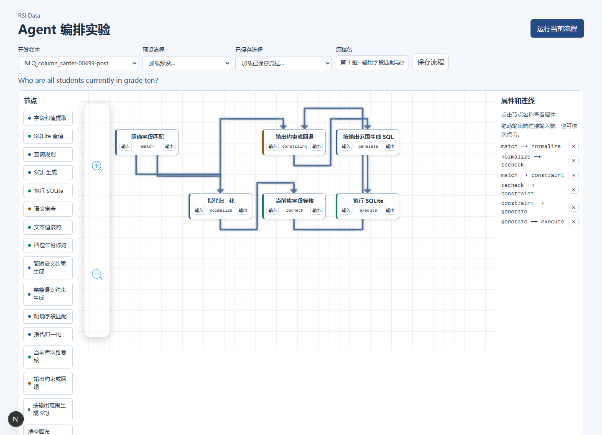

2026 年 11 月 25 日。开发题 `NLQ_column_carrier-00499`，Spider 原题 871，库 `network_1`。在课程平台的 Visual 实验页重新连接「复核 → 约束」、保存并刷新重载，随后在页面点击运行四个条件。
前端把节点和连线送到课程 Spring Boot 的 `/api/task2-experiment/run`。`rsi-flow` 依次调度画布事件，分支条件由工作节点判断，跳过的节点也记下状态。基线与加强都用原 SQL 生成提示和同侧 SQLite，参考 SQL 只供本地评分。

[本机画布](../task2-rsi-data/experiment/README.md#课程画布) · [画布截图](../results/task2/submission/canvas/01-v1.png) · [执行截图](../results/task2/submission/records/task2-projection-v1/post-result.png) · [导出结构](../results/task2/submission/records/task2-projection-v1/structure-v1.json) · [课程后端响应](../results/task2/submission/records/task2-projection-v1/browser-results.json) · [版本与哈希](../results/task2/submission/records/task2-projection-v1/run-meta.json)

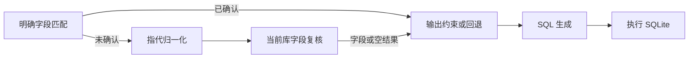

- `pre` 明确请求姓名，直接核验 `Highschooler.name`，归一和复核节点标记为跳过。
- `post` 的 `Who are all students …` 未给字段名。归一节点给出学生姓名候选，复核节点从当前 schema 找到唯一匹配 `Highschooler.name`，约束节点说明 `ID` 和 `grade` 只在明确要求时才输出。
- 输入要求姓名和 ID、规则无法确认输出时，约束为空，生成请求与基线逐字段相等。这个回退分支用离线测试核验，四次在线对照覆盖直接和归一分支。

| 题面 | 流程 | EX | 返回列 | 输入 token | 输出 token | 总 token | 证据 |
|---|---|---|---|---:|---:|---:|---|
| pre | 基线 | 通过 | `name` | 4562 | 18 | 4580 | [节点与模型记录](../results/task2/submission/records/course-node-traces/1a659ce715fb457eb4a7952708c6a33e.json) |
| pre | 输出字段 v1 | 通过 | `name` | 4597 | 18 | 4615 | [节点与模型记录](../results/task2/submission/records/course-node-traces/d55d8c4afb7b486f8f1d724470d9f9be.json) |
| post | 基线 | 未通过 | `ID, name, grade` | 4557 | 22 | 4579 | [节点与模型记录](../results/task2/submission/records/course-node-traces/72002ef83ad84b5cac8af4937c3aab05.json) |
| post | 输出字段 v1 | 通过 | `name` | 4592 | 18 | 4610 | [节点与模型记录](../results/task2/submission/records/course-node-traces/b922086e1b1d47b491f702e0dfe43666.json) |

实际 SQL 与结果。

```sql
-- post 基线
SELECT ID, name, grade
FROM Highschooler
WHERE grade = 10;

-- post 编排。pre 两组也返回同样的单列姓名。
SELECT name
FROM Highschooler
WHERE grade = 10;
```

四次运行均查得 4 行。编排在同一个 post 输入上把输出从 `ID, name, grade` 收敛为 `name`，返回 Haley、Andrew、Kris、Brittany，执行结果与参考一致。pre 仍通过。
每个条件各调用一次 `gpt-6-sol`。pre 总 token 增 35，post 增 31，配对平均增 33（以当轮基线均值计约 0.72%）。服务未返回可核实的模型指纹或 digest。

当前规则覆盖这份画布支持的学生姓名问法。四格结果是第 1 题开发样本的校验，同类未见原题、整体效果和 Thinking 对照待后续测量。

#### v2、Thinking 与复测题单

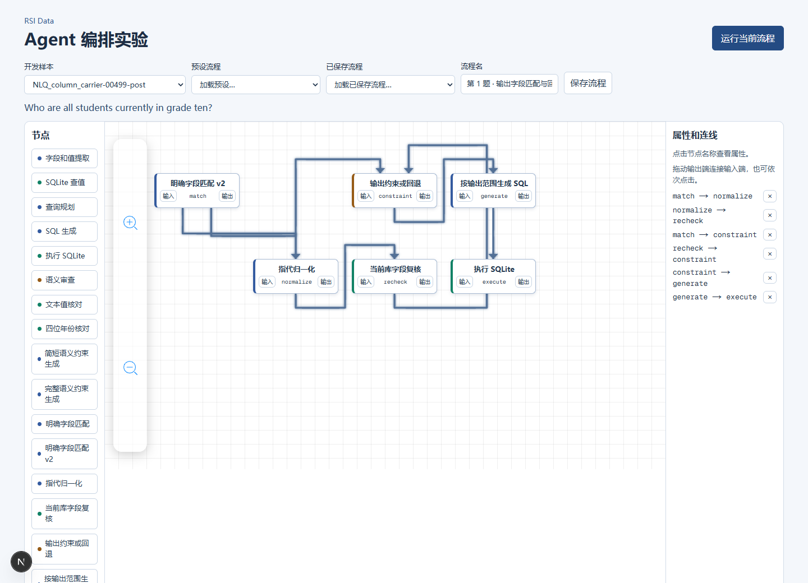

##### 课程视频 2 对后续接入的影响

视频里的前端 `structure` 可以承载编排结构和先验。后端按 `reference` 调用 `@Flow` 对应能力，编排 JSON 用 `params`、`results` 和 `routes` 约定输入、输出、连线，Java 节点内部可调用 Python。
现有预览已经由课程引擎执行从画布提交的结构。后续若把字段匹配、查值、输出约束做成跨题复用的能力，可为它们注册独立名称和出参，交给视频里的 `FlowCodeRun` 调度。
课程视频 2 的要点见上段 · [v1 前端](../task2-rsi-data/experiment/README.md#课程画布) · [v2 前端](../task2-rsi-data/experiment/README.md#课程画布)

##### v1 覆盖检查与 v2 调整

先做题面和 schema 静态检查。v1 的归一分支在官方题库中只触发到原题 871 的两个变体。v2 保留六节点结构，把候选词扩展到教师、员工、参赛者、歌手、国家等实体。题面有额外输出线索、候选名称列不唯一、或句式不受支持时，回退到原生成。仍然只调用一次 SQL 生成模型，字段约束在当侧确定。

v2 已在前端点击运行课程后端。原开发题 post 走 normalized → `Highschooler.name`，返回四人单列，EX 通过。默认参数这次返回 4610 总 token。
[画布截图](../results/task2/submission/canvas/01-v2.png) · [浏览器响应](../results/task2/submission/records/task2-projection-comparison-v1/browser-v2-result.json) · [课程节点记录](../results/task2/submission/records/course-node-traces/e76bfa8cb984400b897b3e1ed107a930.json)

##### 原开发题的 Thinking 对照

8 次真实请求，模型 ID `gpt-6-sol`。方法与 `reasoning_effort=none/high` 交叉，各组使用同一侧的题面与 schema。表中的 Thinking 档按请求参数表示，网关的推理 token 字段有缺失。

| 方法 | 请求档 | pre EX | post EX | pre 总 token | post 总 token | 原始评分 |
|---|---|---|---|---:|---:|---|
| 基线 | none | 通过 | 未通过 | 4580 | 4579 | [pre](../results/task2/submission/records/task2-projection-comparison-v1/anchor-thinking/records/baseline/none/NLQ_column_carrier-00499-pre.json) · [post](../results/task2/submission/records/task2-projection-comparison-v1/anchor-thinking/records/baseline/none/NLQ_column_carrier-00499-post.json) |
| 基线 | high | 通过 | 通过 | 4606 | 4575 | [pre](../results/task2/submission/records/task2-projection-comparison-v1/anchor-thinking/records/baseline/high/NLQ_column_carrier-00499-pre.json) · [post](../results/task2/submission/records/task2-projection-comparison-v1/anchor-thinking/records/baseline/high/NLQ_column_carrier-00499-post.json) |
| 编排 v2 | none | 通过 | 通过 | 4615 | 8962 | [pre](../results/task2/submission/records/task2-projection-comparison-v1/anchor-thinking/records/canvas_v2/none/NLQ_column_carrier-00499-pre.json) · [post](../results/task2/submission/records/task2-projection-comparison-v1/anchor-thinking/records/canvas_v2/none/NLQ_column_carrier-00499-post.json) |
| 编排 v2 | high | 通过 | 通过 | 4615 | 8874 | [pre](../results/task2/submission/records/task2-projection-comparison-v1/anchor-thinking/records/canvas_v2/high/NLQ_column_carrier-00499-pre.json) · [post](../results/task2/submission/records/task2-projection-comparison-v1/anchor-thinking/records/canvas_v2/high/NLQ_column_carrier-00499-post.json) |

原题上，基线 high 修复了 post，v2 在两个请求档均通过，pre 四组均通过。同一题面的提示差异很小，但部分响应的总 token 相差约一倍。浏览器默认档 v2 post 报 4610，而单独的 none 和 high 请求分别报 8962、8874。网关未给可核实的系统指纹，保留原始用量，当前一个题例不足以判断成本规律。

##### 16 对同类与混合复测的冻结题单

合并主批、扩样、历版画布和早期模型的实际评分或响应记录后，Spider-dev 全部 1,034 道原题均已有项目暴露证据。从本地索引中排除已记录的扰动对后，按固定哈希挑出 16 个不同原题的官方变体。这是按新变体做的开发回归，用于估计这份混合题单的效果。独立原题验证仍需另找数据。

| 分组 | 配对数 | 选择依据 | 离线 v2 路由 |
|---|---:|---|---|
| 同类 | 8 | NLQ_column_carrier，pre 明确要求名称，post 变为实体指代，两侧都能定位同一唯一名称列 | pre 直接匹配 8，post 归一化 8 |
| 混合对照 | 8 | DB、NLQ、SQL 共八种预设扰动层，各取一对 | 两侧都回退 8 对 |

冻结后共计划 128 个条件。分组报告 EX、双侧通过、修复、回退和 token，额外看相同输入回退后的自然波动。在查看结果后修改的规则进入下一版。
[冻结题单](../results/task2/submission/records/task2-projection-comparison-v1/plan.json) · [历史暴露索引](../results/task2/submission/records/task2-projection-comparison-v1/exposed-original-ids.json)

##### 16 对同类与混合复测结果

冻结题单的 128 个条件全部评分，并重新执行 SQL 核对。只使用各侧公开题面、对应 schema 和该侧规则产生的字段提示。这里复用课程画布的节点实现批跑。浏览器到课程引擎的实测见上文。
同类层有意覆盖 v2 能触发的名称指代，混合对照层的编排全走回退。同一请求档下，混合层的两方法请求逐字段相同，其成绩差异记录为重跑波动。
所有比较均以已见原题的新官方变体为范围。

| 题单 | 方法与请求档 | pre EX | post EX | 双侧通过 | 本组 pre 通过后 post 失败率 | 平均总 token |
|---|---|---:|---:|---:|---:|---:|
| 同类 | 基线 none | 6/8 | 5/8 | 5/8 | 1/6 | 4942.0 |
| 同类 | 基线 high | 6/8 | 4/8 | 4/8 | 2/6 | 4971.3 |
| 同类 | 编排 v2 none | 6/8 | 7/8 | 6/8 | 0/6 | 4711.1 |
| 同类 | 编排 v2 high | 7/8 | 6/8 | 6/8 | 1/7 | 5537.2 |
| 混合对照 | 基线 none | 6/8 | 5/8 | 5/8 | 1/6 | 5122.3 |
| 混合对照 | 基线 high | 6/8 | 5/8 | 5/8 | 1/6 | 5232.7 |
| 混合对照 | 编排 v2 none | 5/8 | 5/8 | 5/8 | 0/5 | 5113.9 |
| 混合对照 | 编排 v2 high | 6/8 | 6/8 | 6/8 | 0/6 | 5231.5 |
| 全体 | 基线 none | 12/16 | 10/16 | 10/16 | 2/12 | 5032.2 |
| 全体 | 基线 high | 12/16 | 9/16 | 9/16 | 3/12 | 5102.0 |
| 全体 | 编排 v2 none | 11/16 | 12/16 | 11/16 | 0/11 | 4912.5 |
| 全体 | 编排 v2 high | 13/16 | 12/16 | 12/16 | 1/13 | 5384.4 |

修复指前对后错变为双侧通过。扰动误伤指双侧通过变为前对后错。原题回退计所有 pre 对转错。双侧净变化的区间按原题配对自举。

| 题单 | 比较 | 修复 | 扰动误伤 | 原题回退 | 双侧通过净变化 | 总 token 差中位数 |
|---|---|---:|---:|---:|---:|---:|
| 同类 | 基线 none → 编排 v2 none | 1 | 0 | 0 | +1/8 （+12.5 pp，95% [+0.0, +37.5]） | 34.0 |
| 同类 | 基线 high → 编排 v2 high | 2 | 0 | 0 | +2/8 （+25.0 pp，95% [+0.0, +62.5]） | 54.5 |
| 同类 | 基线 none → 基线 high | 0 | 1 | 0 | -1/8 （-12.5 pp，95% [-37.5, +0.0]） | 25.5 |
| 同类 | 编排 v2 none → 编排 v2 high | 0 | 0 | 0 | +0/8 （+0.0 pp，95% [+0.0, +0.0]） | 35.5 |
| 混合对照 | 基线 none → 编排 v2 none | 0 | 0 | 1 | +0/8 （+0.0 pp，95% [+0.0, +0.0]） | 1.5 |
| 混合对照 | 基线 high → 编排 v2 high | 1 | 0 | 0 | +1/8 （+12.5 pp，95% [+0.0, +37.5]） | 10.0 |
| 混合对照 | 基线 none → 基线 high | 0 | 0 | 0 | +0/8 （+0.0 pp，95% [+0.0, +0.0]） | 53.0 |
| 混合对照 | 编排 v2 none → 编排 v2 high | 0 | 0 | 0 | +1/8 （+12.5 pp，95% [+0.0, +37.5]） | 46.5 |
| 全体 | 基线 none → 编排 v2 none | 1 | 0 | 1 | +1/16 （+6.2 pp，95% [+0.0, +18.8]） | 11.5 |
| 全体 | 基线 high → 编排 v2 high | 3 | 0 | 0 | +3/16 （+18.8 pp，95% [+0.0, +37.5]） | 23.5 |
| 全体 | 基线 none → 基线 high | 0 | 1 | 0 | -1/16 （-6.2 pp，95% [-18.8, +0.0]） | 31.5 |
| 全体 | 编排 v2 none → 编排 v2 high | 0 | 0 | 0 | +1/16 （+6.2 pp，95% [+0.0, +18.8]） | 43.0 |

全体的 token 为接口报告值。推理 token 字段有缺失，Thinking 分组按实际请求档。

| 方法与请求档 | 平均输入 token | 平均输出 token | 平均总 token | 报告非零推理 token |
|---|---:|---:|---:|---:|
| 基线 none | 4963.9 | 68.3 | 5032.2 | 10/10 条有字段 |
| 基线 high | 4994.9 | 107.1 | 5102.0 | 25/25 条有字段 |
| 编排 v2 none | 4840.8 | 71.8 | 4912.5 | 10/10 条有字段 |
| 编排 v2 high | 5275.8 | 108.6 | 5384.4 | 27/27 条有字段 |

逐对状态按 pre、post 排列。C 为通过，W 为未通过。

| 分组 | 样本 | 基线 none | 编排 none | 基线 high | 编排 high |
|---|---|---|---|---|---|
| 同类 | `NLQ_column_carrier-00111` | CW | CC | CW | CC |
| 同类 | `NLQ_column_carrier-00563` | CC | CC | CC | CC |
| 同类 | `NLQ_column_carrier-00082` | CC | CC | CC | CC |
| 同类 | `NLQ_column_carrier-00346` | CC | CC | CW | CC |
| 同类 | `NLQ_column_carrier-00494` | WW | WC | WW | CW |
| 同类 | `NLQ_column_carrier-00464` | WW | WW | WW | WW |
| 同类 | `NLQ_column_carrier-00572` | CC | CC | CC | CC |
| 同类 | `NLQ_column_carrier-00400` | CC | CC | CC | CC |
| 混合对照 | `DB_DBcontent_equivalence-00284` | CC | CC | CC | CC |
| 混合对照 | `DB_schema_abbreviation-00734` | CC | CC | CC | CC |
| 混合对照 | `DB_schema_synonym-01943` | WW | WW | WW | WW |
| 混合对照 | `NLQ_column_attribute-00045` | CC | CC | CC | CC |
| 混合对照 | `NLQ_column_value-00047` | CC | CC | CC | CC |
| 混合对照 | `NLQ_keyword_synonym-00058` | CC | CC | CC | CC |
| 混合对照 | `SQL_comparison-00047` | WW | WW | WW | WW |
| 混合对照 | `SQL_sort_order-00098` | CW | WW | CW | CC |

[汇总与四格转移矩阵](../results/task2/submission/records/task2-projection-comparison-v1/summary.json) · [模型、样本与评测版本](../results/task2/submission/records/task2-projection-comparison-v1/config.json) · [逐侧记录](../results/task2/submission/完整批测记录.zip)（包内 `runs/task2-projection-comparison-v1/records`） · [请求与响应](../results/task2/submission/完整批测记录.zip)（包内 `runs/task2-projection-comparison-v1/requests`）

##### 结果解释与 v2 版本决定

- **输出字段修复可重现。** 「获奖最多的员工」在基线两档分别多返回员工 ID、获奖次数，或只多返回获奖次数。编排两档都只输出姓名，两侧均通过。「亚洲预期寿命最低的国家」在 high 基线多返回寿命列，编排后只返回国家名。[员工基线 high](../results/task2/submission/records/task2-projection-comparison-v1/records/baseline/high/NLQ_column_carrier-00111-post.json) · [员工编排 high](../results/task2/submission/records/task2-projection-comparison-v1/records/canvas_v2/high/NLQ_column_carrier-00111-post.json) · [国家编排 high](../results/task2/submission/records/task2-projection-comparison-v1/records/canvas_v2/high/NLQ_column_carrier-00346-post.json)
- **剩余两道同类题涉及表关系的含义。** 「没有朋友的学生」按 `Friend.student_id` 检查得到 Brittany 和 John，两个端点都检查时结果为空。「收到最多赞的学生」的参考 SQL 按 `Likes.student_id` 统计发出点赞，返回 John，实际按 `liked_id` 统计收到点赞时 Cassandra 与 Kris 并列最多。编排已经输出单列姓名。两例保留官方 EX，并记下关系方向及题意分歧。当前没有证据需要改 v2 的姓名字段规则。[好友判分](../results/task2/submission/records/task2-projection-comparison-v1/records/canvas_v2/high/NLQ_column_carrier-00494-post.json) · [点赞判分](../results/task2/submission/records/task2-projection-comparison-v1/records/canvas_v2/none/NLQ_column_carrier-00464-post.json)
- **混合层的变动来自相同请求的重跑。** 唯一出现状态变化的是最早或最晚毕业生题。none 档的 pre 回退由模型加入额外关联、改变候选集合引起。high 档的 post 错转对则是模型改用 `Students.date_left` 排序。这两处的编排与对应档的基线请求逐字段相同，回退节点没有传入字段约束。[毕业生基线 none](../results/task2/submission/records/task2-projection-comparison-v1/records/baseline/none/SQL_sort_order-00098-pre.json) · [毕业生编排 none](../results/task2/submission/records/task2-projection-comparison-v1/records/canvas_v2/none/SQL_sort_order-00098-pre.json) · [毕业生编排 high](../results/task2/submission/records/task2-projection-comparison-v1/records/canvas_v2/high/SQL_sort_order-00098-post.json)
- **Thinking 的收益随题和方法变化。** 同类 v2 的 none 和 high 都是 6/8 双侧通过，post 分别为 7/8 和 6/8。high 的全体双侧增量出现在混合回退题。相对 v2 none，v2 high 的全体平均总 token 从 4912.5 升至 5384.4，逐侧差值中位数为 +43.0。所有双侧净变化的探索性区间包含零，且原题均已有历史暴露。

##### 134 对历史失败中的同类回归

取 134 对前对后错复核表中属于「输出线索由具体变宽」的全部 18 对，共 14 道原题。同一原题有不同扰动变体，按配对计数。题单来自历史错误，采用同轮基线估计可重复的修复。
使用上轮冻结的 v2 和同一 SQLite 执行评分，固定 `gpt-6-sol` 及 `reasoning_effort=none`。每侧分别运行基线和 v2，72 个条件均取得响应并重新执行评分。其中一个基线 pre 请求收到 HTTP 524，用原请求重试后成功。

| post 路由 | 配对 | pre EX 基线 → v2 | post EX 基线 → v2 | 双侧通过 | post 错转对 / 对转错 | pre 回退 |
|---|---:|---:|---:|---:|---|---:|
| 全体 | 18 | 18/18 → 17/18 | 3/18 → 6/18 | 3/18 → 6/18 | 4 / 1 | 1 |
| 生成前加字段约束 | 6 | 6/6 → 6/6 | 2/6 → 5/6 | 2/6 → 5/6 | 3 / 0 | 0 |
| 回退 | 12 | 12/12 → 11/12 | 1/12 → 1/12 | 1/12 → 1/12 | 1 / 1 | 1 |

同轮四格中，前对后错变为双侧通过 **4/15**。每个条件各调用模型一次，平均总 token 4824.2 → 5361.9，各题面 token 差值中位数 +18.5。
post 回退组的两方法请求逐字段一致。这里的分数变化是相同提示的重跑波动。该组部分题的 pre 仍会触发约束，pre 和双侧指标另列。

| 配对编号 | 原题 ID | v2 pre / post 路由 | 基线 | 编排 v2 | 新基线 post 仅输出列多选 |
|---|---:|---|---|---|---|
| `NLQ_column_carrier-00127` | 262 | fallback / fallback | CW | CW | 是 |
| `NLQ_column_carrier-00324` | 692 | direct / normalized | CC | CC | — |
| `NLQ_column_carrier-00326` | 692 | direct / normalized | CW | CC | 是 |
| `NLQ_column_carrier-00364` | 802 | direct / fallback | CW | CW | 是 |
| `NLQ_column_carrier-00467` | 889 | direct / fallback | CW | CC | 是 |
| `NLQ_column_carrier-00474` | 901 | fallback / fallback | CW | CW | 是 |
| `NLQ_column_carrier-00499` | 871 | direct / normalized | CC | CC | — |
| `NLQ_column_synonym-00198` | 365 | fallback / fallback | CW | CW | — |
| `NLQ_column_synonym-00200` | 365 | fallback / fallback | CW | CW | — |
| `NLQ_column_synonym-00367` | 681 | direct / fallback | CW | CW | 是 |
| `NLQ_keyword_synonym-00053` | 82 | fallback / fallback | CW | CW | — |
| `NLQ_keyword_synonym-00419` | 383 | direct / normalized | CW | CC | 是 |
| `NLQ_multitype-00519` | 383 | direct / normalized | CW | CC | 是 |
| `NLQ_multitype-01142` | 910 | fallback / fallback | CC | CW | — |
| `NLQ_multitype-01294` | 1006 | direct / normalized | CW | CW | — |
| `NLQ_others-02589` | 939 | fallback / fallback | CW | CW | 是 |
| `NLQ_others-02664` | 965 | fallback / fallback | CW | WW | 是 |
| `NLQ_value_synonym-00454` | 910 | fallback / fallback | CW | CW | 是 |

C 为通过，W 为未通过，依次表示 pre 和 post。最后一列用执行结果核对，保留已有行和顺序，只取参考对应列即可通过的基线错题才算。

[题单和来源](../results/task2/submission/records/task2-projection-historical-v2/plan.json) · [运行版本](../results/task2/submission/records/task2-projection-historical-v2/config.json) · [汇总](../results/task2/submission/records/task2-projection-historical-v2/summary.json) · [逐笔评分](../results/task2/submission/完整批测记录.zip)（包内 `runs/task2-projection-historical-v2/records`） · [请求与响应](../results/task2/submission/完整批测记录.zip)（包内 `runs/task2-projection-historical-v2/requests`）

##### 历史回归诊断

- **触发后修了 3 对，涉及 2 道原题。** 参赛者题去掉了 `contestant_number`。两对教师题是同一道原题的不同变体，排序继续用 `Age`，输出里去掉了 `Age`，两对均通过。触发组剩余的失败保留单列 `Name`，但把题面的 `French` 当成 `Citizenship` 的库内值，仍多返回 1 行。[参赛者](../results/task2/submission/records/task2-projection-historical-v2/records/canvas_v2/none/NLQ_column_carrier-00326-post.json) · [教师](../results/task2/submission/records/task2-projection-historical-v2/records/canvas_v2/none/NLQ_keyword_synonym-00419-post.json) · [法国国籍](../results/task2/submission/records/task2-projection-historical-v2/records/canvas_v2/none/NLQ_multitype-01294-post.json)
- **覆盖率限制了整类修复。** 新基线仍有 11 个 post 错误，在不改动结果行和顺序的情况下，只去掉多选列即可通过。v2 在其中 3 对加入了约束，其余 8 对回退。例如「人口最多的前三个国家」的问法未被当前句式识别，两次均额外返回 `Population`。「既有朋友又被点赞的学生」被连接词保护规则拦下，两次仍返回 `ID, name, grade`。这里的 `and` 连接两个筛选条件，输出仍可只取姓名。[人口排名](../results/task2/submission/records/task2-projection-historical-v2/records/canvas_v2/none/NLQ_column_carrier-00364-post.json) · [好友与点赞](../results/task2/submission/records/task2-projection-historical-v2/records/canvas_v2/none/NLQ_column_carrier-00474-post.json)
- **回退组单独保留。** 它有 1 个 post 错转对和 1 个 post 对转错，另有 1 个 pre 回退。三个变化题面的两种方法发送相同请求，归为模型重跑波动。这批检验的是历史错误的复现和修复，记录中的 3 对触发修复均来自固定的 v2。[pre 回退](../results/task2/submission/records/task2-projection-historical-v2/records/canvas_v2/none/NLQ_others-02664-pre.json)

### 第 2 题 · 筛选值大小写不一致

题面把 `Sky Radio` 写作 `Sky radio`，生成 SQL 的精确匹配查不到库内值。

#### 筛选值核验编排 v1

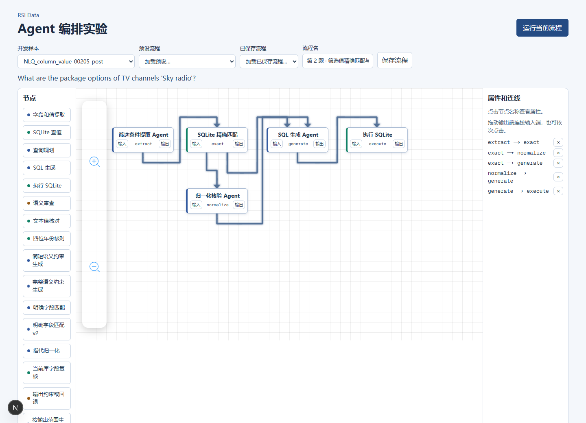

开发题 `NLQ_column_value-00205`。根据我设计的方案，由课程 Visual 提交五个节点和连线，Spring Boot 通过 `rsi-flow` 执行。题面、对应 SQLite 和原生成提示沿用第一轮。模型为 `gpt-6-sol`，服务端默认参数，未设置 Thinking 对照。模型指纹不可用。[画布截图](../results/task2/submission/canvas/02-v1.png) · [导出结构](../results/task2/submission/records/task2-filter-format-v1/structure-v1.json) · [四次浏览器响应](../results/task2/submission/records/task2-filter-format-v1/browser-results.json) · [版本与哈希](../results/task2/submission/records/task2-filter-format-v1/run-meta.json)

1. **筛选条件提取 Agent。** 接 LLM，读取当前题面和表结构，输出一条明确的文本等值条件。表列须在当前库中存在，筛选值须来自题面。
2. **SQLite 精确匹配。** 工具节点，在已定位的列按原始文本精确查找。命中后跳过归一化。
3. **归一化核验 Agent。** 精确未命中时，工具在同一列比较大小写和空白归一化后的键。恰好一个库内原值同形时，由 LLM 核验它是否对应当前题面。无匹配、多匹配及 Agent 拒绝时回退。Agent 只能接受或拒绝工具提供的候选。
4. **SQL 生成 Agent。** 接 LLM，收到已核验的库内原值时作为证据加入 prompt。回退时的模型请求与原生成一致。
5. **执行 SQLite。** 工具节点执行预测 SQL，参考 SQL 留在评分端。

| 题面 | 基线结果 | v1 分支及结果 | LLM 调用 | 总 token |
|---|---|---|---|---|
| pre `Sky Radio` | 通过，`Sky Famiglia` | 原值精确命中，归一化 Agent 跳过，返回 `Sky Famiglia` | 1 → 2 | 8,946 → 13,603 |
| post `Sky radio` | 未通过，0 行 | 精确未命中，归一化后唯一候选 `Sky Radio`，核验通过，返回 `Sky Famiglia` | 1 → 3 | 4,647 → 19,707 |

四条 SQL 均重新执行，评分与浏览器记录一致。[pre 画布结果](../results/task2/submission/records/task2-filter-format-v1/pre-result.png) · [post 画布结果](../results/task2/submission/records/task2-filter-format-v1/post-result.png)

- pre 保存了原库值 `Sky Radio` 和正确结果。post 在增加两个 LLM 调用后从 0 行变为 1 行，修复了这对开发样本。
- 离线用模拟核验响应覆盖无匹配、多匹配和 Agent 拒绝。真实 SQLite 测试也验证了两个大小写不同的库内原值会保留为两个候选。无匹配和多匹配的回退请求与基线完全一致。
- 总 token 为服务端报告的本次观测值，含各节点上下文。当前只验证这一对开发题及本地回退分支，同类、混合题单和 Thinking 比较留待后续试验。

#### v1 补充 · Thinking 与分层对照

固定第 2 题原画布和 `gpt-6-sol`，在原题及 16 对未见官方变体上跑基线和编排，交叉比较 `reasoning_effort=none/high`。复用课程画布的节点实现批跑。所有生成请求仅使用当侧题面、schema 和节点取得的证据。

同类层依据题面格式差和只读 SQLite 唯一匹配选取 8 对，实际选中的 8 对均为大小写变化。参考 SQL 仅供筛选和本地评分。混合层从八种 DB、NLQ、SQL 扰动各取一对。16 对原题 ID 互异，但原题已在项目中暴露，结论限于开发回归。Thinking 按请求档记录，模型系统指纹及全量推理 token 不可验证。原始运行目录沿用条件名 `canvas_v2`，本节实际执行的结构为第 2 题 v1。

[冻结题单](../results/task2/submission/records/task2-filter-format-comparison-v1/plan.json) · [版本与配置](../results/task2/submission/records/task2-filter-format-comparison-v1/config.json) · [逐条件记录](../results/task2/submission/完整批测记录.zip)（包内 `runs/task2-filter-format-comparison-v1/records`） · [逐节点请求与响应](../results/task2/submission/完整批测记录.zip)（包内 `runs/task2-filter-format-comparison-v1/requests`） · [完整指标与转移矩阵](../results/task2/submission/records/task2-filter-format-comparison-v1/summary.json)

##### 原开发题 Thinking 对照

| 方法 | 请求档 | pre EX | post EX | pre 总 token | post 总 token |
|---|---|---|---|---:|---:|
| 基线 | none | 通过 | 未通过 | 5962 | 4647 |
| 基线 | high | 通过 | 未通过 | 8937 | 4647 |
| 编排 v1 | none | 通过 | 未通过 | 9491 | 9412 |
| 编排 v1 | high | 通过 | 通过 | 9543 | 22561 |

##### 同类、混合与全体结果

| 题单 | 方法与请求档 | pre EX | post EX | 双侧通过 | pre 通过后 post 失败率 | 平均模型调用数 | 平均总 token |
|---|---|---:|---:|---:|---:|---:|---:|
| 同类 | 基线 none | 8/8 | 2/8 | 2/8 | 6/8 | 1.00 | 5859.7 |
| 同类 | 基线 high | 7/8 | 1/8 | 1/8 | 6/7 | 1.00 | 5622.1 |
| 同类 | 编排 v1 none | 8/8 | 5/8 | 5/8 | 3/8 | 2.25 | 11493.8 |
| 同类 | 编排 v1 high | 8/8 | 5/8 | 5/8 | 3/8 | 2.38 | 12411.1 |
| 混合 | 基线 none | 8/8 | 6/8 | 6/8 | 2/8 | 1.00 | 5034.1 |
| 混合 | 基线 high | 6/8 | 8/8 | 6/8 | 0/6 | 1.00 | 5695.0 |
| 混合 | 编排 v1 none | 8/8 | 7/8 | 7/8 | 1/8 | 2.12 | 12285.6 |
| 混合 | 编排 v1 high | 8/8 | 6/8 | 6/8 | 2/8 | 2.12 | 11928.5 |
| 全体 | 基线 none | 16/16 | 8/16 | 8/16 | 8/16 | 1.00 | 5446.9 |
| 全体 | 基线 high | 13/16 | 9/16 | 7/16 | 6/13 | 1.00 | 5658.5 |
| 全体 | 编排 v1 none | 16/16 | 12/16 | 12/16 | 4/16 | 2.19 | 11889.7 |
| 全体 | 编排 v1 high | 16/16 | 11/16 | 11/16 | 5/16 | 2.25 | 12169.8 |

修复为前对后错转为双侧通过。扰动误伤为双侧通过转为前对后错。原题回退包含所有 pre 对转错。

| 题单 | 比较 | 修复 | 扰动误伤 | 原题回退 | 双侧净变化 | 每题 TOKEN 差中位数 |
|---|---|---:|---:|---:|---:|---:|
| 同类 | 基线 none → 编排 v1 none | 4 | 1 | 0 | +3/8 （95% [-12.5, +87.5] pp） | 5265.0 |
| 同类 | 基线 high → 编排 v1 high | 4 | 0 | 0 | +4/8 （95% [+12.5, +87.5] pp） | 6171.5 |
| 同类 | 基线 none → 基线 high | 1 | 2 | 1 | -1/8 （95% [-50.0, +25.0] pp） | 19.0 |
| 同类 | 编排 v1 none → 编排 v1 high | 1 | 1 | 0 | +0/8 （95% [-37.5, +37.5] pp） | 219.0 |
| 混合 | 基线 none → 编排 v1 none | 2 | 1 | 0 | +1/8 （95% [-25.0, +50.0] pp） | 5943.5 |
| 混合 | 基线 high → 编排 v1 high | 0 | 1 | 0 | +0/8 （95% [-37.5, +37.5] pp） | 5080.0 |
| 混合 | 基线 none → 基线 high | 0 | 0 | 2 | +0/8 （95% [+0.0, +0.0] pp） | 56.0 |
| 混合 | 编排 v1 none → 编排 v1 high | 0 | 1 | 0 | -1/8 （95% [-37.5, +0.0] pp） | 92.5 |
| 全体 | 基线 none → 编排 v1 none | 6 | 2 | 0 | +4/16 （95% [-6.2, +56.2] pp） | 5265.0 |
| 全体 | 基线 high → 编排 v1 high | 4 | 1 | 0 | +4/16 （95% [+0.0, +50.0] pp） | 5407.5 |
| 全体 | 基线 none → 基线 high | 1 | 2 | 3 | -1/16 （95% [-25.0, +12.5] pp） | 26.0 |
| 全体 | 编排 v1 none → 编排 v1 high | 1 | 2 | 0 | -1/16 （95% [-25.0, +12.5] pp） | 154.0 |

C 为通过，W 为未通过。字母按 pre、post 排列。路由按 pre/post 排列。

| 题单 | 官方配对 ID | 基线 none | 编排 none | 基线 high | 编排 high | 编排 none 路由 | 编排 high 路由 |
|---|---|---|---|---|---|---|---|
| 同类 | `NLQ_others-00287` | CW | CW | WW | CW | exact/normalized | exact/normalized |
| 同类 | `NLQ_column_value-00062` | CW | CW | CW | CW | fallback/fallback | exact/fallback |
| 同类 | `NLQ_others-00896` | CW | CC | CW | CC | exact/normalized | exact/normalized |
| 同类 | `NLQ_multitype-00721` | CW | CC | CC | CC | fallback/fallback | exact/fallback |
| 同类 | `NLQ_multitype-01032` | CC | CC | CW | CW | exact/fallback | exact/normalized |
| 同类 | `NLQ_others-00967` | CW | CC | CW | CC | exact/normalized | exact/normalized |
| 同类 | `NLQ_others-01751` | CW | CC | CW | CC | exact/normalized | exact/normalized |
| 同类 | `NLQ_others-01346` | CC | CW | CW | CC | fallback/fallback | exact/normalized |
| 混合 | `DB_DBcontent_equivalence-00295` | CC | CW | CC | CW | fallback/fallback | fallback/fallback |
| 混合 | `DB_schema_abbreviation-00301` | CW | CC | WC | CW | exact/fallback | exact/fallback |
| 混合 | `DB_schema_synonym-01120` | CC | CC | CC | CC | fallback/fallback | fallback/fallback |
| 混合 | `NLQ_column_attribute-00109` | CC | CC | CC | CC | fallback/fallback | fallback/fallback |
| 混合 | `NLQ_column_value-00176` | CW | CC | WC | CC | normalized/normalized | normalized/normalized |
| 混合 | `NLQ_keyword_synonym-00594` | CC | CC | CC | CC | fallback/fallback | fallback/fallback |
| 混合 | `SQL_comparison-00011` | CC | CC | CC | CC | fallback/fallback | fallback/fallback |
| 混合 | `SQL_sort_order-00114` | CC | CC | CC | CC | fallback/fallback | fallback/fallback |

- 全体 `none` 的 32 个编排题面分支计数，exact 6、fallback 20、normalized 6。

- 全体 `high` 的 32 个编排题面分支计数，exact 9、fallback 15、normalized 8。


##### 逐例诊断与成本

136 个条件均已评分，219 条模型响应、请求档和逐节点 token 均核对。4 格执行结果以相同本地评测器重放。所有回退题的最终 SQL 生成请求与同档基线逐字段一致，统计保留这些题的重跑差异。

- **原题的 none 失败发生在筛选值提取。** 输出是包含外层引号的 `'Sky radio'`，引号进入了比较键。用同一 SQLite 重放，保留引号得到零候选，只去掉题面分隔用的外层引号后唯一命中 `Sky Radio`。原题 high 提取了不含引号的文本，归一化和 SQL 执行通过。[原题 none](../results/task2/submission/records/task2-filter-format-comparison-v1/records/canvas_v2/none/NLQ_column_value-00205-post.json) · [原题 high](../results/task2/submission/records/task2-filter-format-comparison-v1/records/canvas_v2/high/NLQ_column_value-00205-post.json)
- **格式匹配的修复在不同库重现。** 两档均修复了 `Data Base → Data base`、`summer show → Summer Show` 和电视剧片名；混合层的 `math → Math` 也命中并通过。两档在同类层都是 5/8 双侧通过，对应的正确配对不同。[模板题](../results/task2/submission/records/task2-filter-format-comparison-v1/records/canvas_v2/high/NLQ_others-00896-post.json) · [课程题](../results/task2/submission/records/task2-filter-format-comparison-v1/records/canvas_v2/none/NLQ_column_value-00176-post.json)
- **列定位和查询口径限制了修复。** AMC 全称实际存于 `car_names.Make`，两档 post 提取均选 `Model`，只查该列时走回退。另有样本在 `USA → usa` 或 `central Africa → Central Africa` 后仍因候选表关联或输出粒度与参考 SQL 不同而未通过。尤其中央非洲 post 省略了“平均”，当前保留官方 EX。[AMC 车型](../results/task2/submission/records/task2-filter-format-comparison-v1/records/canvas_v2/high/NLQ_column_value-00062-post.json) · [美国汽车](../results/task2/submission/records/task2-filter-format-comparison-v1/records/canvas_v2/high/NLQ_others-00287-post.json) · [中央非洲](../results/task2/submission/records/task2-filter-format-comparison-v1/records/canvas_v2/high/NLQ_multitype-01032-post.json)
- **本轮 post 误伤都发生在已回退的请求。** 例如指挥家题的基线返回名和姓两列，回退重跑把它们拼成一列。Volvo 题的 high 回退改选了 `Make`，基线用 `mdl`。这两题的生成输入逐字段相同，证据支持记录为同请求重跑差异。两档均未观察到编排使 pre 对转错。[指挥家题](../results/task2/submission/records/task2-filter-format-comparison-v1/records/canvas_v2/high/DB_DBcontent_equivalence-00295-post.json) · [Volvo 题](../results/task2/submission/records/task2-filter-format-comparison-v1/records/canvas_v2/high/DB_schema_abbreviation-00301-post.json)
- **同类结果增加，但成本超过两倍。** 全体每题面均值在 none 档从 5,446.9 到 11,889.7 总 token，在 high 档从 5,658.5 到 12,169.8。编排仅在已确定唯一候选时额外调用归一化核验，即使最终回退，已经发生的提取 Agent 调用也计入成本。此批没有稳定的 Thinking 成绩优势。使用同类与混合题单观察覆盖和成本，独立原题泛化尚未验证。

### 第 3 题 · 筛选值同义配对

题面以 `United States` 替代 `USA`，逐字匹配漏掉了 12 家航司。

#### 筛选值同义配对 v1

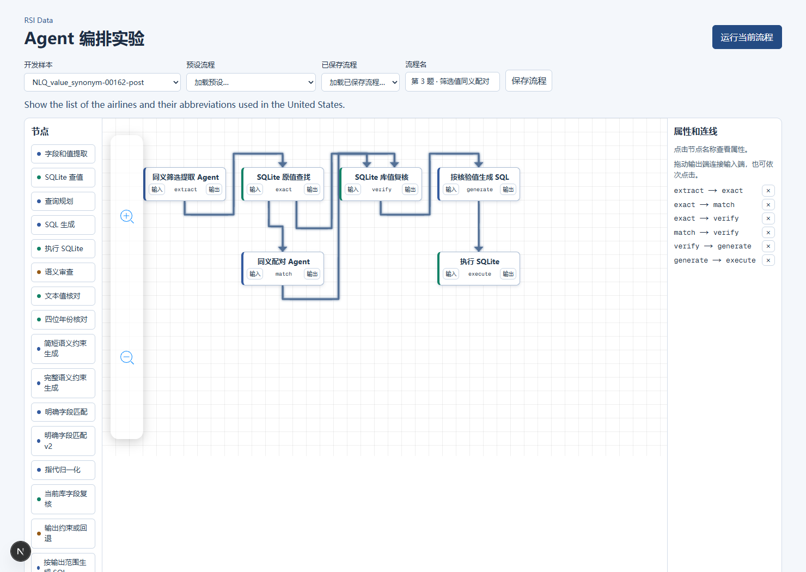

开发题 `NLQ_value_synonym-00162`，Spider 原题 184，库 `flight_2`。问题要求美国航司名称及缩写，`pre` 写 `USA`，`post` 写 `United States`。用两种文字分别精确查 `Airlines.Country`，得到 12 行和 0 行。编排采用我确定的「精确命中沿用原生成，未命中才调用同义 Agent，同义无法确认就回退」。[冻结结构与题单](../results/task2/submission/records/task2-filter-synonym-v1/plan.json)

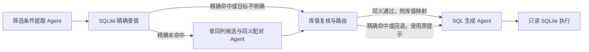

| 节点 | 类型 | 输入 | 输出与作用 |
|---|---|---|---|
| 筛选条件提取 | LLM | 当前题面、当前库 schema | 单一文本等值或不等值条件的表、列、题面原词、运算符。条件不明确时返回空。 |
| SQLite 原值查找 | 工具 | 提取条件、当前库 | 核对列和题面原词，精确查值后返回 `exact`、`miss` 或 `unresolved`。 |
| 同义配对 | SQLite 工具 + LLM | 精确未命中状态、题面、已确认表列与同列候选值 | SQLite 枚举该列候选。Agent 返回候选原值和同义依据，无法确认时返回空。精确命中时跳过模型调用。 |
| SQLite 库值复核 | 工具 | 精确查值状态、同义 Agent 输出 | 对同一表列重新精确查找所选值，输出 `exact`、`synonym` 或 `fallback`。只有同义确认才附映射。 |
| 按核验值生成 SQL | LLM | 原题面、schema、可选的已核验映射 | 生成 SQL。同义映射包含原词、实际库值、原列和原运算符。精确或回退沿用基线提示。 |
| 执行 SQLite | 工具 | 生成 SQL、当前侧 SQLite | 返回实际结果或执行错误。评测在末端对照参考 SQL。 |

v1 通过 SQLite 枚举最多 64 个同列文本候选。超过上限则回退，避免从不完整候选中硬选。同义 Agent 负责判断语义，SQLite 能核验值的存在性。同义模型如果误判，查库核验仍可能通过，这一点用拒绝候选和混合题检查。已见历史错题的同类回归与混合题都属于开发评估。

##### 原题页面实测与开发回归

浏览器从课程 Visual 提交本轮原题的四个条件。每条返回课程引擎流程 ID，浏览器提交结构与 Python 执行记录一致。


[浏览器请求与结果](../results/task2/submission/records/task2-filter-synonym-v1/browser-results.json) · [pre 路由截图](../results/task2/submission/records/task2-filter-synonym-v1/pre-result.png) · [post 路由截图](../results/task2/submission/records/task2-filter-synonym-v1/post-result.png)

| 条件 | 题面 | 路由 | EX | 查询行数 | LLM 调用 | 总 token |
|---|---|---|---|---:|---:|---:|
| synonym | pre | exact | 通过 | 12 | 2 | 12069 |
| synonym | post | fallback | 未通过 | 0 | 3 | 19943 |
| baseline | pre | baseline | 通过 | 12 | 1 | 7309 |
| baseline | post | baseline | 未通过 | 0 | 1 | 4612 |

在浏览器默认请求档的 post 运行中，提取正确定位了 `Airlines.Country = United States`，精确查值未命中，SQLite 给出的同列候选是 `USA`。同义 Agent 在理由中认出了全称和缩写关系，但误以为候选缺少数据库证据，仍返回空值。复核节点按设计回退，原 SQL 生成返回 0 行。批测中 none 档的 Agent 也拒绝了该映射，理由混淆了航司和国家字段。high 档选择了 `USA`。

在单独的 `Canada` 负对照中，Agent 看到了唯一候选 `USA`，仍返回无同义匹配。基线和编排均返回 0 行，编排耗用 3 次 LLM。这条人工变体用于核验回退，不进入 17 对批测统计。[逐节点记录](../results/task2/submission/records/task2-filter-synonym-v1/canvas_v2/high/canada-negative/record.json)

批测覆盖 1 对原开发题、8 对历史同类错题、8 对沿用第 2 题题单的混合对照。17 对的原题 ID 互异。每侧在基线与编排分别用 `reasoning_effort=none/high` 请求，合计 136 条评分。模型均返回 `gpt-6-sol` 标识。Thinking 以请求档位记载。精确命中和回退分支的 SQL 生成请求已逐字段核对，与同档基线一致。

[运行配置](../results/task2/submission/records/task2-filter-synonym-v1/config.json) · [完整统计](../results/task2/submission/records/task2-filter-synonym-v1/summary.json) · [逐节点请求、响应、生成 SQL 及评分](../results/task2/submission/完整批测记录.zip)（包内 `runs/task2-filter-synonym-v1`）

| 题单 | 条件 | pre EX | post EX | 双侧通过 | 回退/精确/同义 | 每题 LLM | 每题总 token |
|---|---|---:|---:|---:|---|---:|---:|
| 原开发题 | 基线 none | 1/1 | 0/1 | 0/1 | — | 1.00 | 5889.5 |
| 原开发题 | 基线 high | 1/1 | 0/1 | 0/1 | — | 1.00 | 6046.5 |
| 原开发题 | 编排 v1 none | 1/1 | 0/1 | 0/1 | 1/1/0 | 2.50 | 12952.5 |
| 原开发题 | 编排 v1 high | 1/1 | 1/1 | 1/1 | 0/1/1 | 2.50 | 16344.5 |
| 同类 | 基线 none | 8/8 | 0/8 | 0/8 | — | 1.00 | 5766.4 |
| 同类 | 基线 high | 8/8 | 1/8 | 1/8 | — | 1.00 | 6157.6 |
| 同类 | 编排 v1 none | 8/8 | 5/8 | 5/8 | 3/5/8 | 2.56 | 13567.6 |
| 同类 | 编排 v1 high | 7/8 | 6/8 | 5/8 | 2/4/10 | 2.69 | 15748.0 |
| 混合 | 基线 none | 6/8 | 8/8 | 6/8 | — | 1.00 | 5338.0 |
| 混合 | 基线 high | 7/8 | 7/8 | 6/8 | — | 1.00 | 5713.4 |
| 混合 | 编排 v1 none | 7/8 | 8/8 | 7/8 | 11/1/4 | 2.25 | 12734.8 |
| 混合 | 编排 v1 high | 8/8 | 8/8 | 8/8 | 10/2/4 | 2.25 | 12626.3 |
| 同类与混合全体 | 基线 none | 14/16 | 8/16 | 6/16 | — | 1.00 | 5552.2 |
| 同类与混合全体 | 基线 high | 15/16 | 8/16 | 7/16 | — | 1.00 | 5935.5 |
| 同类与混合全体 | 编排 v1 none | 15/16 | 13/16 | 12/16 | 14/6/12 | 2.41 | 13151.2 |
| 同类与混合全体 | 编排 v1 high | 15/16 | 14/16 | 13/16 | 12/6/14 | 2.47 | 14187.2 |

修复按基线前对后错且编排后双侧通过计。扰动误伤按双侧通过变前对后错计。pre 回退包含所有原题对转错。区间来自以原题为单位的配对自举。

| 题单 | 比较 | 修复 | 扰动误伤 | pre 回退 | 双侧净变化与 95% 区间 | token 差中位数 |
|---|---|---:|---:|---:|---|---:|
| 同类 | 基线 none → 编排 v1 none | 5 | 0 | 0 | +5/8 [+25.0, +87.5] pp | 7183.0 |
| 同类 | 基线 high → 编排 v1 high | 5 | 0 | 1 | +4/8 [+0.0, +87.5] pp | 9728.5 |
| 同类 | 基线 none → 基线 high | 1 | 0 | 0 | +1/8 [+0.0, +37.5] pp | 50.0 |
| 同类 | 编排 v1 none → 编排 v1 high | 1 | 0 | 1 | +0/8 [-37.5, +37.5] pp | 252.0 |
| 混合 | 基线 none → 编排 v1 none | 0 | 0 | 0 | +1/8 [+0.0, +37.5] pp | 6464.0 |
| 混合 | 基线 high → 编排 v1 high | 1 | 0 | 0 | +2/8 [+0.0, +62.5] pp | 5313.0 |
| 混合 | 基线 none → 基线 high | 0 | 0 | 0 | +0/8 [+0.0, +0.0] pp | 37.0 |
| 混合 | 编排 v1 none → 编排 v1 high | 0 | 0 | 0 | +1/8 [+0.0, +37.5] pp | 153.0 |
| 同类与混合全体 | 基线 none → 编排 v1 none | 5 | 0 | 0 | +6/16 [+12.5, +62.5] pp | 7183.0 |
| 同类与混合全体 | 基线 high → 编排 v1 high | 6 | 0 | 1 | +6/16 [+6.2, +68.8] pp | 7098.0 |
| 同类与混合全体 | 基线 none → 基线 high | 1 | 0 | 0 | +1/16 [+0.0, +18.8] pp | 38.5 |
| 同类与混合全体 | 编排 v1 none → 编排 v1 high | 1 | 0 | 1 | +1/16 [-12.5, +25.0] pp | 215.0 |

| 配对 | 题单 | 基线 none | 编排 none | 基线 high | 编排 high | 编排 none 路由 | 编排 high 路由 |
|---|---|---|---|---|---|---|---|
| NLQ_value_synonym-00162 | 原开发题 | CW | CW | CW | CC | exact/fallback | exact/synonym |
| NLQ_multitype-00851 | 同类 | CW | CC | CW | CC | exact/synonym | exact/synonym |
| NLQ_value_synonym-00483 | 同类 | CW | CW | CW | CC | exact/fallback | synonym/synonym |
| NLQ_value_synonym-00029 | 同类 | CW | CC | CC | WC | fallback/synonym | exact/synonym |
| NLQ_value_synonym-00211 | 同类 | CW | CC | CW | CC | synonym/synonym | synonym/synonym |
| NLQ_value_synonym-00215 | 同类 | CW | CW | CW | CW | synonym/fallback | synonym/fallback |
| NLQ_value_synonym-00413 | 同类 | CW | CC | CW | CC | synonym/synonym | synonym/synonym |
| NLQ_value_synonym-00146 | 同类 | CW | CC | CW | CC | exact/synonym | exact/synonym |
| NLQ_multitype-00659 | 同类 | CW | CW | CW | CW | exact/exact | exact/fallback |
| DB_DBcontent_equivalence-00295 | 混合 | CC | CC | CC | CC | fallback/fallback | fallback/fallback |
| DB_schema_abbreviation-00301 | 混合 | WC | WC | WC | CC | fallback/exact | exact/exact |
| DB_schema_synonym-01120 | 混合 | CC | CC | CC | CC | synonym/synonym | synonym/synonym |
| NLQ_column_attribute-00109 | 混合 | CC | CC | CC | CC | fallback/fallback | fallback/fallback |
| NLQ_column_value-00176 | 混合 | WC | CC | CW | CC | synonym/synonym | synonym/synonym |
| NLQ_keyword_synonym-00594 | 混合 | CC | CC | CC | CC | fallback/fallback | fallback/fallback |
| SQL_comparison-00011 | 混合 | CC | CC | CC | CC | fallback/fallback | fallback/fallback |
| SQL_sort_order-00114 | 混合 | CC | CC | CC | CC | fallback/fallback | fallback/fallback |

##### 第 3 题失败诊断与版本记录

- 原题的 `pre` 在浏览器和两个批测档都走精确命中。原题 `post` 在浏览器默认档和批测 none 档回退后仍错，批测 high 档选择 `USA` 并通过。浏览器中误拒发生在同义 Agent 的输出，后续 SQLite 复核与回退按设计运行。
- 8 对同类题在 none 与 high 档均有 5 对由前对后错转为双侧通过。high 档同类题额外出现一次 pre 回退。该题 `NLQ_value_synonym-00029-pre` 已精确命中小写库值 `usa`，后续生成请求与同档基线逐字段相同，编排响应却生成了大写 `USA`。这次回退发生在原 SQL 生成分支，同义 Agent 未调用。
- 混合组两个档都触发了同义节点，例如 `left / L → L` 与 `math → Math`。因此混合结果反映整套流程在其他扰动类型上的表现。部分本来能精确匹配的输入也因提取 Agent 保留外围引号而走到了同义分支，例如 `'Welcome to NY'`。v1 记录了这一额外调用来源。
- 16 对合计，none/high 同档比较都净增 6 对双侧通过。每题平均总 token 分别从 5552.2 → 13151.2，5935.5 → 14187.2，增幅约 137% 和 139%。编排的 high 档比 none 档净多 1 对双侧通过，配对区间跨 0。历史错题挑选及模型响应波动均限制推论范围。

### 第 4 题 · 布尔字段编码

数据库把船只状态文本换成布尔编码，模型用数字 1 筛选实际存为文本 T 的字段。

初次实现的课程画布

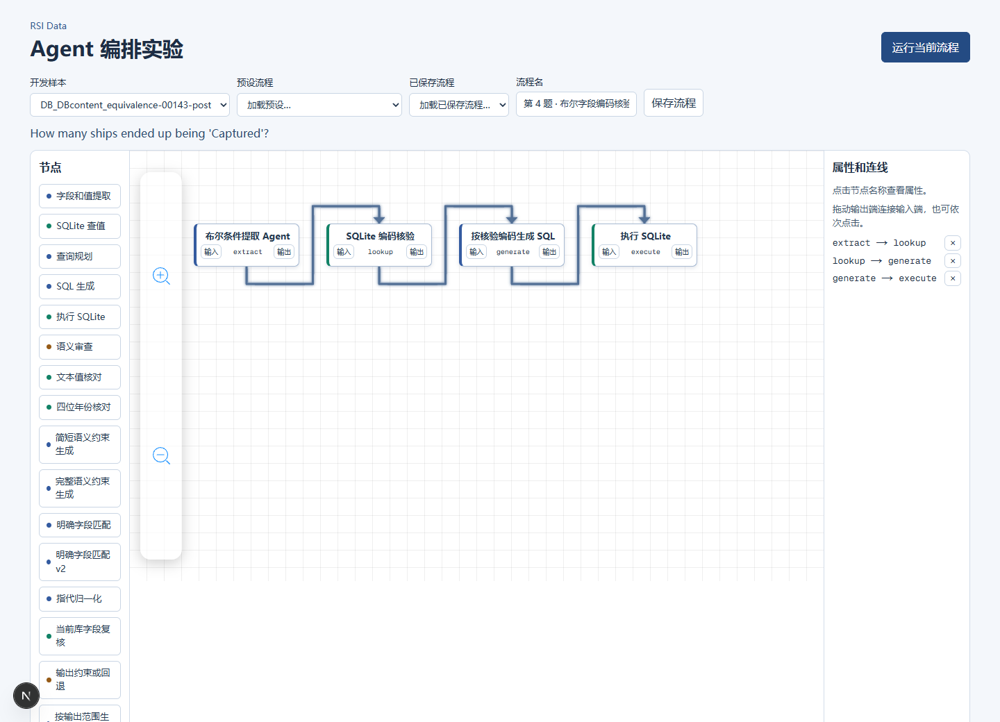

第一版验收实现收紧了精确命中时的提示注入。第二版才加入布尔值取样和证据判断。

#### v1 · 编码核验与精确命中控制


开发题 `DB_DBcontent_equivalence-00143`，原题 ID 491。题面为 `How many ships ended up being 'Captured'?`。`pre` 的 `ship.disposition_of_ship` 存原值 `Captured`。`post` 的 `ship.is_captured` 声明为 `bool`，SQLite 实际存储文本 `T/F`。两个题面的期望结果均为 4 艘。

##### 画布结构与节点输入输出

```text
题面 + 当前库 schema
  → 筛选条件提取 Agent
  → SQLite 编码核验（精确原值 / 已确认布尔编码 / 回退）
  → SQL 生成 Agent
  → SQLite 只读执行与本地评分
```

| 节点 | 类型 | 输入 | 输出 |
|---|---|---|---|
| `extract` 筛选条件提取 | LLM Agent | 当侧题面和 schema | 单个筛选候选 `table, column, term, operator, truth`。列不明确或没有唯一条件时返回空候选。 |
| `lookup` 编码核验 | 只读 SQLite 工具 | 上游候选和当侧数据库 | `exact`、`boolean` 或 `fallback`。确定时给出表列、题面词、实际库值与 SQLite 存储类型。无法确认时给出原因。 |
| `generate` SQL 生成 | LLM Agent | 当侧题面、schema，以及核验后的证据 | 一条 SQLite 查询。输入证据限于核实的列、值和类型。回退时采用基线生成提示。 |
| `execute` SQL 执行 | 只读 SQLite 工具 | 生成 SQL 和当侧数据库 | 执行状态、列名及结果行，由本地参考 SQL 判 EX。 |

先用 SQLite 判定题面原值是否精确命中。未命中时要求字段为语义匹配的肯定型标志，题面中的状态词和极性可核对，并且 SQLite 返回完整、同一存储类型的已知二值编码。当前识别文本 `T/F`、`true/false`、文本或整数 `0/1`。任意编码、缺少一个类别、混合存储类型、筛选列或语义不明确时走回退。工具不输出值的频次。本题的 `T` 频次就是答案，筛选值证据和执行答案在请求中分开。

本地检查覆盖原题两侧、错误极性、不明字段、节点执行顺序及模型消息的证据传递。分层对照题单冻结为 8 对文本布尔编码及 8 对混合官方变体。样本排除了已有配对和本题原题，Spider-dev 原题已被项目暴露，因此该题单衡量开发回归。参考 SQL 只用于抽样与评测。各模型运行状态在下文追加。

[初次实现源码快照](../results/task2/submission/records/task2-filter-boolean-v1/boolean_canvas.py) · [冻结题单](../results/task2/submission/records/task2-filter-boolean-comparison-v1/plan.json)

##### 第一版验收实现 · 精确命中沿用基线提示

初次实现将精确命中的原值也附在生成提示上。v2 保留四节点结构，只把证据注入条件收紧到 `boolean`。精确命中和回退均使用与对应基线逐字段相同的生成消息。初次和修正后的调用分别留存。


[导出结构](../results/task2/submission/records/task2-filter-boolean-v2/structure-v2.json) · [当前节点源码](../task2-rsi-data/experiment/boolean_canvas.py) · [四次浏览器运行](../results/task2/submission/records/task2-filter-boolean-v2/browser-results.json) · [节点版本与运行 ID](../results/task2/submission/records/task2-filter-boolean-v2/run-meta.json) · [初次运行](../results/task2/submission/records/task2-filter-boolean-v1/browser-results.json)

课程 Visual 从浏览器提交画布到 Spring Boot，四次运行均取得流程 ID。预测 SQL 重新在对应的 SQLite 执行，结果与浏览器评分一致。

| 题面 | 基线 | v2 节点路由与结果 | 模型调用数 | 总 token |
|---|---|---|---:|---:|
| pre | 4 艘 | `exact` 核验为 `Captured`，按原提示生成，得到 4 艘 | 1 → 2 | 4,631 → 12,212 |
| post | 0 艘 | `boolean` 核验为 `T`，注入文本编码，得到 4 艘 | 1 → 2 | 4,702 → 9,584 |

##### post 真实节点追踪

| 节点 | 当次输入 | 当次输出 |
|---|---|---|
| 提取 | 当侧题面及 `battle_death_0` schema | `ship.is_captured`、`Captured`、`=`、`truth=true` |
| 核验 | 候选列与当侧 SQLite | `boolean`，声明 `bool`，观测 `F/T`，选中 `T`，类型 `text` |
| 生成 | 当侧题面、schema、列值类型证据 | `SELECT COUNT(*) FROM ship WHERE is_captured = 'T';` |
| 执行 | 上步 SQL 与只读 SQLite | `[[4]]`，官方 EX 通过 |

[post 节点记录](../results/task2/submission/records/course-node-traces/c1dd019fd8024e17837f029e1ec797e1.json) · [post 执行截图](../results/task2/submission/records/task2-filter-boolean-v2/post-result.png) · [pre 执行截图](../results/task2/submission/records/task2-filter-boolean-v2/pre-result.png)

##### 原题 Thinking 对照

| 方法 | Thinking 请求档 | pre EX | post EX | pre token | post token |
|---|---|---|---|---:|---:|
| 基线 | none | 通过 | 未通过 | 4,622 | 4,634 |
| 基线 | high | 通过 | 未通过 | 4,636 | 4,685 |
| 编排 v2 | none | 通过 | 通过 | 12,123 | 9,517 |
| 编排 v2 | high | 通过 | 通过 | 12,438 | 9,728 |

原题共 8 条 Thinking 条件重新执行评分并核对节点请求和 token。Thinking 按服务请求档记录，模型指纹不可核实。

[参数和版本](../results/task2/submission/records/task2-filter-boolean-comparison-v2/config.json) · [逐条件结果](../results/task2/submission/完整批测记录.zip)（包内 `runs/task2-filter-boolean-comparison-v2/records`） · [原始请求响应](../results/task2/submission/完整批测记录.zip)（包内 `runs/task2-filter-boolean-comparison-v2/requests`）

##### 扩展题单的本地工具检查

同一冻结题单包含 8 对同类和 8 对混合官方变体。使用人工标注的列候选，本地工具已验证宠物和学位库中的文本布尔编码。三条左撇子变体的字段表示「右撇子」，题面缺少可直接核验的同向状态词，按当前规则回退。这里记录工具层的可覆盖范围，模型推断及最终 EX 仍需扩展实测。

[冻结题单](../results/task2/submission/records/task2-filter-boolean-comparison-v2/plan.json) · [只读工具探查](../results/task2/submission/records/task2-filter-boolean-comparison-v2/sqlite-tool-probes.json)


##### 同类与混合题单复测

各条件均固定原题侧、schema、模型、流程实现和执行评分。Thinking 使用 `none/high` 请求档。该题单原题已暴露，统计用于开发回归。

| 题单 | 方法与 Thinking | pre EX | post EX | 双侧通过 | 平均模型调用 | 平均总 token |
|---|---|---:|---:|---:|---:|---:|
| 同类 | 基线 none | 6/8 | 0/8 | 0/8 | 1.00 | 6091.3 |
| 同类 | 基线 high | 5/8 | 0/8 | 0/8 | 1.00 | 5612.3 |
| 同类 | 编排 v2 none | 6/8 | 2/8 | 2/8 | 2.00 | 12608.2 |
| 同类 | 编排 v2 high | 6/8 | 1/8 | 1/8 | 2.00 | 13242.8 |
| 混合 | 基线 none | 5/8 | 4/8 | 3/8 | 1.00 | 5919.4 |
| 混合 | 基线 high | 6/8 | 4/8 | 4/8 | 1.00 | 7128.0 |
| 混合 | 编排 v2 none | 4/8 | 4/8 | 3/8 | 2.00 | 12481.1 |
| 混合 | 编排 v2 high | 4/8 | 3/8 | 2/8 | 2.00 | 13857.7 |
| 全体 | 基线 none | 11/16 | 4/16 | 3/16 | 1.00 | 6005.4 |
| 全体 | 基线 high | 11/16 | 4/16 | 4/16 | 1.00 | 6370.2 |
| 全体 | 编排 v2 none | 10/16 | 6/16 | 5/16 | 2.00 | 12544.6 |
| 全体 | 编排 v2 high | 10/16 | 4/16 | 3/16 | 2.00 | 13550.2 |

| 题单 | 对照 | 修复 | post 对转错 | pre 回退 | 双侧净变化 | 总 token 差中位数 |
|---|---|---:|---:|---:|---:|---:|
| 同类 | 编排 none | 2 | 0 | 0 | +2/8 | 5696.0 |
| 同类 | 编排 high | 1 | 0 | 0 | +1/8 | 7743.0 |
| 同类 | 基线 none→high | 0 | 0 | 1 | +0/8 | 41.0 |
| 同类 | 编排 v2 none→high | 0 | 1 | 0 | -1/8 | 283.5 |
| 混合 | 编排 none | 0 | 0 | 1 | +0/8 | 5031.0 |
| 混合 | 编排 high | 0 | 1 | 2 | -2/8 | 5232.5 |
| 混合 | 基线 none→high | 0 | 0 | 0 | +1/8 | 109.0 |
| 混合 | 编排 v2 none→high | 0 | 1 | 0 | -1/8 | 335.0 |
| 全体 | 编排 none | 2 | 0 | 1 | +2/16 | 5371.5 |
| 全体 | 编排 high | 1 | 1 | 2 | -1/16 | 6691.5 |
| 全体 | 基线 none→high | 0 | 0 | 1 | +1/16 | 41.0 |
| 全体 | 编排 v2 none→high | 0 | 2 | 0 | -2/16 | 302.5 |

修复指基线前对后错而编排后双侧通过。逐题下表的两位依次表示 pre/post，C 通过，W 未通过。

| 题单 | 配对 | 基线 none | 编排 none | 基线 high | 编排 high | 编排路由 none / high |
|---|---|---|---|---|---|---|
| 同类 | `DB_DBcontent_equivalence-00038` | CW | CW | CW | CW | fallback/fallback / fallback/fallback |
| 同类 | `DB_DBcontent_equivalence-00148` | CW | CC | CW | CC | exact/boolean / fallback/boolean |
| 同类 | `DB_DBcontent_equivalence-00044` | CW | CC | CW | CW | exact/boolean / exact/fallback |
| 同类 | `DB_DBcontent_equivalence-00046` | CW | CW | CW | CW | fallback/fallback / fallback/fallback |
| 同类 | `DB_DBcontent_equivalence-00162` | WW | WW | WW | WW | fallback/fallback / fallback/fallback |
| 同类 | `DB_DBcontent_equivalence-00136` | CW | CW | WW | CW | fallback/fallback / fallback/fallback |
| 同类 | `DB_DBcontent_equivalence-00133` | CW | CW | CW | CW | fallback/fallback / fallback/fallback |
| 同类 | `DB_DBcontent_equivalence-00140` | WW | WW | WW | WW | fallback/fallback / fallback/fallback |
| 混合 | `DB_DBcontent_equivalence-00055` | CC | CC | CC | CC | fallback/fallback / fallback/fallback |
| 混合 | `DB_schema_abbreviation-02289` | WW | WW | WW | WW | fallback/fallback / exact/fallback |
| 混合 | `DB_schema_synonym-01689` | WC | WC | CC | WC | fallback/fallback / fallback/fallback |
| 混合 | `NLQ_column_attribute-00075` | CC | CC | CC | CW | fallback/fallback / fallback/fallback |
| 混合 | `NLQ_column_value-00303` | CW | CW | CW | CW | fallback/fallback / fallback/fallback |
| 混合 | `NLQ_keyword_synonym-00240` | CW | WW | CW | WW | fallback/fallback / fallback/fallback |
| 混合 | `SQL_comparison-00035` | CC | CC | CC | CC | fallback/fallback / fallback/fallback |
| 混合 | `SQL_sort_order-00096` | WW | WW | WW | WW | fallback/fallback / fallback/fallback |


##### 路由、失败与成本

本轮原题 8 条和扩展题单 128 条均已评分。两阶段合计 204 条模型响应，均报告 `gpt-6-sol`，系统指纹为空。样本、画布节点代码、请求档、生成提示和对应 SQLite 的哈希按配置留存。续跑前修正了配置记录中的 JSON 列表校验，原题评分、题单和各组提示均沿用原版本。

[运行配置](../results/task2/submission/records/task2-filter-boolean-comparison-v2/config.json) · [逐条件评分](../results/task2/submission/完整批测记录.zip)（包内 `runs/task2-filter-boolean-comparison-v2/records`） · [逐节点请求与响应](../results/task2/submission/完整批测记录.zip)（包内 `runs/task2-filter-boolean-comparison-v2/requests`） · [汇总、路由及配对区间](../results/task2/submission/records/task2-filter-boolean-comparison-v2/summary.json) · [续跑前配置](../results/task2/submission/records/task2-filter-boolean-comparison-v2/config-before-resume.json)

- **编码核验成功的 3 次同类 post 均通过。** 学士注册题在两个 Thinking 档都把 `is_bachelor` 核验为文本 `T`。没有养猫的学生题在 none 档把猫的编码核验为文本 `T` 并通过。high 档的同一题返回空候选并回退。[学士题 high](../results/task2/submission/records/task2-filter-boolean-comparison-v2/records/canvas_v2/high/DB_DBcontent_equivalence-00148-post.json) · [养猫题 none](../results/task2/submission/records/task2-filter-boolean-comparison-v2/records/canvas_v2/none/DB_DBcontent_equivalence-00044-post.json) · [养猫题 high](../results/task2/submission/records/task2-filter-boolean-comparison-v2/records/canvas_v2/high/DB_DBcontent_equivalence-00044-post.json)
- **同类 post 的其余 13 次走回退，均未通过。** 11 次缺少唯一候选。涉及狗和学生性别、猫和年龄、学士和硕士资格时，Agent 返回多个候选或空候选，当前核验一次只接收一个。另有两次给出 `left handed` 和 `is_right_handed` 的候选，当前规则仅核验同向状态词或显式否定，没有验证左右手互反，因此回退。[多条件](../results/task2/submission/records/task2-filter-boolean-comparison-v2/records/canvas_v2/none/DB_DBcontent_equivalence-00038-post.json) · [两个布尔条件](../results/task2/submission/records/task2-filter-boolean-comparison-v2/records/canvas_v2/none/DB_DBcontent_equivalence-00162-post.json) · [反向字段](../results/task2/submission/records/task2-filter-boolean-comparison-v2/records/canvas_v2/high/DB_DBcontent_equivalence-00140-post.json)
- **混合组没有注入布尔证据。** 实测回退的所有最终生成请求均与同档基线逐字段一致。none 档 1 次 pre 回退，high 档 2 次 pre 回退和 1 次 post 对转错。航司题多选了航班数，最少投票题返回了两个并列项，扑克题把排序列从收入换成决赛次数。报告保留这些 EX 变化及相同生成请求的证据。[航司题 pre](../results/task2/submission/records/task2-filter-boolean-comparison-v2/records/canvas_v2/none/NLQ_keyword_synonym-00240-pre.json) · [投票题 pre](../results/task2/submission/records/task2-filter-boolean-comparison-v2/records/canvas_v2/high/DB_schema_synonym-01689-pre.json) · [扑克题 post](../results/task2/submission/records/task2-filter-boolean-comparison-v2/records/canvas_v2/high/NLQ_column_attribute-00075-post.json)
- **编排每个题面增加一次模型调用。** 16 对题全体的平均总 token 在 none 档由 6,005.4 增至 12,544.6，约为 2.09 倍。high 档由 6,370.2 增至 13,550.2，约为 2.13 倍。即便回退，前置提取请求也已经发生。当前 16 对上，high 档没有带来稳定收益。

##### 第一版归档与第二版设计依据

本次验收实现和结果定为第 4 题的**正式第一版**。历史运行目录中的 `v2` 表示第一版内修正了精确命中时的提示注入条件。画布、节点代码快照、原题及扩展结果按 SHA-256 归档。初次运行也保留供追溯。[第一版归档清单](../results/task2/submission/records/task2-filter-boolean-v2/first-version.json) · [冻结节点代码](../results/task2/submission/records/task2-filter-boolean-v2/boolean_canvas-first-version.py)

- **入口丢失了可核验的候选。** 同类 post 在两个请求档合计 16 次运行。8 次提取为空，3 次提取到两条条件。工具只接受恰好一条候选，因此这 11 次均未提供库值证据。典型例子是「母学生养的狗」同时涉及宠物类型和学生性别，「3 岁的猫」同时涉及宠物类型和年龄。
- **反向字段的语义无法核验。** 另外 2 次提取到 `left handed` 与 `is_right_handed`，却不能用当前的同向或显式否定规则确认对应关系，最终回退。其余 3 次取得布尔证据，SQL 生成和执行全部通过。13 次回退的同类 post 均未通过。
- **成本发生在前置提取。** 回退仍会先调用提取 Agent，再调用 SQL 生成 Agent。混合层未注入布尔证据，回退后的生成输入与基线相同。相关 EX 变化作为同请求重跑观测保留。

第二版中，我重新设计了节点和连线。设计确定后，使用原题及同一冻结的 8 对同类、8 对混合样本复测。按 `none/high` 比较两版的候选覆盖、编码核验、pre 回退、双侧 EX 和 token，并保留每版的画布及执行记录。

#### v2 · 布尔字段取样

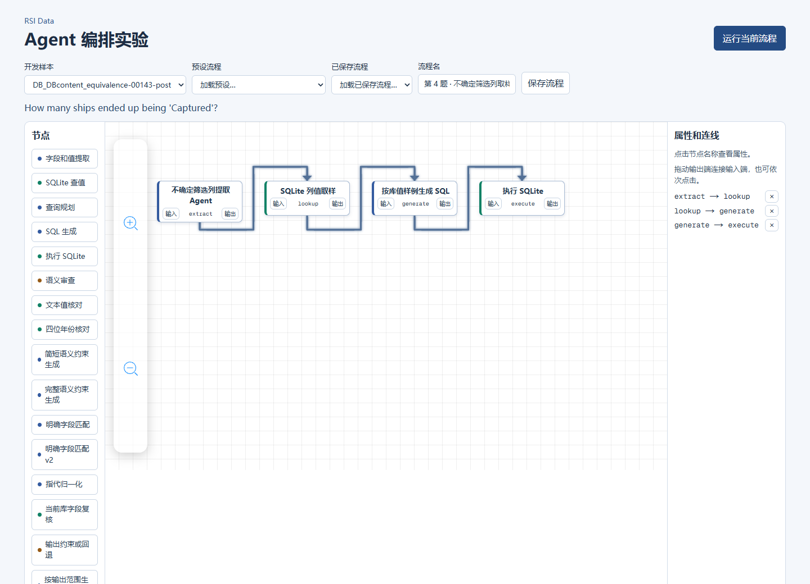

第二版将筛选列逐个核验，把库内观察值和 SQLite 类型交给生成 Agent 判断。第一版只接收一个候选，并由工具按规则选定编码。第二版在输入和证据均明确时支持多列，在没有可用证据时使用与基线逐字段相同的生成请求。

```text
当前题面与 schema → 不确定筛选列提取 Agent → SQLite 列值取样
                           → SQL 生成 Agent → SQLite 只读执行与评分
```

| 节点 | 类型 | 输入 | 输出 |
|---|---|---|---|
| 候选提取 | LLM Agent | 当侧题面、schema | 最多四个疑似编码或存值形式不确定的表列和题面原文，可返回空候选。 |
| 列值取样 | SQLite 工具 | 候选表列和当侧 SQLite | 每个可用列一条证据，包含表列、对应题面词和一至四个同类型去重值。原值精确命中跳过；空值、混合类型和超过取样上限的列不发送证据。 |
| SQL 生成 | LLM Agent | 原题面、schema，可用时附库值和类型 | 结合字段语义使用实际编码，生成单条 SQL。没有可用证据时沿用基线提示。 |
| 执行 | SQLite 工具 | 预测 SQL、当侧 SQLite | 查询行、列、执行状态，参考 SQL 用于本地 EX 评分。 |

实现将「取一条结果」解释为每列一条结构化证据。布尔列可同时报告 `F/T`，工具报告库内值和类型，不给出频次、选定的对应值或整行数据。部分候选无结果时，其余可用证据仍可进入生成节点。


[第二版结构](../results/task2/submission/records/task2-filter-boolean-evidence-v2/visual/structure-v2.json) · [节点源码快照](../results/task2/submission/records/task2-filter-boolean-evidence-v2/boolean_evidence_canvas-second-version.py) · [课程运行记录](../results/task2/submission/records/task2-filter-boolean-evidence-v2/visual/browser-results.json) · [运行 ID 和哈希](../results/task2/submission/records/task2-filter-boolean-evidence-v2/visual/run-meta.json)

##### 原题页面实测

| 题面 | 基线结果 | 第二版实际节点输出 | 第二版结果 | 总 token 基线 → 第二版 |
|---|---:|---|---:|---:|
| pre | 4 艘 | 原词 `Captured` 命中，沿用基线生成请求 | 4 艘 | 4,599 → 15,423 |
| post | 0 艘 | `ship.is_captured` 观察到 `F/T` 均为文本，模型选 `T` | 4 艘 | 10,548 → 9,734 |

重新执行并核对了四次浏览器结果。上表 token 来自课程画布各自的单次请求，批量成本见下方对照。

[post 截图](../results/task2/submission/records/task2-filter-boolean-evidence-v2/visual/post-result.png) · [pre 截图](../results/task2/submission/records/task2-filter-boolean-evidence-v2/visual/pre-result.png)

##### 固定题单两版对照

复用第一版的原开发题、8 对同类、8 对混合样本以及第一版保存的基线响应。第二版新增 68 条评分和 136 条模型响应，逐条重执行 SQL。两条 HTTP 503 原请求续跑后补齐。Thinking 比较沿用 `none/high` 请求档。题面所属原题已在项目中暴露，结果适用于该开发回归题单。

| 题单 | Thinking | 双侧通过 基线 → 第一版 → 第二版 | 第二版 pre EX | 第二版 post EX | 平均总 token 第一版 → 第二版 |
|---|---|---:|---:|---:|---:|
| 原开发题 | none | 0/1 → 1/1 → 1/1 | 1/1 | 1/1 | 10,820.0 → 14,015.5 |
| 原开发题 | high | 0/1 → 1/1 → 1/1 | 1/1 | 1/1 | 11,083.0 → 14,372.5 |
| 同类 | none | 0/8 → 2/8 → 5/8 | 6/8 | 5/8 | 12,608.2 → 12,846.7 |
| 同类 | high | 0/8 → 1/8 → 5/8 | 5/8 | 5/8 | 13,242.8 → 15,629.9 |
| 混合 | none | 3/8 → 3/8 → 4/8 | 5/8 | 5/8 | 12,481.1 → 13,211.8 |
| 混合 | high | 4/8 → 2/8 → 3/8 | 4/8 | 4/8 | 13,857.7 → 13,872.6 |
| 全体 | none | 3/16 → 5/16 → 9/16 | 11/16 | 10/16 | 12,544.6 → 13,029.2 |
| 全体 | high | 4/16 → 3/16 → 8/16 | 9/16 | 9/16 | 13,550.2 → 14,751.2 |

##### 变化与剩余失败

- **同类 post 两个档合计 16 次都把观察值交到了生成节点。** 第一版只有 3 次取得编码证据。第二版在多个筛选条件同时出现时能够保留相关布尔列，并让生成节点用实际 `F/T` 处理「左撇子」和「是否右撇子」的反向表达。
- **同类剩余三题在两个档都出现同样的失分。** 学士与硕士题的两个编码都正确，但多返回学期名称和年份。WTA 左手获胜者题的 `F` 和赛事正确，按比赛行计数得到 3，预期是 2 位获胜者。左手选手全名题正确使用 `F`，却将名和姓拼成一列。只调整各自的输出列或计数口径，本地回放 6 次均与参考一致。
- **混合组全部回退。** 32 个编排生成请求逐字段匹配同档基线。混合组的 EX 变化保留为同请求重跑观测。与第一版比，第二版在全体 `none` 新增 4 对双侧通过，`high` 新增 5 对，另有 1 条 `pre` 回退。
- 前置提取仍固定调用一次，每题面合计两次模型调用。全体平均 token 相比第一版分别增加约 3.9% 和 8.9%。

[冻结题单](../results/task2/submission/records/task2-filter-boolean-evidence-v2/plan.json) · [运行配置](../results/task2/submission/records/task2-filter-boolean-evidence-v2/config.json) · [逐条件记录](../results/task2/submission/完整批测记录.zip)（包内 `runs/task2-filter-boolean-evidence-v2/records`） · [模型请求和响应](../results/task2/submission/完整批测记录.zip)（包内 `runs/task2-filter-boolean-evidence-v2/requests`） · [汇总与转移矩阵](../results/task2/submission/records/task2-filter-boolean-evidence-v2/summary.json) · [失分 SQL 单点回放](../results/task2/submission/records/task2-filter-boolean-evidence-v2/diagnostic-replay.json)

### 第 5 题 · 缺失明细与零值

比较方向改为少于两种语言，空关联被当成零，六个缺少记录的地区进入结果。

#### 缺失明细与零值 v1


我采用以下方案。入口 Agent 判断数量在题面中是返回项、筛选条件还是两者，并判断是否应保留没有明细的实体。程序核对当前 SQLite 的候选表列，再选择统计口径。原开发题为 `SQL_comparison-00133`，其两侧分别比较超过两种和少于两种语言。

##### 编排结构与节点输入输出

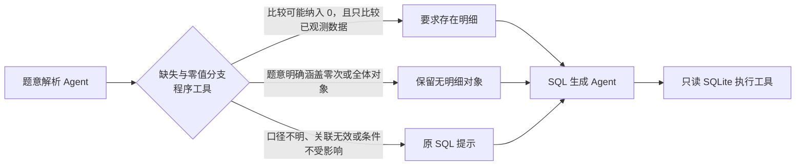

画布有四个执行节点。图中的三条分支是统计口径工具的三种输出，由同一个 SQL 生成节点消费。

| 节点 | 类型 | 输入 | 输出与职责 |
|---|---|---|---|
| 统计题意解析 | LLM Agent | 当前侧题面、对应 SQLite schema | 单个结构化候选，含父表与明细表的表列、计数角色、比较运算符和阈值、口径 `observed/zero/unknown`、题面原文依据。无法确定时可返回空候选。 |
| 缺失与零值分支 | 程序工具 | 解析候选、当前题面与库内表列 | 核对表列存在和题面依据。输出 `observed`、`zero` 或 `fallback`，记录依据及关联。已观测分支处理可能接收 0 的单一上限筛选。不确定及不受 0 影响时保持原生成提示。 |
| 按统计口径生成 SQL | LLM Agent | 当前侧题面、schema、工具输出 | 生成一条 SQL。已观测分支要求有明细，零值分支保留应纳入的父实体并计有效明细。 |
| 执行 SQLite | 程序工具 | 生成 SQL、当前侧 SQLite | 只读执行并保存结果或失败。参考 SQL 与预期输出在本地评分步骤使用。 |

对第 5 题，`post` 的「少于 2」接受零值。语言表表示已有记录，控制目标是避免把无明细的实体当作已确认的 0 种语言。`pre` 的「超过 2」不会因误计零值而纳入缺失实体，工具可回退。对明确问「哪些对象没有明细」的控制题，保留零值分支。SQLite 可以确认表列存在，业务覆盖范围仍由题意和 schema 语义判断。

##### 已冻结的比较

- 原题 1 对、同类 8 对、混合 9 对，18 个 Spider 原题 ID 互异。混合包含 3 对明确查询缺席的题，另有其他扰动。同类题的参考查询经本地反事实检查，改为保留零明细时会额外返回记录。参考查询只用于选题和评分。
- 同一题面的基线与编排分别使用 `reasoning_effort=none/high` 请求，计划 144 条评分。保存模型调用数、输入与输出及总 token，记录修复、误伤、失败和双侧通过。Thinking 按请求档位记录。Spider-dev 原题已经有历史项目暴露，分层结果按开发回归解读。
- 已实现 [画布节点](../task2-rsi-data/experiment/count_scope_canvas.py) 和[冻结题单](../results/task2/submission/records/task2-count-scope-v1/plan.json)。本地检查覆盖已观测、零值和回退分支，以及回退生成请求与基线一致。真实模型的结果在下方追加。


##### 本地验证与运行状态

- 三项本地测试通过。核对了三种路由、带限定条件的「all」不会单独触发零值分支，以及回退分支沿用基线请求。使用固定的测试 Agent 输出驱动四个节点后，在原题 post 对应的 SQLite 上执行并通过评分。
- Playwright 从本机课程页面加载冻结图和原题，实测四个节点可见。[课程画布预览](../results/task2/submission/records/task2-count-scope-v1/canvas-preview.png)使用本地目录响应替身，记录的是前端渲染。

##### 原题页面实测

从课程页面点击运行。前端提交画布和样本编号，Spring Boot 注册课程流程并逐节点调用 Python worker。四次返回均按原 SQLite 重新执行评分。浏览器使用服务端默认生成设置，下面的批测另行指定 Thinking 档。

| 方法 | 题侧 | 路由 | 执行行数 | EX | 模型调用 | 总 token | 证据 |
|---|---|---|---:|---|---:|---:|---|
| 编排 v1 | post | observed | 21 | 通过 | 2 | 10214 | [节点追踪](../results/task2/submission/records/course-node-traces/ec5434f8dea74edc8a3cb680a5d5747e.json) · [课程页面](../results/task2/submission/records/task2-count-scope-v1/post-visual-result.png) |
| 编排 v1 | pre | fallback | 149 | 通过 | 2 | 10016 | [节点追踪](../results/task2/submission/records/course-node-traces/4cf2b16498ed43f4bbcc4b765f05f81a.json) · [课程页面](../results/task2/submission/records/task2-count-scope-v1/pre-visual-result.png) |
| 基线 | post | 原生成 | 27 | 未通过 | 1 | 4966 | [节点追踪](../results/task2/submission/records/course-node-traces/4f9544bd2c7e4f0b94e454b700db7f88.json) |
| 基线 | pre | 原生成 | 149 | 通过 | 1 | 4848 | [节点追踪](../results/task2/submission/records/course-node-traces/5f153bfbe5214d5488f6ab3fedadd5bd.json) |

原题 post 的解析输出将计数标为 `both`，比较为 `< 2`，关联为 `country.Code = countrylanguage.CountryCode`。工具选择 `observed` 并传给生成节点，SQL 使用内连接，返回参考的 21 行。pre 的比较条件不受零值影响，工具输出 `fallback`。基线 post 仍有 6 条无明细地区被算成 0。

[实际画布](../results/task2/submission/canvas/05-v1.png) · [前端提交与课程运行 ID](../results/task2/submission/records/task2-count-scope-v1/visual-results.json)

##### 原题、同类与混合回归结果

以下成绩按全部八个条件完整的配对统计。C/W 分别表示执行评分通过和失败。

| 范围 | 方法 | Thinking | pre EX | post EX | 双侧通过 | 平均调用 | 平均输入 token | 平均输出 token | 平均总 token |
|---|---|---|---:|---:|---:|---:|---:|---:|---:|
| 原题 | baseline | none | 1/1 | 0/1 | 0/1 | 1.00 | 4768.0 | 121.0 | 4889.0 |
| 原题 | baseline | high | 1/1 | 0/1 | 0/1 | 1.00 | 4768.0 | 114.0 | 4882.0 |
| 原题 | canvas_v1 | none | 1/1 | 1/1 | 1/1 | 2.00 | 9833.0 | 182.0 | 10015.0 |
| 原题 | canvas_v1 | high | 1/1 | 1/1 | 1/1 | 2.00 | 9833.0 | 305.0 | 10138.0 |
| 同类 | baseline | none | 6/8 | 0/8 | 0/8 | 1.00 | 6942.2 | 86.1 | 7028.2 |
| 同类 | baseline | high | 6/8 | 0/8 | 0/8 | 1.00 | 6575.6 | 139.4 | 6714.9 |
| 同类 | canvas_v1 | none | 6/8 | 2/8 | 1/8 | 2.00 | 12117.8 | 257.3 | 12375.1 |
| 同类 | canvas_v1 | high | 6/8 | 1/8 | 1/8 | 2.00 | 12610.3 | 388.4 | 12998.7 |
| 混合 | baseline | none | 8/9 | 8/9 | 7/9 | 1.00 | 5516.0 | 71.9 | 5587.9 |
| 混合 | baseline | high | 6/9 | 7/9 | 6/9 | 1.00 | 5844.6 | 169.9 | 6014.4 |
| 混合 | canvas_v1 | none | 7/9 | 8/9 | 6/9 | 2.00 | 12036.8 | 180.7 | 12217.5 |
| 混合 | canvas_v1 | high | 7/9 | 8/9 | 7/9 | 2.00 | 12007.0 | 380.5 | 12387.5 |
| 同类与混合合计 | baseline | none | 14/17 | 8/17 | 7/17 | 1.00 | 6187.1 | 78.6 | 6265.7 |
| 同类与混合合计 | baseline | high | 12/17 | 7/17 | 6/17 | 1.00 | 6188.6 | 155.5 | 6344.1 |
| 同类与混合合计 | canvas_v1 | none | 13/17 | 10/17 | 7/17 | 2.00 | 12074.9 | 216.7 | 12291.7 |
| 同类与混合合计 | canvas_v1 | high | 13/17 | 9/17 | 8/17 | 2.00 | 12290.9 | 384.2 | 12675.1 |

| 范围 | 对照 | 完整/计划配对 | 修复 | post 回退 | pre 回退 | 双侧净变化 | 总 token 差中位数 |
|---|---|---:|---:|---:|---:|---:|---:|
| 原题 | 编排 none | 1/1 | 1 | 0 | 0 | +1 | 5126.0 |
| 原题 | 编排 high | 1/1 | 1 | 0 | 0 | +1 | 5256.0 |
| 原题 | baseline none→high | 1/1 | 0 | 0 | 0 | +0 | -7.0 |
| 原题 | canvas_v1 none→high | 1/1 | 0 | 0 | 0 | +0 | 123.0 |
| 同类 | 编排 none | 8/8 | 1 | 0 | 0 | +1 | 4966.5 |
| 同类 | 编排 high | 8/8 | 1 | 0 | 0 | +1 | 5161.0 |
| 同类 | baseline none→high | 8/8 | 0 | 0 | 0 | +0 | 26.5 |
| 同类 | canvas_v1 none→high | 8/8 | 0 | 1 | 0 | +0 | 115.0 |
| 混合 | 编排 none | 9/9 | 0 | 0 | 1 | -1 | 5129.0 |
| 混合 | 编排 high | 9/9 | 0 | 0 | 0 | +1 | 5114.0 |
| 混合 | baseline none→high | 9/9 | 0 | 1 | 2 | -1 | 111.0 |
| 混合 | canvas_v1 none→high | 9/9 | 0 | 0 | 1 | +1 | 153.5 |
| 同类与混合合计 | 编排 none | 17/17 | 1 | 0 | 1 | +0 | 5070.0 |
| 同类与混合合计 | 编排 high | 17/17 | 1 | 0 | 0 | +2 | 5119.0 |
| 同类与混合合计 | baseline none→high | 17/17 | 0 | 1 | 2 | -1 | 38.5 |
| 同类与混合合计 | canvas_v1 none→high | 17/17 | 0 | 1 | 1 | +1 | 115.0 |

修复指基线前对后错、编排后双侧通过。路由按 pre/post 列出。

| 配对 | 范围 | 基线 none | 编排 none | 基线 high | 编排 high | 编排路由 none；high |
|---|---|---|---|---|---|---|
| `SQL_comparison-00133` | 原题 | CW | CC | CW | CC | fallback/observed；fallback/observed |
| `SQL_comparison-00165` | 同类 | WW | WW | WW | WW | fallback/observed；fallback/observed |
| `SQL_comparison-00160` | 同类 | CW | CC | CW | CC | fallback/observed；fallback/observed |
| `SQL_comparison-00100` | 同类 | WW | WC | WW | WW | fallback/observed；fallback/fallback |
| `SQL_comparison-00175` | 同类 | CW | CW | CW | CW | fallback/fallback；fallback/fallback |
| `SQL_comparison-00013` | 同类 | CW | CW | CW | CW | fallback/fallback；fallback/fallback |
| `SQL_comparison-00126` | 同类 | CW | CW | CW | CW | fallback/fallback；fallback/fallback |
| `SQL_comparison-00006` | 同类 | CW | CW | CW | CW | fallback/fallback；fallback/fallback |
| `SQL_comparison-00173` | 同类 | CW | CW | CW | CW | fallback/fallback；fallback/fallback |
| `DB_schema_abbreviation-02606` | 混合 | CC | WC | WW | CC | zero/zero；zero/zero |
| `NLQ_keyword_synonym-00799` | 混合 | WC | WC | WC | WC | fallback/zero；fallback/zero |
| `NLQ_keyword_carrier-00209` | 混合 | CC | CC | CC | CC | fallback/zero；fallback/zero |
| `DB_DBcontent_equivalence-00072` | 混合 | CC | CC | CC | CC | fallback/fallback；fallback/fallback |
| `DB_schema_synonym-01086` | 混合 | CC | CC | CC | CC | fallback/fallback；fallback/fallback |
| `NLQ_column_attribute-00100` | 混合 | CC | CC | CC | CC | fallback/fallback；fallback/fallback |
| `NLQ_column_value-00007` | 混合 | CC | CC | CC | CC | fallback/fallback；fallback/fallback |
| `SQL_comparison-00023` | 混合 | CW | CW | WW | WW | fallback/fallback；fallback/fallback |
| `SQL_sort_order-00122` | 混合 | CC | CC | CC | CC | fallback/fallback；fallback/fallback |


##### 效果与代价

- **原题在真实课程画布和两档 Thinking 对照中均修复。** 两档的基线都为前对后错，编排后双侧通过。课程画布的 post 从 27 行变成 21 行，pre 维持 149 行。课程画布使用默认生成设置，批测按 `none/high` 明确传入请求档。
- **同类题的主要限制在路由覆盖。** 两档各把 1/8 从前对后错修成双侧通过，都是宠物诊所的从业人员处理次数题 `SQL_comparison-00160`。八条同类 post 中，`none` 只有三条进入已观测分支，`high` 只有两条。歌手歌曲数、厂商数、投票数和宠物数等题，解析 Agent 往往无法确定事件缺席能否计为零，于是回退。以「最多一只宠物」为例，自然语言可以涵盖没有宠物的学生，官方参考的内连接只保留有宠物明细的学生。回退生成的 SQL 返回 33 行，参考返回 1 行。本轮保留官方 EX 与语义差异。[同类队列追踪](../results/task2/submission/records/task2-count-scope-v1/records/canvas_v1/none/SQL_comparison-00006-post.json)
- **零值分支保留了三个明确问缺席的 post 结果。** 三对缺席对照在两档的 post 均走 `zero` 且评分通过。低档中 `DB_schema_abbreviation-02606-pre` 发生唯一原题侧回退。生成查询筛出了没有朋友的学生，却只做了按学生分组的最小成绩，返回 `12` 和 `10` 两行。局部复跑时，只加上对分组后的全局 `MIN`，结果恢复为参考的 `10`。另一题用 `do not have any friends` 表达缺席，解析给出零值口径，工具未识别该原文形式，因而回退。[全局聚合回退](../results/task2/submission/records/task2-count-scope-v1/records/canvas_v1/none/DB_schema_abbreviation-02606-pre.json) · [缺席措辞回退](../results/task2/submission/records/task2-count-scope-v1/records/canvas_v1/none/NLQ_keyword_synonym-00799-pre.json)
- **排除缺失之后，计数单位仍会造成差异。** `SQL_comparison-00165-post` 两档均进入已观测分支。题面写「治疗种类」，生成 SQL 按不同治疗类型计数，返回 8 行。参考按治疗记录数计数，返回 7 行。只换计数单位即可在原库通过官方 EX，按题面取不同种类也有依据。[治疗种类逐节点证据](../results/task2/submission/records/task2-count-scope-v1/records/canvas_v1/none/SQL_comparison-00165-post.json)
- **扩展题单的平均 token 接近翻倍。** `none` 档双侧通过保持 7/17，平均总 token 从 6265.7 增至 12291.7。`high` 档双侧通过从 6/17 增至 8/17，平均总 token 从 6344.1 增至 12675.1。两档每题面都调用两次模型，回退时也已发生解析调用。`high` 的同类 post 比 `none` 少通过一题，差异来自课程分班题从已观测改走回退。两档在这批题上没有一致的成绩优势。[课程分班低档](../results/task2/submission/records/task2-count-scope-v1/records/canvas_v1/none/SQL_comparison-00100-post.json) · [课程分班高档](../results/task2/submission/records/task2-count-scope-v1/records/canvas_v1/high/SQL_comparison-00100-post.json)

全部 144 条评分由 216 条模型响应产生，已逐条重新执行 SQL 核对。服务返回的模型标识为 `gpt-6-sol`，系统指纹为空。扩展组的 17 对中有 5 对官方变体已出现在项目记录里，全部原题已有历史暴露。两个档位及各层结论的范围均为这批开发回归题。[运行配置](../results/task2/submission/records/task2-count-scope-v1/config.json) · [分层统计与转移](../results/task2/submission/records/task2-count-scope-v1/summary.json) · [运行故障记录](../results/task2/submission/records/task2-count-scope-v1/run-failures.json)

##### 同类失分的单点回放

逐侧重放已有编排 SQL。对评分失败、SQL 只有一个外连接的情况，诊断时仅将该 `LEFT JOIN` 改为内连接。比较门槛、统计项、分组和输出列全部保留。这次诊断使用已经知道的失败结果筛选回放对象。

| Thinking 请求档 | v1 已有结果，双侧通过 | 本地修改连接后，双侧通过 |
|---|---:|---:|
| `none` | 1/8 | 7/8 |
| `high` | 1/8 | 7/8 |

两档都补上了课程分班题的失败侧，并恢复歌曲、厂商、投票和宠物题的官方 EX。例如，「至多一只宠物」从 33 行变为参考的 1 行。「治疗种类」一题在两侧均已排除无明细人员，剩余失分源于题面要求去重计种类而参考 SQL 按治疗记录计数。

本地修改验证了候选记录范围对这批开发题的影响。它使用已知失败定位改动，未调用模型，也没有验证运行时如何从当前题面选择统计口径。若后续采用「口径未明时按仅有明细的实体计算」的基准约定，需要单独记录此默认值，并验证明确询问零次对象及实体全集的题仍能完整返回。[修改前后的 SQL 与评分](../results/task2/submission/records/task2-count-scope-v1/join-scope-replay.json)

#### 缺失明细与零值 v2

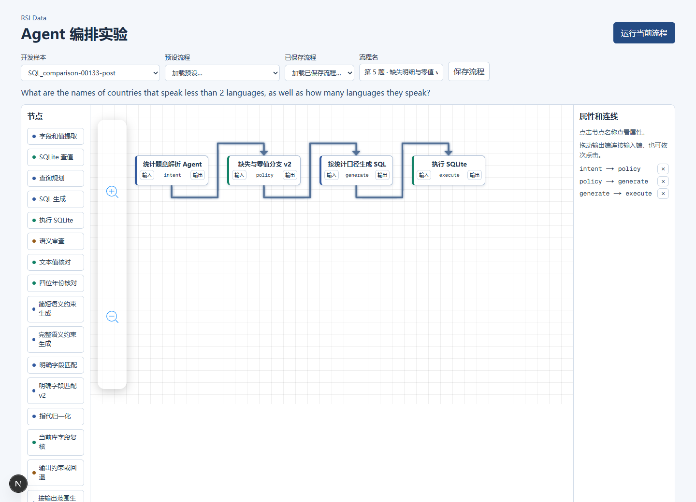

v2 将 Dr.Spider 的默认计数口径写进分支工具。它在 v1 无法确定口径时，从当前题面核对唯一的数量上限，检查是否会纳入零，并核对解析返回的关联表列、主体单列主键和已有外键声明。上限一致、关联符合条件，且题面没有明确零值或检测到的复合条件时，默认只统计有明细的主体。题面要求保留零值时沿用零值分支。

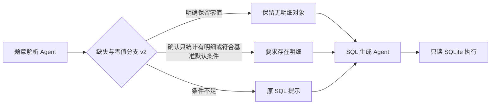

| 节点 | 类型 | 输入 | 输出与职责 |
|---|---|---|---|
| 统计题意解析 | LLM Agent | 当侧题面、SQLite schema | 主体与明细的表列、计数角色、比较和阈值、口径判断及题面依据。 |
| 缺失与零值分支 v2 | 程序工具 | 当侧题面、解析输出、SQLite schema | 给出统计范围、核验的表列与分支依据。命中基准默认值时记录 `benchmark_default`。 |
| 按统计口径生成 SQL | LLM Agent | 当侧题面、schema、工具输出 | 生成 SQL。有明确统计范围时附加约束，回退时沿用原 SQL 提示。 |
| 执行 SQLite | 程序工具 | SQL、当侧 SQLite | 只读执行，输出结果或错误。本地评测按参考 SQL 判分。 |

#### 缺失明细与零值 v3

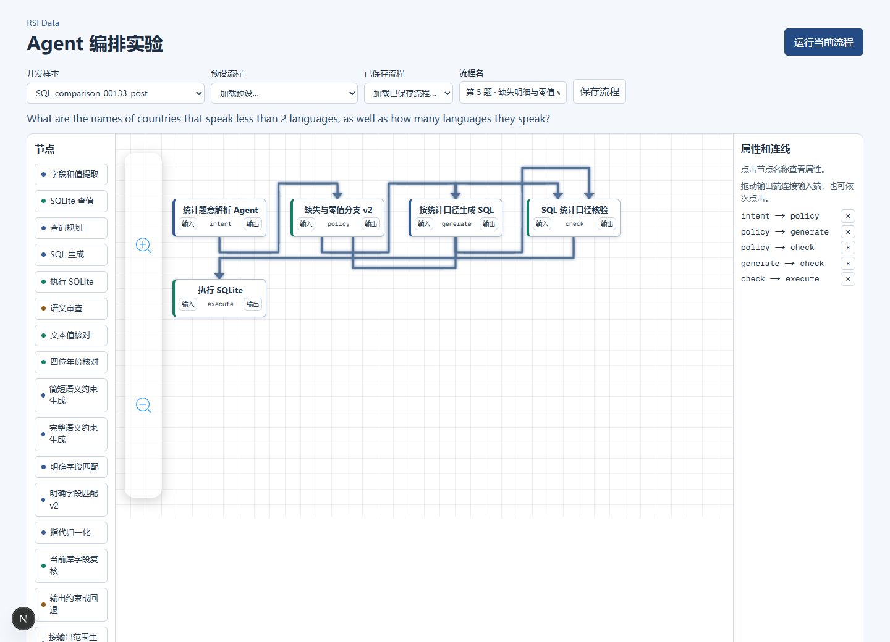

v3 在 SQL 生成和执行之间加一个程序节点，同时接收 v2 的口径输出。已观测分支核对单一连接、连接键、按主体分组的列和数量比较。如果生成 SQL 仍用外连接，程序可在这一受支持的形状中要求匹配明细。零值分支核对明确问全局最小或最大值的查询。若 SQL 在逐主体分组后直接返回多个最值，程序在外层再取一次全局最值。其他形状按生成结果直接执行。


| 节点 | 类型 | 输入 | 输出与职责 |
|---|---|---|---|
| 统计题意解析 | LLM Agent | 当侧题面、SQLite schema | 结构化计数意图和题面依据。 |
| 缺失与零值分支 v2 | 程序工具 | 当侧题面、解析输出、SQLite schema | 输出已核验的统计范围和关联，供生成与核验共用。 |
| 按统计口径生成 SQL | LLM Agent | 当侧题面、schema、统计范围 | 输出 SQL 草稿。 |
| SQL 统计口径核验 | 程序工具 | 草稿、当侧题面和已核验口径 | 检查支持的 SQL 形状，输出可执行 SQL 和核验动作。 |
| 执行 SQLite | 程序工具 | 核验节点输出的 SQL、当侧 SQLite | 只读执行并输出结果或错误。 |

##### 原题页面实测与同题单复测

课程 Visual 实跑 v2、v3 原题两侧，各版均按参考结果返回 pre 149 行、post 21 行。四次课内运行各调用模型两次，节点、SQL、课程流程 ID 和执行评分已保存。[课程运行与节点输出](../results/task2/submission/records/task2-count-scope-revisions/comparison.json)

复测沿用 v1 的 18 对题和 `none/high` 两档。每版新增 72 个评分条件，基线与 v1 沿用原始响应。v2 的 144 次逻辑调用中，131 次请求与 v1 完全相同并复用响应，13 次发送了增加统计约束的请求。v3 复用 v2 的全部 144 条模型响应，程序核验的差异可以直接追溯到 SQL。全部 288 个评分条件已重新执行。表内依次为 **pre 通过数 / post 通过数 / 双侧通过数**，每项以该行题对数为分母。

| 范围 | 题对数 | Thinking | 基线 | v1 | v2 | v3 |
|---|---:|---|---|---|---|---|
| 原题 | 1 | none | 1 / 0 / 0 | 1 / 1 / 1 | 1 / 1 / 1 | 1 / 1 / 1 |
| 原题 | 1 | high | 1 / 0 / 0 | 1 / 1 / 1 | 1 / 1 / 1 | 1 / 1 / 1 |
| 同类 | 8 | none | 6 / 0 / 0 | 6 / 2 / 1 | 7 / 6 / 6 | 7 / 6 / 6 |
| 同类 | 8 | high | 6 / 0 / 0 | 6 / 1 / 1 | 6 / 7 / 6 | 6 / 7 / 6 |
| 混合 | 9 | none | 8 / 8 / 7 | 7 / 8 / 6 | 7 / 8 / 6 | 8 / 8 / 7 |
| 混合 | 9 | high | 6 / 7 / 6 | 7 / 8 / 7 | 7 / 8 / 7 | 7 / 8 / 7 |
| 扩展全体 | 17 | none | 14 / 8 / 7 | 13 / 10 / 7 | 14 / 14 / 12 | 15 / 14 / 13 |
| 扩展全体 | 17 | high | 12 / 7 / 6 | 13 / 9 / 8 | 13 / 15 / 13 | 13 / 15 / 13 |

| Thinking | 基线平均总 token | v1 | v2 | v3 |
|---|---:|---:|---:|---:|
| none | 6265.7 | 12291.7 | 12026.7 | 12026.7 |
| high | 6344.1 | 12675.1 | 12251.4 | 12251.4 |

token 表使用扩展全体的逐题面平均值。三版编排每侧计两次模型调用，基线计一次。每个样本的 SQL、分支、token、评分和分层转移矩阵均可核对。[完整对照与逐题证据](../results/task2/submission/records/task2-count-scope-revisions/comparison.json) · [v2 配置](../results/task2/submission/records/task2-count-scope-revisions/config-v2.json) · [v3 配置](../results/task2/submission/records/task2-count-scope-revisions/config-v3.json)

##### 版本改进与剩余失分

- **基线到 v1。** 加入解析和统计范围工具，原题两档均从前对后错变为双侧通过。同类双侧各到 1/8，许多上限题因零值口径不明确而回退。
- **v1 到 v2。** 默认口径扩大了路由覆盖，同类双侧两档都从 1/8 到 6/8。扩展全体双侧分别从 7/17 到 12/17、从 8/17 到 13/17。两档均未出现新的 pre 或 post 回退。
- **v2 到 v3。** 核验节点修复了 `DB_schema_abbreviation-02606-pre` 的全局最小值。原 SQL 返回 12 和 10 两行，补上外层 `MIN` 后只返回 10。因而 none 档混合双侧从 6/9 到 7/9，扩展全体到 13/17。high 档该题在 v2 已通过。同一批测试中，生成后的有明细校验分支没有触发，单独用原题对应的外连接 SQL 在本地验证了这个分支。
- **同类两档仍各有两对未双侧通过。** 治疗种类题的题面支持去重计种类，官方 SQL 按治疗记录计数。另一对随档位不同，none 的歌手至多一首歌和 high 的课程分班 pre 都把计数筛选错标成返回项，导致工具回退。18 对均为开发回归，所有原题已有历史暴露。

### 第 6 题 · 姓名分列和拼接

数据库把单列姓名拆成名和姓，模型重新拼接，导致参考要求的两列输出变成一列。

#### 姓名分列与拼接 v1

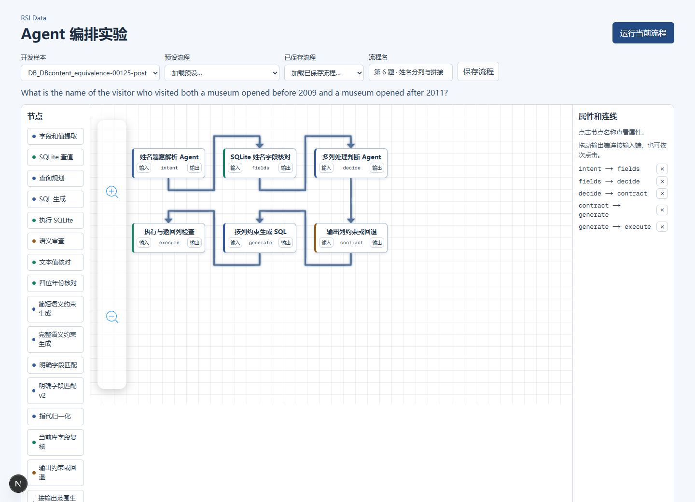

开发题 `DB_DBcontent_equivalence-00125`。原题 1 对、同类 8 对、混合 8 对。基线和编排分别用 Thinking 请求档 `none/high` 对每侧生成，参考 SQL 只用于样本归类和本地评分。本轮盘点到 1034 道已暴露原题，扩展结果按开发回归解读。

##### 编排图与节点输入输出


| 节点 | 类型 | 输入 | 输出 |
|---|---|---|---|
| 题意解析 | LLM | 当侧题面、schema | 姓名原文、输出或筛选用途、所属表、候选列 |
| 字段核对 | SQLite 工具 | 候选字段、当侧 SQLite | 直接使用单列、核实的多列组或回退原因 |
| 多列处理判断 | 条件调用 LLM | 当侧题面、核实的姓名组成列及用途 | 分列、组合查找、明确合并显示或回退，以及题面依据 |
| 输出约束 | 程序规则 | 通过核验的判断 | 姓名列顺序、查找用途提示或空提示 |
| SQL 生成 | LLM | 当侧题面和 schema，非空时加约束 | 一条 SQLite SQL 和触发路径 |
| 执行与返回列检查 | SQLite 工具 | SQL、分列约束 | 返回列、结果行、分列约束检查状态 |

画布以六个事件顺序执行。单列及无法核对时，多列节点记录跳过，生成请求与同档基线逐字段相同。v1 支持姓名组成列，明确要求一列时才启用合并展示。组合查找由 SQL 生成节点使用核验列。返回列检查记录分列提示是否被遵守，EX 独立按执行结果评分。

##### 原题页面实测

在浏览器重新连线、保存、刷新并重载，再经课程 Spring Boot / RSI Flow 运行两侧和基线。

[画布截图](../results/task2/submission/canvas/06-v1.png) · [导出结构](../results/task2/submission/records/task2-split-output-v1/structure-v1.json) · [浏览器请求和后端运行](../results/task2/submission/records/task2-split-output-v1/browser-results.json) · [post 执行截图](../results/task2/submission/records/task2-split-output-v1/post-result.png)

| 方法 | 侧 | EX | 返回列 | 模型调用 | token |
|---|---|---|---|---:|---:|
| canvas | post | match | `['first_name', 'last_name']` | 3 | 14614 |
| canvas | pre | match | `['Name']` | 2 | 9634 |
| baseline | post | match | `['first_name', 'last_name']` | 1 | 4776 |
| baseline | pre | match | `['Name']` | 1 | 4697 |

post 节点实际输出如下。

1. 题意解析 `{'targets': [{'kind': 'name', 'table': 'visitor', 'fields': ['first_name', 'last_name'], 'role': 'output', 'cue': 'name of the visitor', 'sole_output': True}]}`。
2. 字段核对 `{'route': 'components', 'table': 'visitor', 'columns': ['first_name', 'last_name'], 'role': 'output', 'cue': 'name of the visitor', 'sole_output': True}`。
3. 多列判断 `{'route': 'split', 'table': 'visitor', 'columns': ['first_name', 'last_name'], 'role': 'output', 'cue': 'name of the visitor', 'sole_output': True, 'decision_cue': 'name of the visitor', 'agent_decision': {'mode': 'split', 'cue': 'name of the visitor'}}`。
4. 约束 `Return this requested person name as separate stored columns in this order: visitor.first_name, visitor.last_name. Preserve all other requested outputs and filters.`。
5. 生成 `SELECT DISTINCT v.first_name, v.last_name FROM visitor AS v WHERE EXISTS ( SELECT 1 FROM visit AS vi JOIN museum AS m ON m.Museum_ID = vi.Museum_ID WHERE vi.visitor_ID = v.ID AND CAST(m.Open_Year AS INTEGER) < 2009 ) AND EXISTS ( SELECT 1 FROM visit AS vi JOIN museum AS m ON m.Museum_ID = vi.Museum_ID WHERE vi.visitor_ID = v.ID AND CAST(m.Open_Year AS INTEGER) > 2011 );`。
6. 执行 `[['Fernando', 'Gago']]`，返回列检查 `match`。

##### 原题、同类、混合与 Thinking 对照

| 样本 | 方法 | pre EX | post EX | 双侧通过 | 平均模型调用 | 平均输入 token | 平均输出 token | 平均总 token |
|---|---|---:|---:|---:|---:|---:|---:|---:|
| 原题 | 基线 none | 1/1 | 0/1 | 0/1 | 1.00 | 4575.5 | 161.0 | 4736.5 |
| 原题 | 基线 high | 1/1 | 0/1 | 0/1 | 1.00 | 4575.5 | 182.5 | 4758.0 |
| 原题 | 编排 v1 none | 1/1 | 1/1 | 1/1 | 2.50 | 11809.0 | 229.0 | 12038.0 |
| 原题 | 编排 v1 high | 1/1 | 0/1 | 0/1 | 2.00 | 9391.0 | 316.5 | 9707.5 |
| 同类 | 基线 none | 5/8 | 2/8 | 2/8 | 1.00 | 5618.0 | 58.9 | 5676.9 |
| 同类 | 基线 high | 5/8 | 1/8 | 1/8 | 1.00 | 5988.5 | 147.5 | 6136.0 |
| 同类 | 编排 v1 none | 5/8 | 2/8 | 2/8 | 2.50 | 14123.1 | 243.9 | 14367.0 |
| 同类 | 编排 v1 high | 5/8 | 3/8 | 3/8 | 2.50 | 15972.9 | 579.1 | 16552.0 |
| 混合对照 | 基线 none | 7/8 | 5/8 | 5/8 | 1.00 | 5177.9 | 62.1 | 5239.9 |
| 混合对照 | 基线 high | 7/8 | 5/8 | 5/8 | 1.00 | 5569.9 | 133.4 | 5703.3 |
| 混合对照 | 编排 v1 none | 7/8 | 5/8 | 5/8 | 2.12 | 12328.9 | 178.7 | 12507.6 |
| 混合对照 | 编排 v1 high | 7/8 | 6/8 | 6/8 | 2.12 | 13348.0 | 440.5 | 13788.5 |
| 扩展全体 | 基线 none | 12/16 | 7/16 | 7/16 | 1.00 | 5397.9 | 60.5 | 5458.4 |
| 扩展全体 | 基线 high | 12/16 | 6/16 | 6/16 | 1.00 | 5779.2 | 140.5 | 5919.7 |
| 扩展全体 | 编排 v1 none | 12/16 | 7/16 | 7/16 | 2.31 | 13226.0 | 211.3 | 13437.3 |
| 扩展全体 | 编排 v1 high | 12/16 | 9/16 | 9/16 | 2.31 | 14660.4 | 509.8 | 15170.2 |

修复计基线前对后错、加强后双侧通过。扰动误伤计双侧通过变成前对后错，pre 回退计所有原题对转错。

| 样本 | 对比 | 修复 | 扰动误伤 | pre 回退 | 双侧净变化 | 总 token 差中位数 |
|---|---|---:|---:|---:|---:|---:|
| 原题 | 基线 none → 编排 v1 none | 1 | 0 | 0 | +1/1 | 7301.5 |
| 原题 | 基线 high → 编排 v1 high | 0 | 0 | 0 | +0/1 | 4949.5 |
| 原题 | 基线 none → 基线 high | 0 | 0 | 0 | +0/1 | 21.5 |
| 原题 | 编排 v1 none → 编排 v1 high | 0 | 1 | 0 | -1/1 | -2330.5 |
| 同类 | 基线 none → 编排 v1 none | 0 | 0 | 0 | +0/8 | 7552.5 |
| 同类 | 基线 high → 编排 v1 high | 2 | 0 | 0 | +2/8 | 10039.5 |
| 同类 | 基线 none → 基线 high | 0 | 1 | 0 | -1/8 | 41.0 |
| 同类 | 编排 v1 none → 编排 v1 high | 1 | 0 | 0 | +1/8 | 550.0 |
| 混合对照 | 基线 none → 编排 v1 none | 0 | 0 | 0 | +0/8 | 5237.0 |
| 混合对照 | 基线 high → 编排 v1 high | 1 | 0 | 0 | +1/8 | 6465.0 |
| 混合对照 | 基线 none → 基线 high | 0 | 0 | 0 | +0/8 | 47.0 |
| 混合对照 | 编排 v1 none → 编排 v1 high | 1 | 0 | 0 | +1/8 | 268.5 |
| 扩展全体 | 基线 none → 编排 v1 none | 0 | 0 | 0 | +0/16 | 6900.0 |
| 扩展全体 | 基线 high → 编排 v1 high | 3 | 0 | 0 | +3/16 | 7844.0 |
| 扩展全体 | 基线 none → 基线 high | 0 | 1 | 0 | -1/16 | 41.0 |
| 扩展全体 | 编排 v1 none → 编排 v1 high | 2 | 0 | 0 | +2/16 | 368.5 |

| 配对 | 层 | 基线 none | 编排 none | 基线 high | 编排 high | 编排 none 路径 | 编排 high 路径 |
|---|---|---|---|---|---|---|---|
| `DB_DBcontent_equivalence-00125` | 原题 | CW | CC | CW | CW | direct/split | direct/fallback |
| `DB_DBcontent_equivalence-00270` | 同类 | CW | CW | CW | CW | direct/fallback | fallback/split |
| `DB_DBcontent_equivalence-00004` | 同类 | WW | WW | WW | WW | direct/split | direct/split |
| `DB_DBcontent_equivalence-00271` | 同类 | CW | CW | CW | CW | direct/fallback | direct/fallback |
| `DB_DBcontent_equivalence-00106` | 同类 | WW | WW | WW | WW | direct/split | direct/split |
| `DB_DBcontent_equivalence-00123` | 同类 | CC | CC | CW | CC | direct/split | direct/split |
| `DB_DBcontent_equivalence-00320` | 同类 | CC | CC | CC | CC | direct/fallback | direct/fallback |
| `DB_DBcontent_equivalence-00117` | 同类 | WW | WW | WW | WW | direct/split | direct/split |
| `DB_DBcontent_equivalence-00289` | 同类 | CW | CW | CW | CC | direct/split | direct/split |
| `DB_DBcontent_equivalence-00176` | 混合 | CW | CW | CW | CW | fallback/fallback | fallback/fallback |
| `NLQ_column_attribute-00065` | 混合 | CW | CW | CW | CC | split/fallback | split/split |
| `DB_schema_synonym-00105` | 混合 | CC | CC | CC | CC | fallback/fallback | fallback/fallback |
| `NLQ_column_attribute-00036` | 混合 | WW | WW | WW | WW | fallback/fallback | fallback/fallback |
| `NLQ_column_value-00137` | 混合 | CC | CC | CC | CC | fallback/fallback | fallback/fallback |
| `NLQ_keyword_synonym-00426` | 混合 | CC | CC | CC | CC | fallback/fallback | fallback/fallback |
| `SQL_comparison-00010` | 混合 | CC | CC | CC | CC | fallback/fallback | fallback/fallback |
| `SQL_sort_order-00128` | 混合 | CC | CC | CC | CC | fallback/fallback | fallback/fallback |

##### 路由与失败证据

| 样本 | 编排档 | pre 路径计数 | post 路径计数 |
|---|---|---|---|
| 原题 | none | `{'direct': 1}` | `{'split': 1}` |
| 原题 | high | `{'direct': 1}` | `{'fallback': 1}` |
| 同类 | none | `{'direct': 8}` | `{'fallback': 3, 'split': 5}` |
| 同类 | high | `{'fallback': 1, 'direct': 7}` | `{'split': 6, 'fallback': 2}` |
| 混合对照 | none | `{'fallback': 7, 'split': 1}` | `{'fallback': 8}` |
| 混合对照 | high | `{'fallback': 7, 'split': 1}` | `{'fallback': 7, 'split': 1}` |
| 扩展全体 | none | `{'direct': 8, 'fallback': 7, 'split': 1}` | `{'fallback': 11, 'split': 5}` |
| 扩展全体 | high | `{'fallback': 8, 'direct': 7, 'split': 1}` | `{'split': 7, 'fallback': 9}` |

- 原题 post `none` 的字段核对为 `components`，生成路径为 `split`，结果列为 `['first_name', 'last_name']`，EX 为 `match`。[实际节点记录](../results/task2/submission/records/task2-split-output-v1/records/canvas_v1/none/DB_DBcontent_equivalence-00125-post.json)

- 原题 post `high` 的字段核对为 `fallback`，生成路径为 `fallback`，结果列为 `['visitor_name']`，EX 为 `mismatch`。[实际节点记录](../results/task2/submission/records/task2-split-output-v1/records/canvas_v1/high/DB_DBcontent_equivalence-00125-post.json)

- **原题 high 的回退起于题意解析。** 解析 Agent 返回 `targets: []`，字段工具无法核验候选，多列 Agent 跳过。SQL 生成用了与基线相同的请求，把姓名拼回一列。这一档没有进入分列决策。[原题 high 全链](../results/task2/submission/records/task2-split-output-v1/records/canvas_v1/high/DB_DBcontent_equivalence-00125-post.json)
- **分列检查通过仍可能 EX 失败。** 2014 年演唱会题正确返回姓名两列，但加了 `DISTINCT`，预测 5 行，参考保留重复记录共 6 行。教师家乡题也正确分列，但筛选字面值的大小写与参考所用库值不同，预测 6 行，参考 7 行。[演唱会](../results/task2/submission/records/task2-split-output-v1/records/canvas_v1/high/DB_DBcontent_equivalence-00004-post.json) · [教师家乡](../results/task2/submission/records/task2-split-output-v1/records/canvas_v1/high/DB_DBcontent_equivalence-00106-post.json)
- **high 档新增的 3 对双侧通过中，2 对直接修复了输出列。** 博物馆会员题将拼接姓名改为两列，同时保留会员等级。最早注册学生题把拼接全名改为三列。指挥家题的两份 SQL 原本就都分列，得分变化来自出生年份排序由 `ASC` 变为 `DESC`。这 1 对照计 EX，无法仅凭本轮运行归因为分列修复。[博物馆会员](../results/task2/submission/records/task2-split-output-v1/records/canvas_v1/high/DB_DBcontent_equivalence-00123-post.json) · [最早注册学生](../results/task2/submission/records/task2-split-output-v1/records/canvas_v1/high/NLQ_column_attribute-00065-post.json) · [指挥家](../results/task2/submission/records/task2-split-output-v1/records/canvas_v1/high/DB_DBcontent_equivalence-00289-post.json)
- **合并分支的覆盖。** 组合查找和明确合并显示有本地单元测试。原题的课程画布实测覆盖直接单列与分列，合并分支未单独做课程 Visual 实测。

共 136 条评分逐项重跑 SQLite 核对。Thinking 记录服务请求档，未取得可核实的模型指纹。批跑直接复用画布节点实现，课程引擎实测见浏览器记录。

[冻结题单](../results/task2/submission/records/task2-split-output-v1/plan.json) · [配置和数据版本](../results/task2/submission/records/task2-split-output-v1/config.json) · [逐题评分](../results/task2/submission/完整批测记录.zip)（包内 `runs/task2-split-output-v1/records`） · [模型请求与响应](../results/task2/submission/完整批测记录.zip)（包内 `runs/task2-split-output-v1/requests`） · [汇总和转移矩阵](../results/task2/submission/records/task2-split-output-v1/summary.json)

#### v2 · 原题空候选恢复


v1 的 `high` 档原题 post 在题意解析返回空候选时进入回退。v2 在字段核对节点增加显式姓名识别。输入为当侧题面、当前 SQLite schema 和 Agent 候选。题面明确请求某实体的姓名、实体能唯一绑定表、姓名字段布局明确时，字段工具直接给出已核验的姓名列。单列走直接路径。分拆字段仍在多列判断节点评估。若判断节点也为空，且已确认是明确请求的姓名输出，就按实验约定分列。SQL 生成节点收到按顺序独立返回各姓名列的约束。原题 `pre` 的 SQL 生成请求与同档基线一致。图继续使用 v1 的六个职责节点，正式预设中替换字段核对节点的类型。

| 离线重放条件 | v2 路径 | SQLite 实际返回 | EX |
|---|---|---|---|
| 原题 pre，复用归档响应 | 单列直通 | `('Fernando Gago',)` | 通过 |
| 原题 post，复用 v1 high 的空候选和归档分列 SQL | 从题面加 schema 恢复两列 | `('Fernando', 'Gago')` | 通过 |
| 原题 post，多列判断也返回空 | 已核验的姓名输出按列分开 | `('Fernando', 'Gago')` | 通过 |

上表属于离线阶段。使用归档模型响应或人工空响应复现分支，并实际运行 SQLite。新模型生成的结果见后续实测小节。
[离线执行与节点证据](../results/task2/submission/records/task2-split-output-v2/offline-replay.json)

##### v2 编排图与节点契约

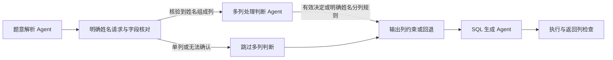

画布注册六个节点。图中的“跳过多列判断”表示多列节点本身的执行分支。

| 节点 | 类型 | 输入 | 输出与作用 |
|---|---|---|---|
| 题意解析 | LLM | 当侧题面、SQLite schema | 姓名用途、题面原文、候选表和列。空候选会交给字段工具继续核对。 |
| 明确姓名请求与字段核对 | SQLite 工具 | 题面、当侧库的实际字段、解析候选 | 对明确请求绑定唯一的实体表，输出单列或按顺序排列的姓名组成列，同时记录绑定依据。其他题面核对 Agent 候选。 |
| 多列处理判断 | 条件调用 LLM | 当侧题面、已核对列和用途 | 判断分列、组合查找、显式合并或回退。已明确的姓名输出在此节点无法给出决定时，规则补上分列决定。单列或无候选时跳过。 |
| 输出列约束或回退 | 程序规则 | 输出决定及已核对字段 | 把分列要求写成最终返回列及其顺序。单列直通和无可靠候选时给空提示。 |
| SQL 生成 | LLM | 当侧题面、schema、有效约束 | 生成一条 SQLite SQL，保留题面里的关联和筛选条件。 |
| 执行与返回列检查 | SQLite 工具 | SQL、返回列约定、当侧库 | 只读执行，返回列和行，并记录 SQL 是否满足分列约定。EX 用参考结果独立评分。 |


##### v2 原题页面实测、批测与扩展复测

本节的原题指最初挑选的第 6 题 `DB_DBcontent_equivalence-00125`，即查询既参观过 2009 年前开馆的博物馆，也参观过 2011 年后开馆的博物馆的访客姓名。原题的修复对象是扰动侧 `DB_DBcontent_equivalence-00125-post`，两个 Thinking 档合计 4/4 通过。干净侧 `pre` 作为配对检查，合计 4/4 通过。下表的 EX 和返回列均由 SQLite 重放核对。

| Thinking 档 | 题面 | EX | 返回列 | 两次平均总 token |
|---|---|---:|---|---:|
| none | pre | 2/2 | `Name` | 9547.0 |
| none | post | 2/2 | `first_name, last_name` | 19219.0 |
| high | pre | 2/2 | `Name` | 9602.0 |
| high | post | 2/2 | `first_name, last_name` | 23473.0 |

v1 原题 `high` 档 post 漏掉候选并返回一列。v2 在该档的两次请求均核验姓名组成列，分列输出后通过。
原题历次模型请求和 SQL 留在两次运行目录。[第一轮请求与评分](../results/task2/submission/完整批测记录.zip)（包内 `runs/task2-split-output-v2/repeat-1`） · [第二轮请求与评分](../results/task2/submission/完整批测记录.zip)（包内 `runs/task2-split-output-v2/repeat-2`） · [原题配置](../results/task2/submission/records/task2-split-output-v2/config.json)

原题 post 中，3/4 次多列 Agent 的输出未满足单一动作契约，由明确姓名分列规则接手。响应包括筛选和关联信息，部分还输出了多个 JSON 对象。这些运行确实使用了规则回退，并继续得到了正确的两列。

课程 Visual 实测重新连线、保存、刷新再重载预设。后端两个题面均通过，post 11271 token，pre 9639 token。
[画布](../results/task2/submission/canvas/06-v2.png) · [导出结构](../results/task2/submission/records/task2-split-output-v2/structure-v2.json) · [页面与课程后端记录](../results/task2/submission/records/task2-split-output-v2/browser-results.json)

原题通过后，再用 v1 已冻结的 8 对同类和 8 对混合题做扩展复测。匹配基线为本轮重新请求。这 16 对属于已有开发题回归。

| 题单 | 条件 | pre EX | post EX | 双侧通过 | 平均调用 | 平均输入 / 输出 / 总 token |
|---|---|---:|---:|---:|---:|---:|
| 同类 | 重跑基线 none | 5/8 | 3/8 | 2/8 | 1.00 | 5057.4 / 46.6 / 5104.1 |
| 同类 | 编排 v2 none | 5/8 | 2/8 | 2/8 | 2.44 | 15379.0 / 296.6 / 15675.6 |
| 同类 | 重跑基线 high | 5/8 | 2/8 | 2/8 | 1.00 | 4952.2 / 97.9 / 5050.1 |
| 同类 | 编排 v2 high | 5/8 | 2/8 | 2/8 | 2.44 | 15318.7 / 526.7 / 15845.4 |
| 混合 | 重跑基线 none | 7/8 | 5/8 | 5/8 | 1.00 | 5829.7 / 74.7 / 5904.4 |
| 混合 | 编排 v2 none | 7/8 | 5/8 | 5/8 | 2.06 | 11728.0 / 170.1 / 11898.1 |
| 混合 | 重跑基线 high | 7/8 | 6/8 | 6/8 | 1.00 | 5840.9 / 114.3 / 5955.2 |
| 混合 | 编排 v2 high | 7/8 | 7/8 | 7/8 | 2.12 | 13533.2 / 295.4 / 13828.7 |
| 扩展合计 | 重跑基线 none | 12/16 | 8/16 | 7/16 | 1.00 | 5443.6 / 60.7 / 5504.2 |
| 扩展合计 | 编排 v2 none | 12/16 | 7/16 | 7/16 | 2.25 | 13553.5 / 233.3 / 13786.8 |
| 扩展合计 | 重跑基线 high | 12/16 | 8/16 | 8/16 | 1.00 | 5396.5 / 106.1 / 5502.7 |
| 扩展合计 | 编排 v2 high | 12/16 | 9/16 | 9/16 | 2.28 | 14426.0 / 411.1 / 14837.0 |

| 题单 | 比较 | 修复 | 扰动误伤 | pre 回退 | 双侧通过净变化 | token 差中位数 |
|---|---|---:|---:|---:|---:|---:|
| 同类 | 重跑基线 none → 编排 v2 none | 0 | 0 | 0 | +0/8 | 10286.5 |
| 同类 | 重跑基线 high → 编排 v2 high | 0 | 0 | 0 | +0/8 | 7465.5 |
| 同类 | 重跑基线 none → 重跑基线 high | 0 | 0 | 0 | +0/8 | 33.5 |
| 同类 | 编排 v2 none → 编排 v2 high | 0 | 0 | 0 | +0/8 | 94.0 |
| 混合 | 重跑基线 none → 编排 v2 none | 0 | 0 | 0 | +0/8 | 4982.5 |
| 混合 | 重跑基线 high → 编排 v2 high | 1 | 0 | 0 | +1/8 | 5353.0 |
| 混合 | 重跑基线 none → 重跑基线 high | 1 | 0 | 0 | +1/8 | 50.5 |
| 混合 | 编排 v2 none → 编排 v2 high | 2 | 0 | 0 | +2/8 | 129.0 |
| 扩展合计 | 重跑基线 none → 编排 v2 none | 0 | 0 | 0 | +0/16 | 5391.5 |
| 扩展合计 | 重跑基线 high → 编排 v2 high | 1 | 0 | 0 | +1/16 | 5935.0 |
| 扩展合计 | 重跑基线 none → 重跑基线 high | 1 | 0 | 0 | +1/16 | 40.5 |
| 扩展合计 | 编排 v2 none → 编排 v2 high | 2 | 0 | 0 | +2/16 | 113.0 |

修复指基线前对后错变为双侧通过。扰动误伤指原本双侧通过变为仅前侧通过，pre 回退计所有原题侧对转错。

| 配对 | 题单 | 基线 none | v2 none | 基线 high | v2 high | v2 两档 pre/post 路径 |
|---|---|---|---|---|---|---|
| `DB_DBcontent_equivalence-00270` | 同类 | CW | CW | CW | CW | direct/split · direct/fallback |
| `DB_DBcontent_equivalence-00004` | 同类 | WW | WW | WW | WW | direct/fallback · direct/split |
| `DB_DBcontent_equivalence-00271` | 同类 | CW | CW | CW | CW | direct/fallback · direct/split |
| `DB_DBcontent_equivalence-00106` | 同类 | WC | WW | WW | WW | direct/fallback · direct/split |
| `DB_DBcontent_equivalence-00123` | 同类 | CC | CC | CC | CC | fallback/split · direct/split |
| `DB_DBcontent_equivalence-00320` | 同类 | CC | CC | CC | CC | direct/split · direct/split |
| `DB_DBcontent_equivalence-00117` | 同类 | WW | WW | WW | WW | direct/split · direct/split |
| `DB_DBcontent_equivalence-00289` | 同类 | CW | CW | CW | CW | direct/split · direct/split |
| `DB_DBcontent_equivalence-00176` | 混合 | CW | CW | CC | CC | fallback/fallback · fallback/fallback |
| `NLQ_column_attribute-00065` | 混合 | CW | CW | CW | CC | fallback/fallback · fallback/split |
| `DB_schema_synonym-00105` | 混合 | CC | CC | CC | CC | fallback/fallback · fallback/fallback |
| `NLQ_column_attribute-00036` | 混合 | WW | WW | WW | WW | fallback/fallback · fallback/fallback |
| `NLQ_column_value-00137` | 混合 | CC | CC | CC | CC | fallback/fallback · fallback/fallback |
| `NLQ_keyword_synonym-00426` | 混合 | CC | CC | CC | CC | fallback/fallback · fallback/fallback |
| `SQL_comparison-00010` | 混合 | CC | CC | CC | CC | fallback/fallback · fallback/fallback |
| `SQL_sort_order-00128` | 混合 | CC | CC | CC | CC | fallback/fallback · fallback/fallback |

扩展题的 64 个 v2 条件有 0 次触发新增的明确姓名绑定。这组扩展结果用于检查整套编排的开发回归。新增绑定的直接证据来自原题。

- `high` 档扩展新增的 1 对通过来自最早注册学生题。基线把三个姓名字段拼成一列，v2 的多列判断启用了分列，最终返回 `first_name`、`middle_name`、`last_name`。[基线](../results/task2/submission/records/task2-split-output-v2/extended-baseline/high/NLQ_column_attribute-00065-post/record.json) · [v2](../results/task2/submission/records/task2-split-output-v2/repeat-extended/high/NLQ_column_attribute-00065-post/record.json)
- `none` 档扩展有一次 post 对转错，来自教师家乡题。v2 走回退，SQL 生成请求与同档重跑基线逐字段一致。两次均返回姓名两列，差异发生在筛选字面值，基线保留了地名前后的空格，v2 的响应省略了空格。该对的 pre 在两组都未通过，所以双侧通过数维持不变。[基线](../results/task2/submission/records/task2-split-output-v2/extended-baseline/none/DB_DBcontent_equivalence-00106-post/record.json) · [v2](../results/task2/submission/records/task2-split-output-v2/repeat-extended/none/DB_DBcontent_equivalence-00106-post/record.json)

8 条原题评分和 128 条扩展评分已复核请求、响应和 SQLite 结果。Thinking 以服务请求档记录。
[扩展题单、代码与数据配置](../results/task2/submission/records/task2-split-output-v2/extended-config.json) · [重跑基线证据](../results/task2/submission/完整批测记录.zip)（包内 `runs/task2-split-output-v2/extended-baseline`） · [v2 扩展证据](../results/task2/submission/完整批测记录.zip)（包内 `runs/task2-split-output-v2/repeat-extended`） · [分层汇总与转移矩阵](../results/task2/submission/records/task2-split-output-v2/extended-summary.json)

#### v3 · SQL 初稿审查与一次修订

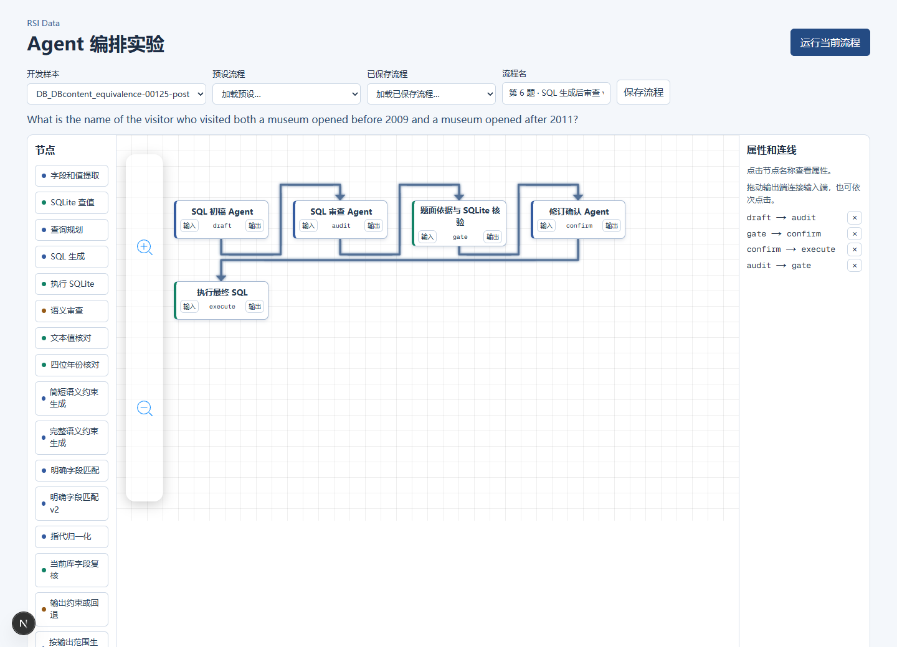

v3 将题目 `DB_DBcontent_equivalence-00125` 放回同一条通用审查流程。先生成一条 SQL 初稿，审查 Agent 从题面和当前 schema 判断是否存在明确冲突。每次审查至多提出一条修订。程序核对题面引文，并用 SQLite `EXPLAIN QUERY PLAN` 检查修订能否按只读查询解析。确认 Agent 决定是否接受可执行的修订。最终 SQL 确定并执行后，才对同一初稿和最终查询分别评分。这样两组共用同一次初稿生成。

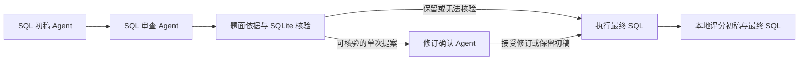

| 节点 | 类型 | 输入 | 作用与输出 |
|---|---|---|---|
| SQL 初稿 | LLM | 当前题面和 SQLite schema | 生成并保存初稿。 |
| SQL 审查 | LLM | 题面、schema、初稿、姓名输出约定 | 检查输出、筛选、关联、计数、去重和排序。输出保留决定，或指出一处冲突并附题面原文、理由和修订 SQL。 |
| 题面依据与 SQLite 核验 | 程序工具 | 审查提案、原题、当前 SQLite | 检查依据是否出现在题面、SQL 是否确实修改且能按只读查询编译。输出是否进入确认及原因。 |
| 修订确认 | 条件调用 LLM | 初稿、通过核验的修订和理由、当前题面与 schema | 确认修订能否解决明确冲突并保留无关语义。输出接受或保留初稿的决定。 |
| 执行最终 SQL | SQLite 工具 | 已确定的 SQL 和当前数据库 | 返回实际列和行。评分回路在此节点之后，EX 只写入运行记录。 |

审查和确认请求使用当前题面、schema 和由模型生成的 SQL。参考 SQL、标准结果和 EX 在本地评测，运行时各节点均不读取这些信息。姓名分列沿用 v1/v2 已定实验约定。SQL 编译核验只检查可执行性，语义是否实现仍由确认节点核对并在最后执行评分。

批测沿用第 6 题原题、v1 冻结的 8 对同类和 8 对混合原题。原题两侧在 Thinking `none/high` 各重复两次，扩展题各条件运行一次。记录每次保留、拒绝或接受提案、初稿与最终 EX、回退和 token。扩展题单用于开发回归。

##### v3 离线分支核验

使用已归档的 v1 基线 SQL 作为初稿，并给审查和确认节点提供预设响应，验证程序分支及 SQLite 执行。原题 pre 保留初稿并通过。post 的归档初稿将姓名拼成一列，预设审查只修改输出列。程序核验通过后执行修订，返回分开的姓名两列，执行判分通过。这次重放的新增模型调用为 0。[离线节点记录](../results/task2/submission/records/task2-split-output-v3/offline-replay.json)


##### v3 实测结果

初稿和最终 SQL 在流程结束后分别用 SQLite 重放。原题 8 次运行产生 16 条评分，扩展 64 次运行产生 128 条评分。

| 原题侧 | Thinking 档 | 初稿 EX | 最终 EX | 平均总 token 初稿 → 最终 |
|---|---|---:|---:|---:|
| pre | none | 2/2 | 2/2 | 6166.5 → 14125.5 |
| pre | high | 2/2 | 2/2 | 4714.5 → 9817.0 |
| post | none | 0/2 | 2/2 | 7734.5 → 19275.5 |
| post | high | 0/2 | 2/2 | 10803.5 → 25434.0 |

课程 Visual 的同一画布重新连线、保存、刷新并重载，再由 Spring Boot / RSI Flow 调用。

| 页面题面 | 初稿 EX | 最终 EX | 修订状态 | 模型调用 |
|---|---|---|---|---:|
| post | mismatch | match | accepted | 3 |
| pre | match | match | skipped | 2 |

[画布](../results/task2/submission/canvas/06-v3.png) · [导出结构](../results/task2/submission/records/task2-split-output-v3/structure-v3.json) · [浏览器记录](../results/task2/submission/records/task2-split-output-v3/browser-results.json)

| 题单 | 方法 | pre EX | post EX | 双侧通过 | 平均调用 | 平均输入 / 输出 / 总 token |
|---|---|---:|---:|---:|---:|---:|
| 同类 | 初稿 none | 5/8 | 0/8 | 0/8 | 1.00 | 4762.4 / 47.1 / 4809.5 |
| 同类 | v3 最终 none | 5/8 | 2/8 | 2/8 | 2.19 | 11358.5 / 141.6 / 11500.1 |
| 同类 | 初稿 high | 5/8 | 1/8 | 1/8 | 1.00 | 5132.1 / 119.4 / 5251.4 |
| 同类 | v3 最终 high | 5/8 | 3/8 | 3/8 | 2.19 | 13038.1 / 286.4 / 13324.5 |
| 混合 | 初稿 none | 7/8 | 5/8 | 5/8 | 1.00 | 6359.8 / 66.4 / 6426.2 |
| 混合 | v3 最终 none | 7/8 | 6/8 | 6/8 | 2.06 | 12367.9 / 154.8 / 12522.8 |
| 混合 | 初稿 high | 7/8 | 5/8 | 5/8 | 1.00 | 6359.8 / 124.5 / 6484.2 |
| 混合 | v3 最终 high | 7/8 | 5/8 | 5/8 | 2.12 | 13107.8 / 306.6 / 13414.4 |
| 扩展合计 | 初稿 none | 12/16 | 5/16 | 5/16 | 1.00 | 5561.1 / 56.8 / 5617.8 |
| 扩展合计 | v3 最终 none | 12/16 | 8/16 | 8/16 | 2.12 | 11863.2 / 148.2 / 12011.4 |
| 扩展合计 | 初稿 high | 12/16 | 6/16 | 6/16 | 1.00 | 5745.9 / 121.9 / 5867.8 |
| 扩展合计 | v3 最终 high | 12/16 | 8/16 | 8/16 | 2.16 | 13072.9 / 296.5 / 13369.4 |

| 题单 | Thinking 档 | 修复 | 扰动误伤 | pre 回退 | 双侧净变化 | 总 token 差中位数 |
|---|---|---:|---:|---:|---:|---:|
| 同类 | none | 2 | 0 | 0 | +2/8 | 4954.0 |
| 同类 | high | 2 | 0 | 0 | +2/8 | 7718.5 |
| 混合 | none | 1 | 0 | 0 | +1/8 | 4979.0 |
| 混合 | high | 0 | 0 | 0 | +0/8 | 5022.5 |
| 扩展合计 | none | 3 | 0 | 0 | +3/16 | 4956.5 |
| 扩展合计 | high | 2 | 0 | 0 | +2/16 | 5039.0 |

| 扩展配对 | 题单 | 初稿 none | 最终 none | 初稿 high | 最终 high |
|---|---|---|---|---|---|
| `DB_DBcontent_equivalence-00270` | 同类 | CW | CW | CW | CW |
| `DB_DBcontent_equivalence-00004` | 同类 | WW | WW | WW | WW |
| `DB_DBcontent_equivalence-00271` | 同类 | CW | CW | CW | CW |
| `DB_DBcontent_equivalence-00106` | 同类 | WW | WW | WW | WW |
| `DB_DBcontent_equivalence-00123` | 同类 | CW | CC | CW | CC |
| `DB_DBcontent_equivalence-00320` | 同类 | CW | CC | CW | CC |
| `DB_DBcontent_equivalence-00117` | 同类 | WW | WW | WW | WW |
| `DB_DBcontent_equivalence-00289` | 同类 | CW | CW | CC | CC |
| `DB_DBcontent_equivalence-00176` | 混合 | CW | CW | CW | CW |
| `NLQ_column_attribute-00065` | 混合 | CW | CC | CW | CW |
| `DB_schema_synonym-00105` | 混合 | CC | CC | CC | CC |
| `NLQ_column_attribute-00036` | 混合 | WW | WW | WW | WW |
| `NLQ_column_value-00137` | 混合 | CC | CC | CC | CC |
| `NLQ_keyword_synonym-00426` | 混合 | CC | CC | CC | CC |
| `SQL_comparison-00010` | 混合 | CC | CC | CC | CC |
| `SQL_sort_order-00128` | 混合 | CC | CC | CC | CC |

扩展修订分支计数为 `{('keep', 'skipped'): 55, ('eligible', 'accepted'): 8, ('eligible', 'rejected'): 1}`。两个 Thinking 值为服务请求档。

- **扩展题接受了 8 次修订，其中 5 次由错转对。** 两档都修好了博物馆会员题和工作年限最长的指挥家题。最早注册学生题在 none 档从拼接全名改为分开返回三列。两档共 5 次 EX 改善都来自输出列调整。
- **确认节点也可能保留错误。** 最早注册学生题在 high 档提出分列，确认 Agent 将题面的“full name”理解为要求一列并拒绝提案，因此保留了执行评分未通过的初稿。家乡筛选题在两档都改对了姓名分列，但字面值匹配仍未通过。混合题另有一次已正确的初稿被加上 `DISTINCT` 后仍通过，这次得分相同无法证明变更在其他数据上等价。 [逐条件决定](../results/task2/submission/records/task2-split-output-v3/conditions.json)
[配置](../results/task2/submission/records/task2-split-output-v3/config.json) · [本轮汇总](../results/task2/submission/records/task2-split-output-v3/summary.json) · [逐条件决定](../results/task2/submission/records/task2-split-output-v3/conditions.json)

### 第 7 题 · Top N 重复行占名额

Top N 由 3 增至 5，未按结果单位去重，重复的姓名和排名组合占了一个名额。

v2 的解析结果仍保留在运行记录中。库字段核验接收预设口径与题面，返回存在的列、N 和重复探针。分支输出组合键和排序约束，生成节点返回 SQL，执行节点按画布约定核对实际结果。

#### Top N 结果单位与澄清分支

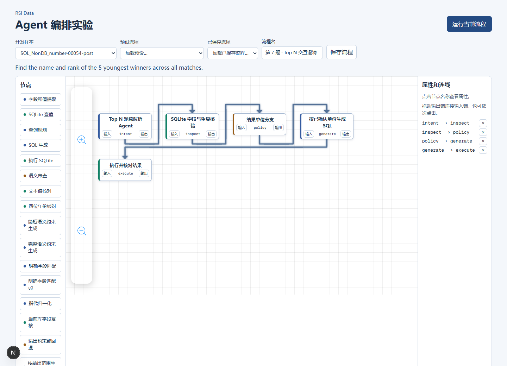

原题 `SQL_NonDB_number-00054` 把年龄最小的获胜者条数从 3 改为 5。按比赛行直接取前 5 时，`(Madison Keys, 12)` 占两个位置。官方参考答案按「姓名与排名组合」区分结果，题面也可以理解为五位不同选手。按姓名合并会丢掉参考中同一选手的其他排名。

我确定的结构先识别结果单位，再依据明确口径生成 SQL。批测回退到原 SQL 生成提示。交互预设在识别到语义歧义时返回澄清问题。两种预设使用同一组五个画布节点，实际分支由第三个节点的输出控制。

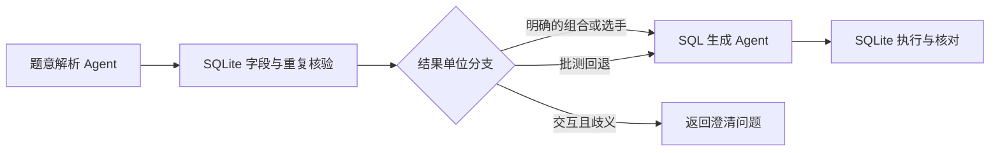

澄清路径依然经过课程引擎注册的生成和执行节点。生成节点传递澄清状态，执行节点回传该状态。这一分支只调用题意解析 Agent。

| 节点 | 类型与作用 | 输入 | 输出 |
|---|---|---|---|
| `intent` | LLM Agent，提取单表 Top N 意图 | 当侧题面、SQLite schema | 候选表、返回列、排序列与方向、N、口径、候选实体键和题面短语 |
| `inspect` | SQLite 工具，验证候选字段与观测重复 | 意图候选、当侧题面和 SQLite | 校验后的表列、组合重复及年龄值多样性，或验证失败原因 |
| `policy` | 程序分支，检查题面是否明确口径 | 核验输出、批测或交互预设 | 按组合、按实体、批测回退或交互澄清；重复观测仅作为事实记录 |
| `generate` | LLM Agent，按确认的口径生成 SQL | 当侧题面、schema、可用的去重与排序约束 | SQL、实际路径，或澄清状态 |
| `execute` | SQLite 工具，只读执行并记录结果检查 | SQL、当前库、确认的列与条数 | 结果行列、最多 N 与组合重复检查，或执行错误、澄清信息 |

按组合的约束要求先分组，以每组最小或最大排序值排序，再限制条数。按实体的约束要求每个核验过的实体键保留一条完整记录，并沿用题面指定的并列规则。程序核对字段是否存在及显式短语是否来自题面。实体 ID 可以留在查询内部，因此最终可见的列适用于核对列数和条数，实体粒度仍要核对 SQL 与参考执行结果。

固定题单为原题 1 对、历史同类 1 对、自制明确口径 2 对、混合开发回归 8 对。自制题使用相同库，分别写明「不同姓名与排名组合」和「按选手 ID 每人一条」，各测 N=3 和 N=5。同类取另一个原题的历史变体。混合组复用第 8 题比较的非目标样本。所有基线和批测编排均交叉提交 `reasoning_effort=none/high`。原题还单独测试交互预设。交互澄清单列为行为结果。历史原题均有项目暴露记录，自制题共用原题数据库与内容，结论限于开发和回归。

[冻结题单](../results/task2/submission/records/task2-top-n-v1/plan.json) · [两种画布结构 JSON](../results/task2/submission/records/task2-top-n-v1/structure.json) · [节点实现](../task2-rsi-data/experiment/top_n_canvas.py)

##### 原题页面实测

| 样本 | 预设 | 实际分支 | 评分或状态 | 模型调用 | 总 token |
|---|---|---|---|---:|---:|
| `SQL_NonDB_number-00054-post` | top_n_interactive | clarification | clarification | 1 | 5027 |
| `SQL_NonDB_number-00054-pre` | top_n | fallback | match | 2 | 12633 |
| `SQL_NonDB_number-00054-post` | top_n | fallback | mismatch | 2 | 9820 |
| `top-n-pair-post` | top_n | fallback | match | 2 | 9936 |
| `top-n-person-post` | top_n | person | mismatch | 2 | 13105 |

[画布](../results/task2/submission/canvas/07-v1.png) · [澄清结果](../results/task2/submission/records/task2-top-n-v1/clarification.png) · [按组合结果](../results/task2/submission/records/task2-top-n-v1/top-n-pair-post.png) · [按选手结果](../results/task2/submission/records/task2-top-n-v1/top-n-person-post.png) · [浏览器提交与课程引擎响应](../results/task2/submission/records/task2-top-n-v1/browser-results.json)

##### 固定题单与 Thinking 比较

批测生成了 96 条基线或编排评分，另记录 4 条原题交互行为。共 148 次取得响应的模型调用。其中 45 条回退路径的 SQL 生成请求与同题同档基线逐字段相同。接口返回非空系统指纹 0/148 次，Thinking 档位按请求记录。

| 范围 | 条件 | pre EX | post EX | 双侧通过 | 平均调用/侧 | 平均总 token/侧及覆盖 |
|---|---|---:|---:|---:|---:|---:|
| 原题 | baseline none | 1/1 | 0/1 | 0/1 | 1.00 | 7711.0（2/2） |
| 原题 | canvas none | 1/1 | 0/1 | 0/1 | 2.00 | 9856.5（2/2） |
| 原题 | baseline high | 1/1 | 0/1 | 0/1 | 1.00 | 7779.5（2/2） |
| 原题 | canvas high | 1/1 | 0/1 | 0/1 | 2.00 | 10005.5（2/2） |
| 历史同类 | baseline none | 1/1 | 0/1 | 0/1 | 1.00 | 4754.0（2/2） |
| 历史同类 | canvas none | 1/1 | 0/1 | 0/1 | 2.00 | 14232.0（2/2） |
| 历史同类 | baseline high | 1/1 | 0/1 | 0/1 | 1.00 | 4856.0（2/2） |
| 历史同类 | canvas high | 1/1 | 0/1 | 0/1 | 2.00 | 14361.0（2/2） |
| 明确组合 | baseline none | 1/1 | 1/1 | 1/1 | 1.00 | 4833.5（2/2） |
| 明确组合 | canvas none | 1/1 | 1/1 | 1/1 | 2.00 | 10025.0（2/2） |
| 明确组合 | baseline high | 1/1 | 1/1 | 1/1 | 1.00 | 4862.0（2/2） |
| 明确组合 | canvas high | 1/1 | 1/1 | 1/1 | 2.00 | 10175.5（2/2） |
| 明确选手 | baseline none | 0/1 | 0/1 | 0/1 | 1.00 | 4919.0（2/2） |
| 明确选手 | canvas none | 0/1 | 0/1 | 0/1 | 2.00 | 11672.0（2/2） |
| 明确选手 | baseline high | 0/1 | 0/1 | 0/1 | 1.00 | 5265.0（2/2） |
| 明确选手 | canvas high | 0/1 | 0/1 | 0/1 | 2.00 | 13178.5（2/2） |
| 混合回归 | baseline none | 6/8 | 6/8 | 6/8 | 1.00 | 6050.3（16/16） |
| 混合回归 | canvas none | 6/8 | 6/8 | 6/8 | 2.00 | 12233.4（16/16） |
| 混合回归 | baseline high | 6/8 | 6/8 | 6/8 | 1.00 | 6089.2（16/16） |
| 混合回归 | canvas high | 6/8 | 6/8 | 6/8 | 2.00 | 12919.7（16/16） |
| 全体开发对照 | baseline none | 9/12 | 7/12 | 7/12 | 1.00 | 5885.0（24/24） |
| 全体开发对照 | canvas none | 9/12 | 7/12 | 7/12 | 2.00 | 11971.0（24/24） |
| 全体开发对照 | baseline high | 9/12 | 7/12 | 7/12 | 1.00 | 5956.3（24/24） |
| 全体开发对照 | canvas high | 9/12 | 7/12 | 7/12 | 2.00 | 12589.8（24/24） |

| 范围 | 档位 | post 错转对 | post 对转错 | pre 对转错 | 双侧通过净数 |
|---|---|---:|---:|---:|---:|
| 原题 | none | 0 | 0 | 0 | +0 |
| 原题 | high | 0 | 0 | 0 | +0 |
| 历史同类 | none | 0 | 0 | 0 | +0 |
| 历史同类 | high | 0 | 0 | 0 | +0 |
| 明确组合 | none | 0 | 0 | 0 | +0 |
| 明确组合 | high | 0 | 0 | 0 | +0 |
| 明确选手 | none | 0 | 0 | 0 | +0 |
| 明确选手 | high | 0 | 0 | 0 | +0 |
| 混合回归 | none | 0 | 0 | 0 | +0 |
| 混合回归 | high | 0 | 0 | 0 | +0 |
| 全体开发对照 | none | 0 | 0 | 0 | +0 |
| 全体开发对照 | high | 0 | 0 | 0 | +0 |

##### 原题与明确口径对照的逐条路径

| 样本 | Thinking | 基线 | 编排 | 分支 |
|---|---|---|---|---|
| `SQL_NonDB_number-00054-pre` | none | 通过 | 通过 | [fallback](../results/task2/submission/records/task2-top-n-v1/records/canvas/none/SQL_NonDB_number-00054-pre.json) |
| `SQL_NonDB_number-00054-pre` | high | 通过 | 通过 | [fallback](../results/task2/submission/records/task2-top-n-v1/records/canvas/high/SQL_NonDB_number-00054-pre.json) |
| `SQL_NonDB_number-00054-post` | none | mismatch | mismatch | [fallback](../results/task2/submission/records/task2-top-n-v1/records/canvas/none/SQL_NonDB_number-00054-post.json) |
| `SQL_NonDB_number-00054-post` | high | mismatch | mismatch | [fallback](../results/task2/submission/records/task2-top-n-v1/records/canvas/high/SQL_NonDB_number-00054-post.json) |
| `SQL_NonDB_number-00061-pre` | none | 通过 | 通过 | [fallback](../results/task2/submission/records/task2-top-n-v1/records/canvas/none/SQL_NonDB_number-00061-pre.json) |
| `SQL_NonDB_number-00061-pre` | high | 通过 | 通过 | [fallback](../results/task2/submission/records/task2-top-n-v1/records/canvas/high/SQL_NonDB_number-00061-pre.json) |
| `SQL_NonDB_number-00061-post` | none | mismatch | mismatch | [fallback](../results/task2/submission/records/task2-top-n-v1/records/canvas/none/SQL_NonDB_number-00061-post.json) |
| `SQL_NonDB_number-00061-post` | high | mismatch | mismatch | [fallback](../results/task2/submission/records/task2-top-n-v1/records/canvas/high/SQL_NonDB_number-00061-post.json) |
| `top-n-pair-pre` | none | 通过 | 通过 | [fallback](../results/task2/submission/records/task2-top-n-v1/records/canvas/none/top-n-pair-pre.json) |
| `top-n-pair-pre` | high | 通过 | 通过 | [fallback](../results/task2/submission/records/task2-top-n-v1/records/canvas/high/top-n-pair-pre.json) |
| `top-n-pair-post` | none | 通过 | 通过 | [fallback](../results/task2/submission/records/task2-top-n-v1/records/canvas/none/top-n-pair-post.json) |
| `top-n-pair-post` | high | 通过 | 通过 | [fallback](../results/task2/submission/records/task2-top-n-v1/records/canvas/high/top-n-pair-post.json) |
| `top-n-person-pre` | none | mismatch | execution_error | [fallback](../results/task2/submission/records/task2-top-n-v1/records/canvas/none/top-n-person-pre.json) |
| `top-n-person-pre` | high | mismatch | mismatch | [person](../results/task2/submission/records/task2-top-n-v1/records/canvas/high/top-n-person-pre.json) |
| `top-n-person-post` | none | mismatch | mismatch | [person](../results/task2/submission/records/task2-top-n-v1/records/canvas/none/top-n-person-post.json) |
| `top-n-person-post` | high | mismatch | mismatch | [person](../results/task2/submission/records/task2-top-n-v1/records/canvas/high/top-n-person-post.json) |

原题交互预设的结果如下。澄清是一项流程行为，单独记录。

| 原题 | Thinking | 实际行为 | 模型调用 |
|---|---|---|---:|
| `SQL_NonDB_number-00054-pre` | none | [clarification](../results/task2/submission/records/task2-top-n-v1/records/interactive/none/SQL_NonDB_number-00054-pre.json) | 1 |
| `SQL_NonDB_number-00054-pre` | high | [clarification](../results/task2/submission/records/task2-top-n-v1/records/interactive/high/SQL_NonDB_number-00054-pre.json) | 1 |
| `SQL_NonDB_number-00054-post` | none | [clarification](../results/task2/submission/records/task2-top-n-v1/records/interactive/none/SQL_NonDB_number-00054-post.json) | 1 |
| `SQL_NonDB_number-00054-post` | high | [clarification](../results/task2/submission/records/task2-top-n-v1/records/interactive/high/SQL_NonDB_number-00054-post.json) | 1 |

[运行配置](../results/task2/submission/records/task2-top-n-v1/config.json) · [全部逐题评分](../results/task2/submission/完整批测记录.zip)（包内 `runs/task2-top-n-v1/records`） · [原始模型请求和响应](../results/task2/submission/完整批测记录.zip)（包内 `runs/task2-top-n-v1/requests`）

##### 补充措辞对照

固定 v1 画布和同一参考 SQL，另跑两个 post 问法，明确只显示姓名和排名。组合问法同时把结果单位改写为较直接的 distinct pairs 表达。此补测单列。

| 问法 | Thinking | 基线 | 编排 | 实际路由 |
|---|---|---|---|---|
| `top-n-pair-post` | none | 通过 | 通过 | [tuple](../results/task2/submission/records/task2-top-n-v1/wording/top-n-pair-post/canvas/none/record.json) |
| `top-n-pair-post` | high | 通过 | 通过 | [tuple](../results/task2/submission/records/task2-top-n-v1/wording/top-n-pair-post/canvas/high/record.json) |
| `top-n-person-post` | none | execution_error | 通过 | [person](../results/task2/submission/records/task2-top-n-v1/wording/top-n-person-post/canvas/none/record.json) |
| `top-n-person-post` | high | 通过 | 通过 | [fallback](../results/task2/submission/records/task2-top-n-v1/wording/top-n-person-post/canvas/high/record.json) |

[补测题面](../results/task2/submission/records/task2-top-n-v1/wording/questions.json) · [补测请求与响应](../results/task2/submission/完整批测记录.zip)（包内 `runs/task2-top-n-v1/wording`）

##### 失败归因和下一版的验证点

- 原题与历史同类的批测 post 在两个档位都错。原题两侧在交互模式四次均输出「前 N 项是指 N 位不同的选手，还是 N 个不同的姓名和排名组合？」。批测按设计回退，因此无法从含歧义的原题稳定得到官方指定的组合。澄清后的口径由两种明确问法分别覆盖。
- 第一组明确组合问法四次均通过，但解析 Agent 把「每组记录的最低年龄」当成超范围聚合，四次都返回空候选。通过来自回退生成，属于识别漏检。正文补测的两种 Thinking 档均进入组合分支并通过。
- 第一组按选手问法的编排四次都未通过。三次进入按人分支，选手 ID 混进了输出字段，SQL 返回三列。一次回退 SQL 引用了不存在的物理列 `age`。补测明确要求只返回姓名和排名，两个档位均通过。其中 `none` 进入按人分支，高档仍回退。第 7 题 v1 尚未稳定区分内部用于分组的键与最终要显示的字段。
- 冻结题单上两档均无新增修复或回退，双侧通过均为 7/12。平均模型调用从 1 次变为 2 次，两个档位的平均总 token 分别增加 6086.0 和 6633.5。当前数据支持交互澄清的作用。批测的额外解析成本有完整记录。

运行基点为 `2916e4d560330c9aa467f635f001d896fb1d6f0d`。结构、提示及运行代码用冻结题单中的 SHA-256 记录。课程画布使用本地 Visual 和 Spring Boot，经五个已注册事件运行。批测复用同一节点函数。两种明确问法的参考 SQL 只在本地评分使用。

#### 原题修复 v2


v2 只运行这对原开发题，同类与混合结果沿用上面单列的 v1 记录。

第 7 题原题预设采用人工指定的结果单位「获胜者姓名和比赛时的排名组合」。预设限定到原题 `SQL_NonDB_number-00054` 的两个题面。原题的两个 N 都从当前题面读取，SQLite 核对列存在并探查组合重复。交互澄清和批测回退仍可从各自预设选择。

五节点依次为题意解析 Agent、库字段核验、结果单位分支、SQL 生成 Agent、SQLite 执行与核对。核验节点保留题意 Agent 的候选记录，同时使用画布声明的组合去重口径。分支向生成节点提供两个输出列、年龄升序和 N。执行节点把模型结果与按已确认口径计算的结果逐行比较，遇到不一致时采用程序生成的只读查询。该检查使用当侧 SQLite 数据与画布口径，官方参考查询用于实验评分。

回退的单元测试复现了 `12、12` 占位，程序查询补回 `9`。以下六次实测均由模型生成的 SQL 直接通过口径核对。

| 题侧 | 运行条件 | 实际排名序列 | EX | 总 token | 证据 |
|---|---|---|---:|---:|---|
| pre | none | 17、24、16 | 通过 | 15975 | [运行记录](../results/task2/submission/records/task2-top-n-original-v2/none/SQL_NonDB_number-00054-pre/record.json) |
| post | none | 17、24、16、12、9 | 通过 | 9900 | [运行记录](../results/task2/submission/records/task2-top-n-original-v2/none/SQL_NonDB_number-00054-post/record.json) |
| pre | high | 17、24、16 | 通过 | 16434 | [运行记录](../results/task2/submission/records/task2-top-n-original-v2/high/SQL_NonDB_number-00054-pre/record.json) |
| post | high | 17、24、16、12、9 | 通过 | 10001 | [运行记录](../results/task2/submission/records/task2-top-n-original-v2/high/SQL_NonDB_number-00054-post/record.json) |
| pre | 页面实测 | 17、24、16 | 通过 | 16141 | [运行记录](../results/task2/submission/records/task2-top-n-original-v2/browser-results.json) |
| post | 页面实测 | 17、24、16、12、9 | 通过 | 9951 | [运行记录](../results/task2/submission/records/task2-top-n-original-v2/browser-results.json) |

两个 Thinking 档均把原题从「pre 通过、post 未通过」修为双侧通过。本次验收覆盖这对原题。采用明确去重口径的结果记录为原题修复。

[画布](../results/task2/submission/canvas/07-v2.png) · [pre](../results/task2/submission/records/task2-top-n-original-v2/pre.png) · [post](../results/task2/submission/records/task2-top-n-original-v2/post.png) · [结构 JSON](../results/task2/submission/records/task2-top-n-original-v2/structure.json) · [运行配置](../results/task2/submission/records/task2-top-n-original-v2/config.json)

#### 通用 Top N 结果单位 v3

v3 增加了可复用的单表 Top N 预设。题意 Agent 分别提取结果单位、用于区分结果的键、最终显示列、排序列和 N。按实体保留每个 ID 的最佳一条完整记录，按字段组合用组内极值排序，按原始记录保留合法重复。原题预设另有已确认的比赛口径，可单独复现 v2 的原题修复。


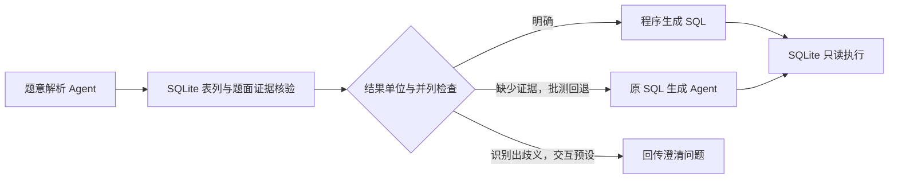

| 节点 | 类型 | 输入 | 输出 |
|---|---|---|---|
| 题意解析 | 条件调用 LLM | 当侧题面、schema | 结果单位、去重键、显示列、排序字段与方向、N、题面证据 |
| 核验 | 程序读取 SQLite | 解析计划、当前库与题面 | 已核验的表列与口径、歧义或回退原因 |
| 分支 | 程序与 SQLite 工具 | 核验结果、交互模式、候选排序 | 检查代表行与第 N 项并列，输出确定的 SQL 计划、回退或澄清 |
| SQL 生成 | 程序模板或 LLM | 已核验计划，或原题面和 schema | SQL 或澄清状态 |
| 执行 | SQLite 工具 | SQL、当前数据库 | 实际结果、路由、执行状态。参考 SQL 用于生成后的 EX 评分 |

题单在运行前固定。12 对历史对照沿用 v1 的题面与数据库，另有 6 对合成对照来自车手圈速和订单两套表结构。合成题中的 5 对明确声明按实体、按组合或按原始记录，另 1 对刻意保留歧义。歧义合成题的 EX 参考预先采用按实体的解释，澄清行为另行计数。共记录 144 个基线或 v3 配对评分条件和 8 个独立交互条件。基线本轮重新请求。53 次回退生成逐字段与匹配基线相同，使用同一份本轮模型响应。流程的 token 和调用成本按节点使用量计入。152 个条件共取得 126 次新模型响应。[冻结题单](../results/task2/submission/records/task2-top-n-v3/plan.json) · [运行配置](../results/task2/submission/records/task2-top-n-v3/config.json)

| 题单 | Thinking | pre EX 基线 → v3 | post EX 基线 → v3 | 双侧通过 基线 → v3 | post 修复 / 回退 | v3 平均调用／题面 | 平均总 token 基线 → v3 |
|---|---|---:|---:|---:|---:|---:|---:|
| 历史 12 对 | none | 9/12 → 10/12 | 7/12 → 7/12 | 7/12 → 7/12 | 0 / 0 | 1.33 | 5510.6 → 7538.9 |
| 历史 12 对 | high | 9/12 → 10/12 | 7/12 → 8/12 | 7/12 → 8/12 | 1 / 0 | 1.29 | 5896.5 → 7776.9 |
| 历史混合 8 对 | none | 6/8 → 6/8 | 6/8 → 6/8 | 6/8 → 6/8 | 0 / 0 | 1.19 | 5851.9 → 6830.1 |
| 历史混合 8 对 | high | 6/8 → 6/8 | 6/8 → 6/8 | 6/8 → 6/8 | 0 / 0 | 1.19 | 6263.1 → 7282.1 |
| 合成明确口径 5 对 | none | 2/5 → 5/5 | 3/5 → 5/5 | 2/5 → 5/5 | 2 / 0 | 1.40 | 5669.8 → 8209.0 |
| 合成明确口径 5 对 | high | 2/5 → 5/5 | 3/5 → 5/5 | 2/5 → 5/5 | 2 / 0 | 1.20 | 5171.9 → 7179.1 |
| 全部 18 对 | none | 11/18 → 15/18 | 10/18 → 12/18 | 9/18 → 12/18 | 2 / 0 | 1.39 | 5499.3 → 7980.1 |
| 全部 18 对 | high | 11/18 → 15/18 | 10/18 → 13/18 | 9/18 → 13/18 | 3 / 0 | 1.31 | 5622.8 → 7875.6 |

批测中，两个档位的 pre 都没有从通过变为失败。原题在两档批测中均为 pre 通过、post 未通过。8 个交互诊断条件有 6 次发出澄清，原题占 4 次。剩余两次是合成歧义题，Agent 倾向按实体理解，校验拒绝该计划后走回退。明确口径的合成题面虽然两个档位均为 10/10 通过，但实际进入模板分支的是 6/10 和 8/10。其余通过来自基线回退。[汇总与逐题评分](../results/task2/submission/records/task2-top-n-v3/summary.json) · [原始请求和分支记录](../results/task2/submission/records/task2-top-n-v3/records.zip)

| 页面实测样本 | 路由 | EX 或状态 | 观察 |
|---|---|---|---|
| 原题 post 交互预设 | 回退 | 未通过 | Agent 将 winners 解析为实体，给出的原文证据不足。核验拒绝该口径，但这次运行未发出澄清 |
| 圈速原始记录 post | 原始记录 | 通过 | 保留两条同名同赛道的记录 |
| 圈速按实体 post | 回退 | 未通过 | 将题面的 3 误提为 5，核验拒绝模板计划。回退 SQL 未达到参考结果 |
| 订单按组合 post | 组合 | 通过 | 按姓名和商品类别分组，以组内最大金额降序取前 4 |

课程 Visual 的四次运行均经过五个课程引擎节点。批测的圈速按实体条件两个档位都通过，课程 Visual 仍观察到解析波动。订单的实体和组合问法另有多次回退，触发原因包括误标不支持、把两段非连续证据连写和提错 N。合成明确口径的修复贡献了整体净提升的大部分。历史混合组继续保持 6/8，额外解析仍有 token 成本。[Visual 运行记录](../results/task2/submission/records/task2-top-n-v3/browser-results.json) · [圈速结果](../results/task2/submission/records/task2-top-n-v3/lap-rows-post.png) · [订单结果](../results/task2/submission/records/task2-top-n-v3/sale-tuple-post.png)

#### Top N 候选规则与自动回退 v4

v4 把结果单位变成 Agent 的有限选项。题面明确提出不同实体、不同组合、原始记录时，优先按该要求选规则。对于明确跨全部事件查询、同时请求实体名称及随事件而变化的属性的题，Agent 可以选择跨事件组合。选择不到可核验的规则时，流程自动用原 SQL 生成提示回退。课程 Visual 预设为 `top_n_v4`。[节点实现](../task2-rsi-data/experiment/top_n_v4.py)

| 候选规则 | 适用依据 | 生成 SQL 的对应操作 |
|---|---|---|
| 按实体 | 题面要求不同实体或每个实体一项 | 按核验后的 ID 分组并选每个实体的代表行。输出仅包含题目要求的列 |
| 按组合 | 题面明确要求不同字段组合 | 按显示字段组合分组，用组内极值排序 |
| 按记录 | 题面明确要求比赛、交易等原始记录 | 对原始记录排序，保留合法重复 |
| 跨事件组合 | 题面明确横跨全部事件，显示实体名称与事件属性，SQLite 确认 ID 与名称的对应关系、属性可变及组合重复 | 按名称与事件属性去重。题面已经明确要求按实体或按记录时，程序拒绝这条缺省规则 |
| 自动回退 | 口径、范围、列或排序证据无法核验 | 采用同题同档基线 SQL 生成 |

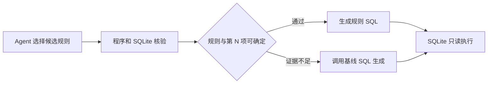

| 节点 | 类型与作用 | 输入 | 输出 |
|---|---|---|---|
| 规则选择 | LLM，按限定选项解析 | 当侧题面、schema、规则说明 | 规则、ID 或组合、显示列、排序、N、连续原文 |
| 规则核验 | 程序与 SQLite | Agent 候选、题面和当前库 | 可执行的规则计划或回退原因。能唯一识别明显 Top N 语句时，数量取自题面 |
| 分支 | 程序与 SQLite | 规则计划和排序字段 | 核对代表行与第 N 项并列，输出模板 SQL 或回退 |
| SQL 生成 | 模板或原 LLM 入口 | 通过的计划，或题目和 schema | 可执行 SQL |
| 只读执行 | SQLite 工具 | SQL 和当前题面的数据库 | 结果行列、选用规则和执行状态 |

跨事件组合是一个有适用条件的默认解释。库里的身份映射和重复值能验证这种执行方式有意义。它是否符合新题的意图由对照测试检验。本轮沿用 v3 的 18 对固定题单，包括原题、历史同类、明确口径对照、合成题和 8 对混合题。真实模型批测的两档条件均已冻结。[v4 题单与代码指纹](../results/task2/submission/records/task2-top-n-v4/plan.json) · [v3 同题单输入](../results/task2/submission/records/task2-top-n-v3/plan.json)

##### 离线规则与回退验证

在相同的 18 对题上执行了 72 个离线条件。规则选择节点使用固定测试输入，回退时回放逐字段匹配的既有基线响应。该检查覆盖程序核验、SQL 生成和 SQLite 执行。下方的两档配对复测检验了 Agent 自动选择规则后的实际结果。

| 题组 | 离线结果 | 核验点 |
|---|---:|---|
| 原题 1 对 | 4/4 | 选定跨事件组合后，两侧均通过，`post` 排名为 17、24、16、12、9 |
| 历史同类 1 对 | 4/4 | 选定同一规则后，`three/six` 与 `names/ranks` 的表述也通过 |
| 明确口径 7 对 | 28/28 | 按实体、按组合和按记录均走各自的规则 SQL |
| 混合 8 对 | 24/32 | 固定为无法选出规则，逐字段匹配基线请求后回放同档响应 |
| 合成歧义 1 对 | 0/4 | 未选到规则，完整走原生成回退，沿用既定 EX 参考 |

离线逐题核验保存在证据包内的 `offline.json`。[离线与批测证据包](../results/task2/submission/records/task2-top-n-v4/records.zip)

##### 真实 Agent 配对复测

使用 `gpt-6-sol` 对同一批 18 对题在 `reasoning_effort=none/high` 两档运行 v4，得到 72 个条件。46 次选择规则的请求取得新响应，44 次回退复用逐字段相同的同题同档基线响应。逻辑流程的调用数与 token 仍计入这些回退请求。所有 SQL 已在同侧 SQLite 重执行，评分与保存结果一致。证据包中的 `records/` 按档位和题目编号组织。[运行配置](../results/task2/submission/records/task2-top-n-v4/config.json) · [逐题请求、响应和评分](../results/task2/submission/records/task2-top-n-v4/records.zip)

| 题组 | Thinking | 基线双侧 | v3 双侧 | v4 pre | v4 post | v4 双侧 | v4 相对基线 post 修复 / 回退 |
|---|---|---:|---:|---:|---:|---:|---:|
| 原题 1 对 | none | 0/1 | 0/1 | 1/1 | 1/1 | 1/1 | 1 / 0 |
| 原题 1 对 | high | 0/1 | 0/1 | 1/1 | 1/1 | 1/1 | 1 / 0 |
| 历史同类 1 对 | none | 0/1 | 0/1 | 1/1 | 0/1 | 0/1 | 0 / 0 |
| 历史同类 1 对 | high | 0/1 | 0/1 | 1/1 | 1/1 | 1/1 | 1 / 0 |
| 历史混合 8 对 | none | 6/8 | 6/8 | 6/8 | 6/8 | 6/8 | 0 / 0 |
| 历史混合 8 对 | high | 6/8 | 6/8 | 6/8 | 6/8 | 6/8 | 0 / 0 |
| 历史全体 12 对 | none | 7/12 | 7/12 | 9/12 | 8/12 | 8/12 | 1 / 0 |
| 历史全体 12 对 | high | 7/12 | 8/12 | 9/12 | 9/12 | 9/12 | 2 / 0 |
| 合成明确口径 5 对 | none | 2/5 | 5/5 | 5/5 | 4/5 | 4/5 | 1 / 0 |
| 合成明确口径 5 对 | high | 2/5 | 5/5 | 5/5 | 5/5 | 5/5 | 2 / 0 |
| 全部 18 对 | none | 9/18 | 12/18 | 14/18 | 12/18 | 12/18 | 2 / 0 |
| 全部 18 对 | high | 9/18 | 13/18 | 14/18 | 14/18 | 14/18 | 4 / 0 |

相对基线，两档 pre 均为 0 回退。相对 v3，两档各出现 1 次 pre 和 1 次 post 回退。总题单平均模型调用/题面在 none 档为基线 1.00、v3 1.39、v4 1.31，在 high 档为基线 1.00、v3 1.31、v4 1.19。平均总 token 在 none 档为 **5499.3 → 7980.1 → 8403.0**，在 high 档为 **5622.8 → 7875.6 → 8552.4**。调用次数下降与平均输入成本上升同时出现。[指标准备与复核结果](../results/task2/submission/records/task2-top-n-v4/summary.json)

| 课程 Visual 样本 | 实际路由 | EX | 总 token |
|---|---|---|---:|
| 原题 pre | 跨事件组合 | 通过 | 12444 |
| 原题 post | 跨事件组合 | 通过 | 5245 |
| 圈速按实体 post | 按实体 | 通过 | 4974 |
| 圈速歧义 post | 自动回退 | 未通过 | 15610 |


- **原题两档 post 和 Visual post 都自动选择跨事件组合。** `SQL_NonDB_number-00054-post` 返回排名 `17、24、16、12、9`。原题 high 的 pre 给出了题面未指定的 ID 次排序，核验后回退，执行仍通过。
- **历史同类在 none 档仍有失败。** `SQL_NonDB_number-00061-post` 的 Agent 选中跨事件组合，却将 `names and ranks` 填入事件范围证据字段，程序回退，重复仍占名额。high 提供事件范围证据，六项去重结果通过。
- **回退与显示列核验仍有缺口。** `top-n-person-post` 的 high 请求把引用中的 `one row per player ID` 也当成显示 ID 的依据，导致多返回一列。`lap-tuple-post` 的 none 请求加入了未要求的次排序列，回退后也未通过。这两条属于相对 v3 的 post 回退。

跨事件组合帮助修复了原题和一个历史同类条件。当前证据覆盖冻结的开发与合成题单。Visual 四次运行均经过五个课程引擎节点，所有分支自动结束。[Visual 运行记录](../results/task2/submission/records/task2-top-n-v4/browser-results.json) · [原题 pre 页面结果](../results/task2/submission/records/task2-top-n-v4/SQL_NonDB_number-00054-pre.png) · [原题 post 页面结果](../results/task2/submission/records/task2-top-n-v4/SQL_NonDB_number-00054-post.png)

### 第 8 题 · 替代字段与反向排序

成立年份换成存续年数后，SQL 沿用了年份降序，导致纪录公司返回顺序反了。

#### 替代字段排序方向 v1

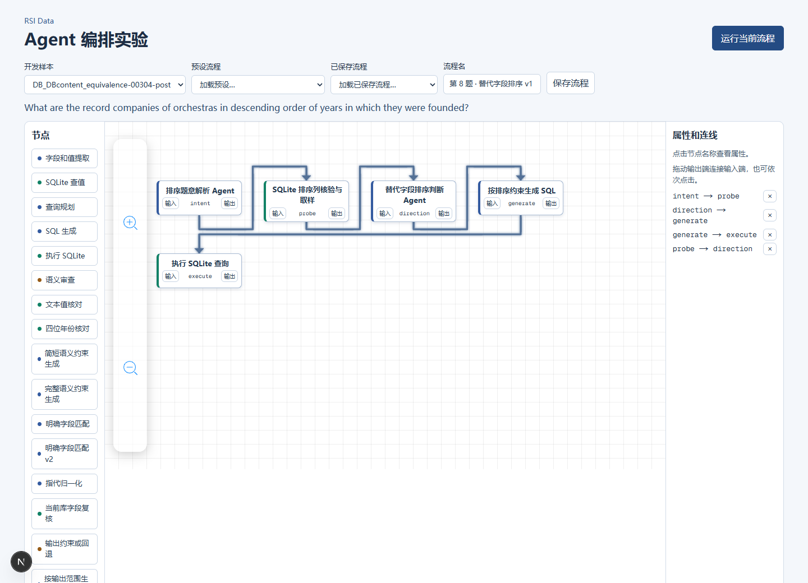

原题 `DB_DBcontent_equivalence-00304`。编排按我设计的条件分支实现。题意 Agent 提取当前问题的原始排序方向和候选列，工具核对当前 SQLite 表列。直接匹配跳过列值取样和方向 Agent。相似列提供最多八个实际值及其存储类型，方向 Agent 判断同向、反向或无法确定。无法确定时，SQL 生成请求与同档基线相同。
推理阶段只使用当侧题面、库和查列证据。配对参考 SQL 只用于筛选和评分。

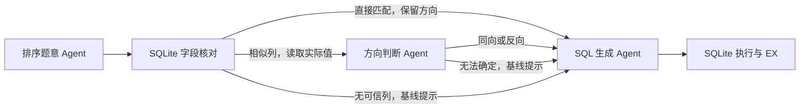

| 节点 | 类型与作用 | 输入 | 输出 |
|---|---|---|---|
| 排序题意解析 | LLM，识别要排序的量及其题意方向 | 当侧题面和 SQLite schema | 题面原文、候选表列、直接或相似、原始 ASC/DESC。无明确单列排序时返回空候选 |
| SQLite 排序列核验与取样 | 只读工具，核验列存在并在相似分支取样 | 上游候选、当侧 SQLite | 直接核验结果，或候选列、至多八个不同值及存储类型和频数，或回退原因 |
| 替代字段排序判断 | 条件调用 LLM，判定原排序量和实际列的关系 | 当侧题面和 schema、已核对的相似列、原方向、取样结果 | 同向、反向或未知，以及理由。程序据关系换算实际方向。直接匹配或无候选时跳过模型 |
| 按排序约束生成 SQL | LLM，生成完整查询 | 当侧题面和 schema。有已选定列和方向时追加查询计划，回退时用基线提示 | 一条 SQL 和所走路径 |
| 执行 SQLite 查询 | 只读工具，运行查询 | 上游生成 SQL 和当侧 SQLite | 返回列、结果行或执行错误。外层评测按参考执行结果判 EX |

##### 原题页面实测

| 方法 | 侧 | EX | 路径或判断 | 调用数 | 总 token |
|---|---|---|---|---:|---:|
| canvas | post | mismatch | fallback · direction_uncertain | 3 | 15477 |
| canvas | pre | match | direct · DESC | 2 | 22336 |
| baseline | post | mismatch | baseline | 1 | 4770 |
| baseline | pre | match | baseline | 1 | 4673 |

已在浏览器重连、保存、刷新后重载流程。页面请求包含图与样本 ID，由 Spring Boot / RSI Flow 逐节点执行。实际列值 13–20 已传入方向 Agent。课程 Visual 的 post 判断返回 unknown，说明该响应认为小整数和列名不足以确认字段语义及共同参照。回退按设计发生，SQL 仍用存续年数降序，12 行顺序错误。pre 命中成立年份直接走降序，方向 Agent 跳过。

[画布](../results/task2/submission/canvas/08-v1.png) · [结构 JSON](../results/task2/submission/records/task2-sort-direction-v1/structure-v1.json) · [浏览器与课程引擎记录](../results/task2/submission/records/task2-sort-direction-v1/browser-results.json) · [post 截图](../results/task2/submission/records/task2-sort-direction-v1/post-result.png)

##### 原题、同类、混合与 Thinking 对照

原题 1 对、同类 5 对、混合 8 对，112 个配对条件全部有评分。同类按显式单列排序、参考字段方向反向和两侧参考执行结果逐序相同筛选。已有暴露原题 1034 道，本组归入开发回归。Thinking 按发送的 none/high 请求档分组。批跑使用和画布同源的节点实现。

| 题单 | 方法与档位 | pre EX | post EX | 双侧通过 | 平均调用 | 平均总 token |
|---|---|---:|---:|---:|---:|---:|
| 原题 | 基线 none | 1/1 | 0/1 | 0/1 | 1.00 | 4698.0 |
| 原题 | 基线 high | 1/1 | 0/1 | 0/1 | 1.00 | 4733.0 |
| 原题 | 编排 v1 none | 1/1 | 0/1 | 0/1 | 2.50 | 13017.0 |
| 原题 | 编排 v1 high | 1/1 | 0/1 | 0/1 | 2.50 | 18373.5 |
| 同类 | 基线 none | 5/5 | 4/5 | 4/5 | 1.00 | 5383.1 |
| 同类 | 基线 high | 5/5 | 4/5 | 4/5 | 1.00 | 6007.9 |
| 同类 | 编排 v1 none | 5/5 | 5/5 | 5/5 | 2.40 | 17696.2 |
| 同类 | 编排 v1 high | 5/5 | 5/5 | 5/5 | 2.40 | 16602.5 |
| 混合 | 基线 none | 5/8 | 6/8 | 5/8 | 1.00 | 5753.1 |
| 混合 | 基线 high | 6/8 | 7/8 | 6/8 | 1.00 | 6736.8 |
| 混合 | 编排 v1 none | 6/8 | 6/8 | 6/8 | 2.00 | 11891.1 |
| 混合 | 编排 v1 high | 7/8 | 7/8 | 7/8 | 2.00 | 12783.8 |
| 扩展全体 | 基线 none | 10/13 | 10/13 | 9/13 | 1.00 | 5610.8 |
| 扩展全体 | 基线 high | 11/13 | 11/13 | 10/13 | 1.00 | 6456.4 |
| 扩展全体 | 编排 v1 none | 11/13 | 11/13 | 11/13 | 2.15 | 14123.8 |
| 扩展全体 | 编排 v1 high | 12/13 | 12/13 | 12/13 | 2.15 | 14252.5 |

| 题单 | 对比 | 修复 | 扰动误伤 | pre 回退 | 双侧通过净变化 | token 差中位数 |
|---|---|---:|---:|---:|---:|---:|
| 原题 | 基线 none → 编排 v1 none | 0 | 0 | 0 | +0/1 | 8319.0 |
| 原题 | 基线 high → 编排 v1 high | 0 | 0 | 0 | +0/1 | 13640.5 |
| 原题 | 基线 none → 基线 high | 0 | 0 | 0 | +0/1 | 35.0 |
| 原题 | 编排 v1 none → 编排 v1 high | 0 | 0 | 0 | +0/1 | 5356.5 |
| 同类 | 基线 none → 编排 v1 none | 1 | 0 | 0 | +1/5 | 12825.0 |
| 同类 | 基线 high → 编排 v1 high | 1 | 0 | 0 | +1/5 | 10354.5 |
| 同类 | 基线 none → 基线 high | 0 | 0 | 0 | +0/5 | 30.0 |
| 同类 | 编排 v1 none → 编排 v1 high | 0 | 0 | 0 | +0/5 | -156.5 |
| 混合 | 基线 none → 编排 v1 none | 0 | 0 | 0 | +1/8 | 5070.0 |
| 混合 | 基线 high → 编排 v1 high | 0 | 0 | 0 | +1/8 | 5301.0 |
| 混合 | 基线 none → 基线 high | 0 | 0 | 0 | +1/8 | 7.5 |
| 混合 | 编排 v1 none → 编排 v1 high | 0 | 0 | 0 | +1/8 | 76.5 |
| 扩展全体 | 基线 none → 编排 v1 none | 1 | 0 | 0 | +2/13 | 5167.0 |
| 扩展全体 | 基线 high → 编排 v1 high | 1 | 0 | 0 | +2/13 | 6343.0 |
| 扩展全体 | 基线 none → 基线 high | 0 | 0 | 0 | +1/13 | 15.5 |
| 扩展全体 | 编排 v1 none → 编排 v1 high | 0 | 0 | 0 | +1/13 | 42.5 |

逐题状态按 pre、post 排列。C 表示通过，W 表示未通过。

| 样本 | 分组 | 基线 none | 编排 none | 基线 high | 编排 high |
|---|---|---|---|---|---|
| `DB_DBcontent_equivalence-00304` | anchor | CW | CW | CW | CW |
| `DB_DBcontent_equivalence-00064` | target | CC | CC | CC | CC |
| `DB_DBcontent_equivalence-00078` | target | CC | CC | CC | CC |
| `DB_DBcontent_equivalence-00101` | target | CC | CC | CC | CC |
| `DB_DBcontent_equivalence-00065` | target | CC | CC | CC | CC |
| `DB_DBcontent_equivalence-00305` | target | CW | CC | CW | CC |
| `DB_schema_synonym-01629` | control | CC | CC | CC | CC |
| `DB_schema_abbreviation-02106` | control | WC | CC | CC | CC |
| `NLQ_column_carrier-00210` | control | WW | WW | WC | WW |
| `NLQ_column_synonym-00083` | control | WW | WW | WW | CC |
| `SQL_sort_order-00123` | control | CC | CC | CC | CC |
| `SQL_NonDB_number-00069` | control | CC | CC | CC | CC |
| `NLQ_column_attribute-00104` | control | CC | CC | CC | CC |
| `SQL_comparison-00134` | control | CC | CC | CC | CC |

[冻结题单](../results/task2/submission/records/task2-sort-direction-v1/plan.json) · [运行配置](../results/task2/submission/records/task2-sort-direction-v1/config.json) · [逐题评分](../results/task2/submission/完整批测记录.zip)（包内 `runs/task2-sort-direction-v1/records`） · [模型请求与响应](../results/task2/submission/完整批测记录.zip)（包内 `runs/task2-sort-direction-v1/requests`） · [汇总与转移矩阵](../results/task2/submission/records/task2-sort-direction-v1/summary.json)

##### 第 8 题的失败与同类差异

- **原题的 post 在课程平台、none 和 high 中都回退。** 题意 Agent 找到了 `orchestra.year_of_existence`，查列工具取得 7 种整数实际值，方向 Agent 把关系判为 `unknown`。这三个响应均认为现有证据没有明确列义或共同参照。三次 SQL 生成都用了 `DESC`。第一轮手工先验直接提供了「存续年数和成立年份反向」这一事实，因此能生成 `ASC`。这轮没有把另一侧的成立年份送进 post 节点。[原题 none](../results/task2/submission/records/task2-sort-direction-v1/records/canvas_v1/none/DB_DBcontent_equivalence-00304-post.json) · [原题 high](../results/task2/submission/records/task2-sort-direction-v1/records/canvas_v1/high/DB_DBcontent_equivalence-00304-post.json)
- **同库措辞变体在两档都修复。** `DB_DBcontent_equivalence-00305` 使用相同的存续年数列和观察值。方向 Agent 在两档都判为反向，SQL 使用 `ASC`。这对是同类层唯一的双侧新增修复。原题与这一变体的差异说明判断对题面措辞或生成波动敏感。[同库变体 none](../results/task2/submission/records/task2-sort-direction-v1/records/canvas_v1/none/DB_DBcontent_equivalence-00305-post.json) · [同库变体 high](../results/task2/submission/records/task2-sort-direction-v1/records/canvas_v1/high/DB_DBcontent_equivalence-00305-post.json)
- **混合层的变化单独解读。** 在两档中各有 1 对新增双侧通过，来自直接字段分支。high 档另有 1 个 post 对转错，基线和编排回退后的 SQL 生成请求完全相同，属于同样输入的重跑差异。当前比较未观察到 pre 对转错。[混合 high 回退记录](../results/task2/submission/records/task2-sort-direction-v1/records/canvas_v1/high/NLQ_column_carrier-00210-post.json)
- **第一个 Agent 和第二个 Agent 对方向的分工需要继续核对。** 员工年龄题 `DB_DBcontent_equivalence-00065` 的 none 档先把题面的年龄升序提前转成了出生年份降序，第二个 Agent 又把关系标成同向，但理由仍说两者反向。这次最终 SQL 得分正确，两节点之间的数据含义出现了不一致。[员工年龄题节点记录](../results/task2/submission/records/task2-sort-direction-v1/records/canvas_v1/none/DB_DBcontent_equivalence-00065-post.json)

扩展题单含 13 对、覆盖 12 个 post 数据库。配对条件共 112 条，另有课程 Visual 实测 4 条，均已回放 SQLite 核对评分。两档的扩展全体均增加 2 对双侧通过，单题面平均总 token 分别从 5610.8 增至 14123.8 和从 6456.4 增至 14252.5。当前 v1 保留为已测试的版本，原题未达到修复条件。

#### 字段含义与排序方向 v2


依据我设计的方案，方向 Agent 先解释题目要比较的量和候选列的实际含义，再给出排序关系。它需要区分日历年、经过年数和无关量。实际值用来印证列义，两侧各自读取当前库。列义或关系不明时回退。v2 沿用 v1 的意图解析、查列、SQL 生成与执行节点。

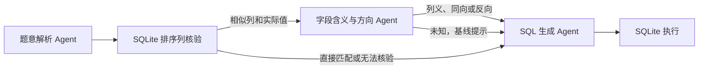

| 节点 | 类型与作用 | 输入 | 输出 |
|---|---|---|---|
| 题意解析 | LLM，辨认排序要求 | 当侧题面、schema | 原始方向、候选表列和匹配类型 |
| 排序列核验 | SQLite 工具，核对字段与取样 | 候选、当前库 | 直接匹配结果，或相似列与实际值、类型、频数 |
| 字段含义与方向判断 | 条件 LLM，理解列义并比较两个量 | 问题、schema 与核实的列证据 | 题意量、列义、同向/反向/未知和依据。程序按关系换算方向或回退 |
| SQL 生成 | LLM，生成查询 | 题面、schema、核实后的排序约束或空提示 | SQL 和路径 |
| 执行 | SQLite 工具，运行只读查询 | SQL 和当前库 | 结果行与列，或执行错误 |

##### 原题页面实测

| 题侧 | 方向路径 | 列义或回退原因 | 生成 SQL | EX | 调用数 | 总 token |
|---|---|---|---|---|---:|---:|
| post | similar ASC | elapsed years of an orchestra's existence, stored as integer duration values | `SELECT "Record_Company" FROM "orchestra" ORDER BY "year_of_existence" ASC;` | match | 3 | 21183 |
| pre | direct DESC | 直接使用核验列 | `SELECT "Record_Company" FROM "orchestra" ORDER BY "Year_of_Founded" DESC;` | match | 2 | 22720 |

[画布](../results/task2/submission/canvas/08-v2.png) · [结构 JSON](../results/task2/submission/records/task2-sort-direction-v2/structure-v2.json) · [浏览器和课程引擎记录](../results/task2/submission/records/task2-sort-direction-v2/browser-results.json)

##### 同一题单和 Thinking 档位对照

冻结题单包含原题 1 对、同类 5 对、混合 8 对。v2 有 56 条评分，基线与 v1 沿用上一轮记录。v2 逻辑调用中，108 次复用逐字段相同的 v1 请求的响应，14 次为变更请求的新响应。表内 token 包含复用响应的使用量，用于比较完整流程成本。

| 题单 | 档位 | 基线双侧 | v1 双侧 | v2 双侧 | v2 pre EX | v2 post EX | v1 → v2 pre 对转错 | v1 → v2 post 对转错 | v1 → v2 平均总 token |
|---|---|---:|---:|---:|---:|---:|---:|---:|---:|
| 原题 | none | 0/1 | 0/1 | 1/1 | 1/1 | 1/1 | 0 | 0 | 13017.0 → 16089.0 |
| 原题 | high | 0/1 | 0/1 | 1/1 | 1/1 | 1/1 | 0 | 0 | 18373.5 → 21491.0 |
| 同类 | none | 4/5 | 5/5 | 3/5 | 5/5 | 3/5 | 0 | 2 | 17696.2 → 16606.8 |
| 同类 | high | 4/5 | 5/5 | 5/5 | 5/5 | 5/5 | 0 | 0 | 16602.5 → 16842.9 |
| 混合 | none | 5/8 | 6/8 | 6/8 | 6/8 | 6/8 | 0 | 0 | 11891.1 → 11891.1 |
| 混合 | high | 6/8 | 7/8 | 7/8 | 7/8 | 7/8 | 0 | 0 | 12783.8 → 12783.8 |
| 扩展全体 | none | 9/13 | 11/13 | 9/13 | 11/13 | 9/13 | 0 | 2 | 14123.8 → 13704.8 |
| 扩展全体 | high | 10/13 | 12/13 | 12/13 | 12/13 | 12/13 | 0 | 0 | 14252.5 → 14345.0 |

[沿用的冻结题单](../results/task2/submission/records/task2-sort-direction-v1/plan.json) · [v2 实验配置](../results/task2/submission/records/task2-sort-direction-v2/config.json) · [逐题证据](../results/task2/submission/完整批测记录.zip)（包内 `runs/task2-sort-direction-v2/records`） · [评分汇总](../results/task2/submission/records/task2-sort-direction-v2/summary.json)

##### v2 原题修复与同类回退

- **原题在课程 Visual 与两档批跑中均修复。** v2 把 `year_of_existence` 理解为乐团已存续的年数，并用 13–20 的整数范围印证这一解释。在同一参照时点下，成立越晚，存续就越短，所以程序将题意的 `DESC` 映射为该列的 `ASC`。两侧均返回与参考一致的 12 行。课程 Visual 的 pre 走直接分支，方向 Agent 跳过。[原题 post 节点证据](../results/task2/submission/records/task2-sort-direction-v2/records/none/DB_DBcontent_equivalence-00304-post.json)
- **同类回退一来自方向被换算两次。** 员工年龄题 `00065` 的题面要求年龄升序，题意 Agent 却提前把方向写成出生年份的 `DESC`。v2 对年龄和出生年份的反向关系判断正确，程序再次换算后得到错误的 `ASC`。下一版可核对意图输出是否仍是题面方向。[员工年龄题证据](../results/task2/submission/records/task2-sort-direction-v2/records/none/DB_DBcontent_equivalence-00065-post.json)
- **另一题仍因关系未知而回退。** 同库变体 `00305` 的 none 档正确解释了列义，但因无参照年份而给出 `unknown`，随后用了基线的 `DESC`。high 档保留通过。这说明加入列义解释后，能否确认共同参照仍会影响结果。[同库变体 none 证据](../results/task2/submission/records/task2-sort-direction-v2/records/none/DB_DBcontent_equivalence-00305-post.json)
- **两档都没有新增 pre 回退，混合层结果保持一致。** 复用完全相同的请求和响应让混合层对照聚焦本次改动。原题的收益和 none 档两道同类 post 的回退均纳入结果。

#### 原文提取与最终方向 v3

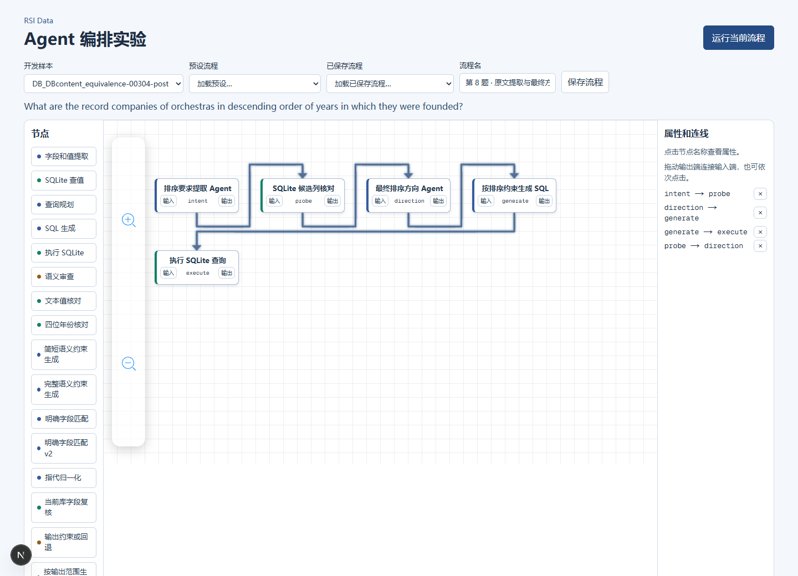

题意节点交付排序原文和候选字段。方向节点结合已核验的列义与样例，输出候选列的最终方向。直接列且题面方向明确时，方向节点从原文读取方向，跳过第二次模型调用。相似列由模型给出最终方向，程序只校验该方向和关系是否一致，冲突或未知时回退。

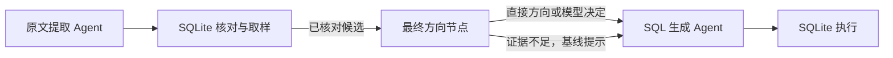

| 节点 | 类型与作用 | 输入 | 输出 |
|---|---|---|---|
| 原文提取 | LLM，挑选题面的排序要求 | 题面、schema | 原文、题意量、候选表列、匹配方式 |
| 字段核对 | SQLite 工具，验证候选并对相似列取样 | 候选、当侧数据库 | 字段名、类型、原文与实际值，或回退原因 |
| 最终方向 | 直接分支用程序，其余候选交给条件 LLM | 核验结果、题面原文、列义证据 | 最终 ASC/DESC、含义、来源或回退原因 |
| SQL 生成 | LLM，组装完整查询 | 题面、schema、最终排序要求或基线提示 | SQL 与触发路径 |
| 执行 | SQLite 工具，执行只读查询 | SQL、当侧数据库 | 结果行列或错误，外层按参考结果评分 |

##### 原题页面复测

| 输入侧 | 路径 | 最终 SQL | EX | 调用数 | 总 token |
|---|---|---|---|---:|---:|
| post | similar ASC | `SELECT "Record_Company" FROM "orchestra" ORDER BY "year_of_existence" ASC;` | match | 3 | 15262 |
| pre | direct DESC | `SELECT Record_Company FROM orchestra ORDER BY Year_of_Founded DESC;` | match | 2 | 9604 |

[课程运行与节点结果](../results/task2/submission/records/task2-sort-direction-v3/browser-results.json) · [结构 JSON](../results/task2/submission/records/task2-sort-direction-v3/structure-v3.json)

##### 与前两版的同题单对照

原题 1 对、同类 5 对、混合 8 对，v3 共 56 个评分条件。两档分别为 none 与 high。逻辑节点调用中 102 次取得新响应，42 次沿用逐字段相同的 v2 响应。基线和前两版沿用同一题单结果。表内总 token 含复用节点的完整成本。

| 题单 | Thinking | 基线双侧 | v1 双侧 | v2 双侧 | v3 双侧 | v3 pre EX | v3 post EX | v2 → v3 pre / post 对转错 | v2 → v3 平均总 token |
|---|---|---:|---:|---:|---:|---:|---:|---:|---:|
| 原题 | none | 0/1 | 0/1 | 1/1 | 0/1 | 1/1 | 0/1 | 0 / 1 | 16089.0 → 12677.5 |
| 原题 | high | 0/1 | 0/1 | 1/1 | 1/1 | 1/1 | 1/1 | 0 / 0 | 21491.0 → 15283.0 |
| 同类 | none | 4/5 | 5/5 | 3/5 | 3/5 | 5/5 | 3/5 | 0 / 1 | 16606.8 → 14545.6 |
| 同类 | high | 4/5 | 5/5 | 5/5 | 5/5 | 5/5 | 5/5 | 0 / 0 | 16842.9 → 16506.3 |
| 混合 | none | 5/8 | 6/8 | 6/8 | 6/8 | 6/8 | 6/8 | 0 / 0 | 11891.1 → 16780.6 |
| 混合 | high | 6/8 | 7/8 | 7/8 | 6/8 | 7/8 | 6/8 | 0 / 1 | 12783.8 → 18904.4 |
| 扩展全体 | none | 9/13 | 11/13 | 9/13 | 9/13 | 11/13 | 9/13 | 0 / 1 | 13704.8 → 15921.0 |
| 扩展全体 | high | 10/13 | 12/13 | 12/13 | 11/13 | 12/13 | 11/13 | 0 / 1 | 14345.0 → 17982.1 |

逐对状态按 pre、post 排列。C 表示通过，W 表示未通过。

| 样本 | 题单 | v1 none | v2 none | v3 none | v1 high | v2 high | v3 high |
|---|---|---|---|---|---|---|---|
| `DB_DBcontent_equivalence-00304` | anchor | CW | CC | CW | CW | CC | CC |
| `DB_DBcontent_equivalence-00064` | target | CC | CC | CC | CC | CC | CC |
| `DB_DBcontent_equivalence-00078` | target | CC | CC | CC | CC | CC | CC |
| `DB_DBcontent_equivalence-00101` | target | CC | CC | CW | CC | CC | CC |
| `DB_DBcontent_equivalence-00065` | target | CC | CW | CC | CC | CC | CC |
| `DB_DBcontent_equivalence-00305` | target | CC | CW | CW | CC | CC | CC |
| `DB_schema_synonym-01629` | control | CC | CC | CC | CC | CC | CC |
| `DB_schema_abbreviation-02106` | control | CC | CC | CC | CC | CC | CC |
| `NLQ_column_carrier-00210` | control | WW | WW | WW | WW | WW | WW |
| `NLQ_column_synonym-00083` | control | WW | WW | WW | CC | CC | CW |
| `SQL_sort_order-00123` | control | CC | CC | CC | CC | CC | CC |
| `SQL_NonDB_number-00069` | control | CC | CC | CC | CC | CC | CC |
| `NLQ_column_attribute-00104` | control | CC | CC | CC | CC | CC | CC |
| `SQL_comparison-00134` | control | CC | CC | CC | CC | CC | CC |

[冻结题单](../results/task2/submission/records/task2-sort-direction-v3/plan.json) · [运行配置](../results/task2/submission/records/task2-sort-direction-v3/config.json) · [逐题记录](../results/task2/submission/records/task2-sort-direction-v3/records/) · [评分汇总](../results/task2/submission/records/task2-sort-direction-v3/summary.json)

##### v3 修复与回退原因

- **重复换算已在员工年龄题复现并消除。** `00065` 的 none 档只把「年龄升序」和 `employee.birthyear` 传给方向 Agent，后者直接输出 `DESC`，原来 v2 误排为 `ASC` 的 post 恢复通过。[员工年龄题](../results/task2/submission/records/task2-sort-direction-v3/records/none/DB_DBcontent_equivalence-00065-post.json)
- **乐团原题的 none 失分发生在候选提取。** Visual 与 high 的 post 都由方向 Agent 给出 `year_of_existence ASC`，通过评分。批跑 none 中，原题 `00304` 和同库变体 `00305` 的提取节点都返回空候选，后续使用基线请求。原题出现 v2 对、v3 错，变体在两版 none 中均错。[乐团原题 none](../results/task2/submission/records/task2-sort-direction-v3/records/none/DB_DBcontent_equivalence-00304-post.json) · [同库变体 none](../results/task2/submission/records/task2-sort-direction-v3/records/none/DB_DBcontent_equivalence-00305-post.json)
- **同类 none 的新增 post 回退是教师年龄题 `00101`。** 候选与取样都正确，方向 Agent 在同一个响应里输出两个 JSON 对象。后一个对象含正确的 `DESC`，现有解析只接受一个对象，因 Extra data 进入回退，最终用了错误的 `ASC`。这与员工题的 1 个修复相抵，同类双侧通过仍为 3/5。[教师年龄题](../results/task2/submission/records/task2-sort-direction-v3/records/none/DB_DBcontent_equivalence-00101-post.json)
- **混合 high 多出 1 个 post 回退。** 最高里程题 `NLQ_column_synonym-00083` 的 `MPG` 列声明为 TEXT。方向 Agent 理解最高值要求降序，但看不到实际值来判断该列能否按数值排序，返回了 unknown。回退生成额外返回 MPG，和只返回车型的参考不一致。[最高里程题](../results/task2/submission/records/task2-sort-direction-v3/records/high/NLQ_column_synonym-00083-post.json)

##### 三版分别改了什么

| 版本 | 相对上一版的改动 | 解决的具体问题 |
|---|---|---|
| v1 | 新增题意解析、查列、方向关系判断，程序根据同向或反向换算 ASC/DESC | 有直接列时保留方向。只给相似列和样例时，可在证据不足时回退 |
| v2 | 方向 Agent 先解释题意量和列义，再输出同向、反向或未知。程序仍负责换算 | 让判断考虑候选列实际存储的量，修复乐团原题 |
| v3 | 题意 Agent 只传排序原文与候选列。相似列的最终方向由方向 Agent 给出，程序只做一致性校验。直接列引用已明确的题面方向 | 将换算集中在一个节点，消除上游提前换算、下游再次翻转的路径 |

### 第 9 题 · 筛选值绑定到错误列

题面把厂商改成 Honda，模型把全称写进缩写列。重量条件还使候选范围存在判分差异。

#### 筛选列核验 v1

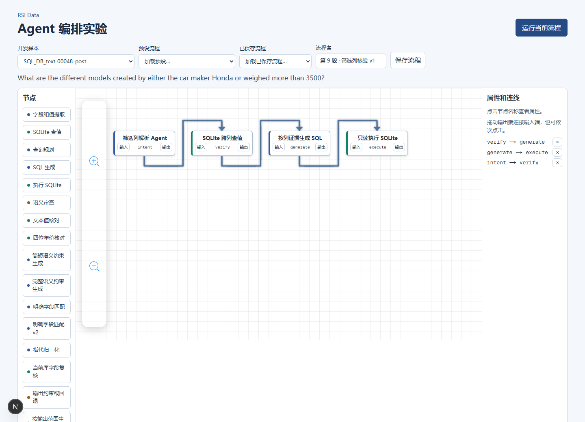

原题 `SQL_DB_text-00048`，`pre` 查询 General Motors，`post` 改为 Honda。两侧都要求返回该厂商制造或重量超过 3500 的不同车型。第一轮先验实验发现厂商名绑定和 `OR` 两个分支的候选范围都会影响 EX。

```text
题意解析 Agent → SQLite 跨列查值 → SQL 生成 Agent → SQLite 执行
```

| 节点 | 类型和作用 | 输入 | 输出 |
|---|---|---|---|
| 题意解析 | LLM Agent，识别返回项、显式筛选条件和逻辑关系，为一个文本等值条件提出候选字段 | 当侧题面、当前库 schema | 返回项和条件描述、`AND/OR`、题面原词、2–4 个候选表列。信号不足时输出空候选 |
| 跨列查值 | SQLite 工具，验证题面原词、表列和库内真实文本，分别查询精确和归一化命中 | 当侧题面、字段候选、只读 SQLite | 每列的原值、匹配方式和核验路径。唯一精确命中时记录该证据，多列命中时保留候选，证据不足时记录回退原因 |
| SQL 生成 | LLM Agent，结合列义和查库证据生成查询，按题面保留其他条件、逻辑连接和去重 | 当侧题面、schema、工具核验的候选证据或空提示 | SQL 或生成失败状态，以及本题走过的证据路径 |
| 执行 SQL | SQLite 工具，执行只读 SQL | 当前 SQLite、生成 SQL | 查询结果和状态。参考 SQL 由本地评分器使用 |

查值节点复用第 2 题的实际库值查询。匹配在各候选列独立完成，归一化仅用于比较大小写和空白，输出保留库内原始文本。工具提供匹配证据，SQL Agent 结合题意决定字段和候选范围。回退使用基线 SQL 生成提示。原题和扩展题的生成过程均只使用当前一侧的输入。

冻结题单包含原开发题 1 对、跨列文本匹配同类 8 对、混合扰动 8 对。选同类题时，参考 SQL 仅供离线识别候选文本等值条件。要求题面含有该值，且同一表中至少两列具有同形库值。该规则筛的是有争议的列证据机会，实际是否走该分支由运行记录确认。混合层覆盖八类官方扰动。扩展样本原题在项目已有暴露，结果按开发回归解释。比较基线和编排在 `reasoning_effort=none/high` 下的 pre、post、双侧 EX，以及变化和 token。[题单与代码哈希](../results/task2/submission/records/task2-filter-column-v1/plan.json) · [编排结构 JSON](../results/task2/submission/records/task2-filter-column-v1/structure-v1.json)

##### 原题页面实测

浏览器移除后重新连上题意解析到查值的边，保存并刷新重载。提交后的 Spring Boot 流程登记了四个 `TASK2_CANVAS_EXPERIMENT_STEP` 节点。画布运行使用服务默认档，两侧各有两次 LLM 调用。

| 题侧 | 厂商列核验 | 返回行 / 参考行 | EX | 总 token |
|---|---|---:|---|---:|
| post | `FullName` 精确命中 `Honda` | 14 / 14 | 通过 | 9976 |
| pre | `FullName` 精确命中 `General Motors` | 14 / 13 | 未通过 | 9986 |

画布的 pre 同样因重量分支纳入 `hi` 而未通过。使用独立预览服务的回环端口跑这两侧，批跑复用同一 Python 节点。
[画布截图](../results/task2/submission/canvas/09-v1.png) · [浏览器提交的结构](../results/task2/submission/records/task2-filter-column-v1/browser-structure.json) · [浏览器响应](../results/task2/submission/records/task2-filter-column-v1/browser-results.json) · [pre 节点结果](../results/task2/submission/records/task2-filter-column-v1/pre-result.png) · [post 节点结果](../results/task2/submission/records/task2-filter-column-v1/post-result.png)

##### 原题、同类和混合对照

| 题单 | Thinking | pre EX 基线 → 编排 | post EX 基线 → 编排 | 双侧通过 基线 → 编排 | pre 回退 | post 错转对 / 对转错 | 平均总 token 基线 → 编排 |
|---|---|---:|---:|---:|---:|---:|---:|
| 原题 | none | 1/1 → 1/1 | 0/1 → 1/1 | 0/1 → 1/1 | 0 | 1 / 0 | 11069 → 9815 |
| 原题 | high | 1/1 → 0/1 | 0/1 → 1/1 | 0/1 → 0/1 | 1 | 1 / 0 | 8059 → 10308.5 |
| 同类 | none | 8/8 → 7/8 | 6/8 → 6/8 | 6/8 → 6/8 | 1 | 1 / 1 | 5936.1 → 11314.8 |
| 同类 | high | 6/8 → 8/8 | 7/8 → 6/8 | 5/8 → 6/8 | 0 | 0 / 1 | 6001.9 → 13083.7 |
| 混合 | none | 6/8 → 6/8 | 6/8 → 7/8 | 6/8 → 6/8 | 0 | 1 / 0 | 5597.4 → 10640.7 |
| 混合 | high | 6/8 → 6/8 | 7/8 → 7/8 | 6/8 → 6/8 | 0 | 0 / 0 | 6105.4 → 12183.1 |
| 全体 | none | 15/17 → 14/17 | 12/17 → 14/17 | 12/17 → 13/17 | 1 | 3 / 1 | 6078.6 → 10909.4 |
| 全体 | high | 13/17 → 14/17 | 14/17 → 14/17 | 11/17 → 12/17 | 1 | 1 / 1 | 6171.6 → 12496.6 |

136 条评分覆盖 17 对题的 4 种方法与档位组合，取得 204 次模型响应。已重新执行 SQLite 并核对请求、响应和评分。所有 token 统计使用接口报告的完整流程总量，编排每题面有两次 LLM 调用，基线一次。全体平均总 token 在 none 档增加约 79.5%，high 档增加约 102.5%。[运行配置](../results/task2/submission/records/task2-filter-column-v1/config.json) · [逐题评分与节点记录](../results/task2/submission/完整批测记录.zip)（包内 `runs/task2-filter-column-v1/records`） · [汇总](../results/task2/submission/records/task2-filter-column-v1/summary.json)

| 原题运行证据 | 题意 Agent 输出 | SQLite 查值 | SQL 生成 | 执行与评分 |
|---|---|---|---|---|
| post，none | Honda、重量大于 3500、`OR`、不同车型 | `FullName` 精确命中 `Honda`，`Maker` 归一化命中 `honda` | 使用 `FullName='Honda'`，关联厂商后应用两个条件 | 14 行，EX 通过 |
| pre，high | General Motors、重量大于 3500、`OR`、不同车型 | `FullName` 精确命中 `General Motors` | 厂商列正确，厂商关联改用 `LEFT JOIN` | 14 行，额外保留 `hi`，参考 13 行，EX 回退 |

- 原题两档 `post` 均修复。`high` 档的 `pre` 仍把无厂商匹配但重量达标的 `hi` 纳入。查值证据能定位厂商列，车型候选范围仍由生成节点判断。按题面，允许重量分支独立成立有合理解释。保留官方 EX 和新增记录证据。[原题 post none](../results/task2/submission/records/task2-filter-column-v1/records/canvas_v1/none/SQL_DB_text-00048-post.json) · [原题 pre high](../results/task2/submission/records/task2-filter-column-v1/records/canvas_v1/high/SQL_DB_text-00048-pre.json)
- 同类样本的增加与回退并存。none 档中 `DB_schema_synonym-00348` 的 post 虽有唯一精确命中，生成把 `cylinder_number` 归到了错误的表别名，SQLite 返回列不存在。high 档的 `DB_schema_synonym-01988` post 把参考输出 `place` 换成 `Continent`，行数相同但结果不一致。[车型失败](../results/task2/submission/records/task2-filter-column-v1/records/canvas_v1/none/DB_schema_synonym-00348-post.json) · [人口失败](../results/task2/submission/records/task2-filter-column-v1/records/canvas_v1/high/DB_schema_synonym-01988-post.json)
- 混合题在两档的 32 个编排条件均走回退。逐字段核对其 SQL 生成请求与对应基线完全相同。none 档混合层的一道 post 错转对来自相同生成请求的两次独立响应，计入实测变化。题意解析调用仍贡献了额外 token。

#### 初稿筛选列核验与局部修正 v2

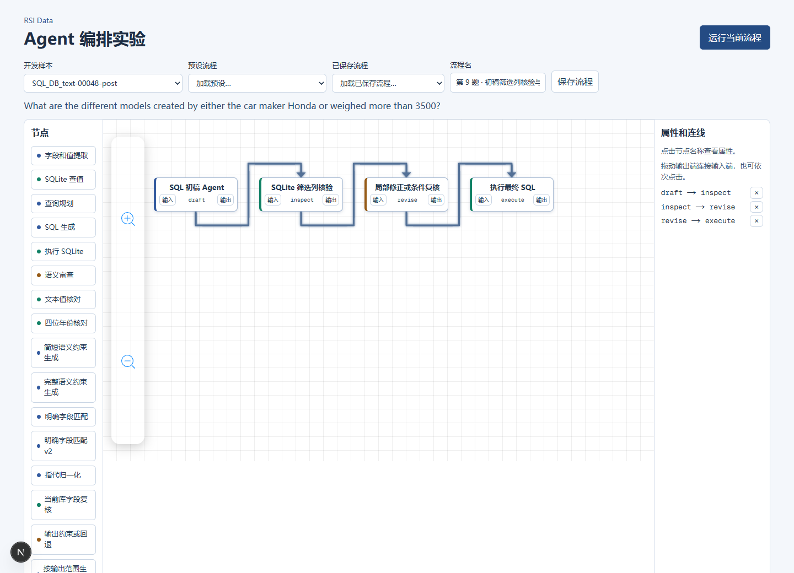

先生成独立 SQL 初稿。SQLite 工具核验顶层 `WHERE` 的文本等值条件，要求字面值来自当侧题面，当前列没有该值，同表候选有精确库值。自动修订还要求同一行支持全名与原列值的对应关系，且题面明确提到该名称。其他候选交给条件复核 Agent，证据不足时保留初稿。所有修订都只替换一处列名，并用 SQLite `EXPLAIN QUERY PLAN` 检查。参考 SQL 留在评分端。

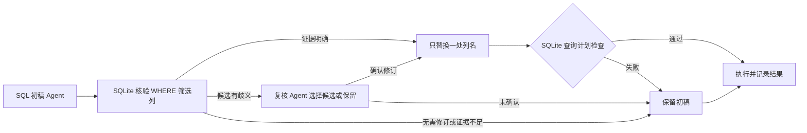

| 节点 | 输入 | 输出 |
|---|---|---|
| SQL 初稿 Agent | 当侧题面、schema | 基线提示生成的 SQL 初稿 |
| SQLite 核验工具 | 初稿、题面、当前库 | 候选列与真实库值、同一行证据，及自动修订、复核或保留的判断 |
| 局部修正与条件复核 | 初稿、候选列证据 | 确认后的最终 SQL、SQLite 检查与修订状态。有语义歧义才调用复核 Agent |
| SQLite 执行工具 | 最终 SQL、当前库 | 返回列、结果行或执行错误 |

##### 原题页面实测（重新生成初稿）

保存并刷新重载画布后，两侧各新发一次 Thingo 请求。四个节点均由 Spring Boot 的课程流程引擎执行，Thinking 使用服务默认设置。

| 题侧 | 初稿行数 / EX | 最终行数 / EX | 修订路径 | 总 token |
|---|---|---|---|---:|
| post | 13 / 未通过 | 14 / 通过 | 工具仅将 `Maker` 改成 `FullName` | 4,955 |
| pre | 14 / 未通过 | 14 / 未通过 | 保留初稿，重量分支已纳入 `hi` | 7,381 |

pre 多返回的 `hi` 已经出现在 LLM 初稿中，v2 保留了相同的 SQL，因此在该次画布运行里，初稿和最终查询均失分。post 的厂商列修订后返回结果与参考逐行一致。

[画布截图](../results/task2/submission/canvas/09-v2.png) · [提交的画布结构](../results/task2/submission/records/task2-filter-column-v2/browser-structure.json) · [课程引擎响应](../results/task2/submission/records/task2-filter-column-v2/browser-results.json)

##### 同初稿的原题、同类和混合回放

沿用 v1 的原题 1 对、同类 8 对、混合 8 对。每侧在 `none` 与 `high` 各运行一次，共用到 68 条已存档基线初稿。将初稿和 v2 最终 SQL 分别在 SQLite 重放核对。表中的 v1 是前一轮编排实测。v2 的 68 个条件只有原题 post 两档触发自动修订，其余 66 次保留初稿。本批没有触发复核 Agent，所列 token 为复用初稿的服务回报，没有新增批跑模型调用。另以模拟复核响应覆盖了支持与拒绝两条路径。

| 题单 | Thinking | pre EX 基线 → v2 | post EX 基线 → v2 | 双侧通过 基线 → v1 → v2 | 每题面平均总 token 基线 → v1 → v2 |
|---|---|---:|---:|---:|---:|
| 原题 | none | 1/1 → 1/1 | 0/1 → 1/1 | 0/1 → 1/1 → 1/1 | 11,069 → 9,815 → 11,069 |
| 原题 | high | 1/1 → 1/1 | 0/1 → 1/1 | 0/1 → 0/1 → 1/1 | 8,059 → 10,308.5 → 8,059 |
| 同类 | none | 8/8 → 8/8 | 6/8 → 6/8 | 6/8 → 6/8 → 6/8 | 5,936.1 → 11,314.8 → 5,936.1 |
| 同类 | high | 6/8 → 6/8 | 7/8 → 7/8 | 5/8 → 6/8 → 5/8 | 6,001.9 → 13,083.7 → 6,001.9 |
| 混合 | none | 6/8 → 6/8 | 6/8 → 6/8 | 6/8 → 6/8 → 6/8 | 5,597.4 → 10,640.7 → 5,597.4 |
| 混合 | high | 6/8 → 6/8 | 7/8 → 7/8 | 6/8 → 6/8 → 6/8 | 6,105.4 → 12,183.1 → 6,105.4 |
| 全体 | none | 15/17 → 15/17 | 12/17 → 13/17 | 12/17 → 13/17 → 13/17 | 6,078.6 → 10,909.4 → 6,078.6 |
| 全体 | high | 13/17 → 13/17 | 14/17 → 15/17 | 11/17 → 12/17 → 12/17 | 6,171.6 → 12,496.6 → 6,171.6 |

v2 在共用初稿的回放中保留了两档原题 pre 的通过，修好两档 post。同类和混合的执行结果与基线相同。全体双侧通过数与 v1 相同，none 和 high 的平均 token 分别较 v1 低约 44.3% 和 50.6%。当前收益集中在两条可局部修订的原题 post，后续覆盖取决于初稿是否呈现可核实的筛选列冲突。

[配置与哈希](../results/task2/submission/records/task2-filter-column-v2/config.json) · [对照汇总](../results/task2/submission/records/task2-filter-column-v2/summary.json) · [原题逐节点批测](../results/task2/submission/records/task2-filter-column-v2/original) · [运行代码](../task2-rsi-data/experiment/filter_column_compare_v2.py)

### 第 10 题 · 改写后漏条件和计数对象

题面把赛事名称换成指代，原 SQL 漏掉赛事筛选。先验实验还暴露了按比赛行计数的问题。

#### 筛选条件与统计对象 v1

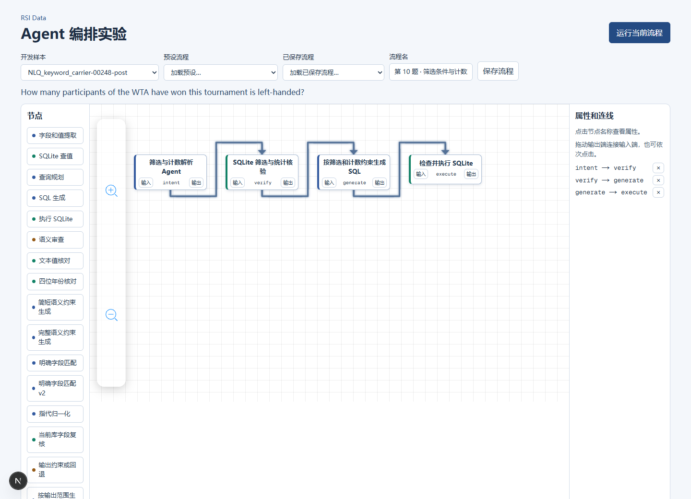

开发题 `NLQ_keyword_carrier-00248`，原题 ID `486`。口径是 WTA Championships 中左撇子获胜者的人数，两个题面均应返回 2。
按我确定的结构，把筛选条件和统计对象交给同一个解析 Agent。下游依次查库核验、生成 SQL、检查并执行。

##### 编排图与节点输入输出

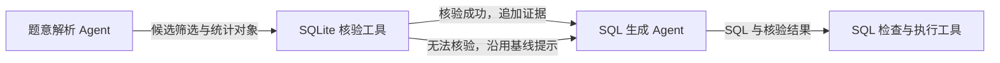

| 节点 | 类型与作用 | 输入 | 输出与原题 post 实例 |
|---|---|---|---|
| 题意解析 | Agent，调用 LLM，提取所有筛选条件和统计对象 | 当侧原题、当前 SQLite schema | 候选条件 `matches.tourney_name ← WTA`、`matches.winner_hand ← left-handed`。计数对象是 `matches.winner_id`，也记录支持判断的题面原词。 |
| 筛选和统计核验 | 工具，核对实际表列和文本值 | 上一步结构化输出、同一侧题面、当前 SQLite | `WTA → WTA Championships`，匹配唯一的完整缩写词。 `left-handed → L`，核对字段含义和实际文本域。返回两条已核验条件、`winner_id` 去重计数及证据来源。候选缺失或不唯一时返回回退原因。 |
| SQL 生成 | Agent，调用 LLM 生成查询 | 当侧原题、schema 和核验结果。回退时使用基线提示 | 生成 `SELECT COUNT(DISTINCT winner_id) FROM matches WHERE tourney_name = 'WTA Championships' AND winner_hand = 'L'`，同时向执行节点传递核验结果。 |
| 检查与执行 | 工具，检查条件与去重口径，执行只读查询 | 生成 SQL、核验结果、当侧 SQLite | 原题返回 `[(2,)]` 与结构检查通过标记。结构不符时保存未通过原因。回退时执行预测 SQL 并标记结构检查不适用。 |

以上实例来自原题 post 的浏览器节点记录。v1 检查的 SQL 形态限于直接单表 `COUNT(DISTINCT 列)` 和以 AND 连接的文本等值条件。参考 SQL 留在评分端。[原题 post 四节点实录](../results/task2/submission/records/task2-filter-count-v1/visual-records/283f8782df7641e0bc09a0c4c32d9918.json)

三条本地测试覆盖双条件与计数先验传递、拦截按比赛行计数及遗漏条件、无法核验时回到原提示。

##### 原题页面实测

在课程 Visual 删除并重新连接「题意解析 → SQLite 核验」，保存后刷新加载，再点运行。浏览器的两个 API 请求定向到本题的隔离本地实例，Spring Boot 通过 `rsi-flow` 注册并调度四个节点，Python worker 调用 Thingo。隔离课程 JAR 沿用现有流程引擎，只将两处 worker 地址改为专用端口。

| 题面 | 查库结果 | 计数对象 | 实际结果 | LLM 调用 | 总 token |
|---|---|---|---:|---:|---:|
| pre | `left handed → L`, `WTA Championships → WTA Championships` | `winner_id` 去重 | 2 | 2 | 9954 |
| post | `WTA → WTA Championships`, `left-handed → L` | `winner_id` 去重 | 2 | 2 | 9989 |

[画布截图](../results/task2/submission/canvas/10-v1.png) · [pre 截图](../results/task2/submission/records/task2-filter-count-v1/pre-result.png) · [post 截图](../results/task2/submission/records/task2-filter-count-v1/post-result.png) · [画布导出](../results/task2/submission/records/task2-filter-count-v1/structure-v1.json) · [浏览器响应](../results/task2/submission/records/task2-filter-count-v1/browser-results.json) · [节点请求与响应](../results/task2/submission/完整批测记录.zip)（包内 `runs/task2-filter-count-v1/visual-records`）

##### 同一开发题的 Thinking 对照

使用同一节点实现，对当侧输入分别运行单 Agent 基线和四节点编排，交叉设置 `reasoning_effort=none/high`。该对照由批跑入口执行，课程 Visual 单独使用服务端默认档。模型为 `gpt-6-sol`，模型指纹按各响应保存。

| Thinking 档 | 题面 | 基线实际结果 / EX | 编排实际结果 / EX | 基线 → 编排总 token |
|---|---|---|---|---:|
| none | pre | 3 / 未通过 | 2 / 通过 | 10,773 → 9,929 |
| none | post | 5 / 未通过 | 2 / 通过 | 10,864 → 9,977 |
| high | pre | 2 / 通过 | 2 / 通过 | 11,324 → 9,997 |
| high | post | 5 / 未通过 | 2 / 通过 | 11,091 → 15,985 |

- 两个 Thinking 档的基线 post 都漏赛事条件，返回 5。none 档基线 pre 保留了筛选，但用 `COUNT(*)` 返回 3。
- 四格编排均按 `winner_id` 去重，返回 2。它在 high 档保留了原本通过的 pre，在 none 档同时修复了 pre 的计数与 post 的漏筛选。
- 每个编排条件都用两次模型调用，基线用一次。token 取服务端回报，在少量请求中有上下波动，保留逐条数值。
- 以上结果来自首批原题调用和本地回退测试。扩展批次按统一配置重新运行原题，并与同类及混合题一起保存记录。

[冻结配置与源码哈希](../results/task2/submission/records/task2-filter-count-v1/config.json) · [八组请求、响应与逐节点评分](../results/task2/submission/完整批测记录.zip)（包内 `runs/task2-filter-count-v1/records`）


##### 原题、同类与混合题统一复测

沿用同一四节点 v1。新发请求并独立保存原题 1 对、同类 8 对和混合 8 对。每对的 pre、post 分别运行基线与编排，并交叉 `reasoning_effort=none/high`，共 136 条评分。用同一 SQLite 和 EX 评分器复核，136 条均有记录，最终请求失败 0 条。

- **同类 8 对**覆盖两个 WTA 原题 ID 485、486，每个原题各取四个变体，包括字段反向布尔编码、列名变化、题面改写和赛事值替换。原题 ID 486 与第 10 题同源。按配对计数，样本存在重复题意。
- **混合 8 对**来自另外八个原题，包含单条件去重属性计数、多表去重计数、文本筛选、数值计数、无筛选计数、排序和列输出。双作者字段样本 `DB_DBcontent_equivalence-00235` 的实际输出是国家集合，冻结题单对该项的用途描述误写为行计数。该题留在原混合层，以下按实际查询计分。
- 抽样时项目记录已覆盖 Spider-dev 的 1,034 个原题。扩展 16 对中 15 对此前未检出同一官方配对的记录；`DB_DBcontent_equivalence-00136` 已有记录。因此本批属于开发回归。题单、来源哈希和数据库哈希在运行前冻结。

| 范围 | Thinking | pre EX | post EX | 双侧都通过 | post 错转对 / 对转错 | 双侧净变化 |
|---|---|---:|---:|---:|---:|---:|
| 原题 | none | 1/1 → 1/1 | 0/1 → 1/1 | 0/1 → 1/1 | 1 / 0 | +1 |
| 原题 | high | 1/1 → 1/1 | 0/1 → 1/1 | 0/1 → 1/1 | 1 / 0 | +1 |
| 同类 | none | 6/8 → 8/8 | 5/8 → 5/8 | 3/8 → 5/8 | 0 / 0 | +2 |
| 同类 | high | 6/8 → 8/8 | 4/8 → 5/8 | 4/8 → 5/8 | 2 / 1 | +1 |
| 混合 | none | 8/8 → 8/8 | 7/8 → 7/8 | 7/8 → 7/8 | 0 / 0 | +0 |
| 混合 | high | 8/8 → 8/8 | 7/8 → 7/8 | 7/8 → 7/8 | 0 / 0 | +0 |
| 全体 | none | 15/17 → 17/17 | 12/17 → 13/17 | 10/17 → 13/17 | 1 / 0 | +3 |
| 全体 | high | 15/17 → 17/17 | 11/17 → 13/17 | 11/17 → 13/17 | 3 / 1 | +2 |

| 范围 | Thinking | 均值总 token（基线 → 编排） | 有 token 记录（基线 / 编排） |
|---|---|---:|---:|
| 原题 | none | 8,135.0 → 9,953.0 | 2/2 · 2/2 |
| 原题 | high | 11,551.5 → 13,238.0 | 2/2 · 2/2 |
| 同类 | none | 6,594.8 → 12,340.9 | 16/16 · 16/16 |
| 同类 | high | 7,358.5 → 12,710.1 | 16/16 · 16/16 |
| 混合 | none | 5,999.6 → 12,607.1 | 16/16 · 16/16 |
| 混合 | high | 6,026.8 → 12,599.7 | 16/16 · 16/16 |
| 全体 | none | 6,405.3 → 12,325.7 | 34/34 · 34/34 |
| 全体 | high | 6,978.5 → 12,689.2 | 34/34 · 34/34 |

##### 分支覆盖与失分

- **原题**两档各自的 pre 均保持通过。post 基线漏掉赛事条件而返回 5，编排核验两条条件后按获胜者去重，返回 2。这次统一复测的 pre 基线两档均通过，首批原题的 none 档基线曾返回 3，两批结果分别保留。
- **同类**每档 16 个题面中 13 个通过证据核验，3 个回退。high 档两条 post 修复均通过了工具核验，并将计数从 3 条比赛记录改为 2 位获胜者。none 档新增的两对双侧通过来自 pre 计数修复，post EX 持平。两档各有 3 个同类 post 未通过，均发生在回退分支。
- **两条布尔编码变体**的 Agent 找对了 `is_winner_right_handed`。SQLite 中实际存文本 `F/T`，v1 只支持 `L/R` 快速核验，所以回退。生成 SQL 把 `F` 当作数字 `0`，返回 0，参考为 2。[原题 485 的变体](../results/task2/submission/records/task2-filter-count-regression-v1/records/canvas_v1/high/DB_DBcontent_equivalence-00135-post/record.json) · [原题 486 的变体](../results/task2/submission/records/task2-filter-count-regression-v1/records/canvas_v1/high/DB_DBcontent_equivalence-00136-post/record.json)
- **同类 high 档唯一新增 post 回退**是 `NLQ_others-01327`。解析 Agent 报出的计数依据不是题面的一段连续原文，工具返回 `unverified_entity_count`。两组的 SQL 生成请求相同，基线返回 2，编排回退后的另一次生成额外加了 `round = F`，返回 0。计入对转错，这一差异无法归因于已核验的先验。[基线](../results/task2/submission/records/task2-filter-count-regression-v1/records/baseline/high/NLQ_others-01327-post/record.json) · [编排](../results/task2/submission/records/task2-filter-count-regression-v1/records/canvas_v1/high/NLQ_others-01327-post/record.json)
- **混合**两档的 32 个编排题面均回退，已复核其 SQL 生成请求与同档基线一致。两档皆无单侧错转对或对转错。排序题 `SQL_sort_order-00078` 在两组均保留了重复的姓名排名记录，属于该流程未覆盖的错误。[混合失分例](../results/task2/submission/records/task2-filter-count-regression-v1/records/canvas_v1/none/SQL_sort_order-00078-post/record.json)
- **成本**每次编排调用两个 Agent，基线调用一次。全体按题面均值计算，none 增加 92.4%，high 增加 81.8%。混合题虽然全部回退，仍消耗一次解析调用，EX 持平。

[冻结题单](../results/task2/submission/records/task2-filter-count-regression-v1/plan.json) · [运行配置](../results/task2/submission/records/task2-filter-count-regression-v1/config.json) · [逐节点请求、响应与评分](../results/task2/submission/完整批测记录.zip)（包内 `runs/task2-filter-count-regression-v1/records`） · [汇总与配对状态转移](../results/task2/submission/records/task2-filter-count-regression-v1/summary.json)

## 十题最新编排结果

每格为「本轮对照 → 最新编排版」的双侧通过数。扰动前和扰动后的 SQL 执行结果都正确，才计为一对通过。

| 题单 | `none` 双侧通过 | `high` 双侧通过 |
|---|---:|---:|
| 所选原题 10 对 | 0/10 → 7/10 | 1/10 → 10/10 |
| 同类 70 对 | 20/70 → 43/70 | 20/70 → 46/70 |
| 混合 81 对 | 56/81 → 61/81 | 57/81 → 60/81 |
| **扩展全体 151 对** | **76/151 → 104/151** | **77/151 → 106/151** |

`none` 档的原题失分是第 2、3、8 题的扰动后题面。另做的 Visual 默认档页面实测中，十道原题有 **8/10** 双侧通过。第 3 题扰动后未通过，第 9 题扰动前未通过。

扩展成绩按各编排的题单累计，同一配对在不同题单出现时分别计入。第 6 题以同轮初稿作为对照，第 9 题两档都用了归档初稿回放。第 7 题的合成题单在 v4 实验一节单独报告。

<details>
<summary>查看十题逐题成绩</summary>

Thinking 两档分别设置 `reasoning_effort=none` 和 `high`。Visual 页面单独使用服务端默认档。仅返回澄清问题计为未通过。

### 所选原题

每格依次列出扰动前、扰动后的成绩（`pre / post`）。第 6 题 v3 在每个 Thinking 档各复测两次，两侧全部通过。第 9 题的两档脚本结果来自归档初稿回放，页面两侧各新生成了一次初稿。

| 题号与问题 | 版本 | Visual 页面实测（默认档） | Thinking `none` | Thinking `high` |
|---|---|---|---|---|
| 1 · 输出线索变宽 | v2 | 通过 / 通过 | 通过 / 通过 | 通过 / 通过 |
| 2 · 库值大小写不一致 | v1 | 通过 / 通过 | 通过 / **未通过** | 通过 / 通过 |
| 3 · 同一对象用另一名称表述 | v1 | 通过 / **未通过** | 通过 / **未通过** | 通过 / 通过 |
| 4 · 布尔字段编码错误 | v2 | 通过 / 通过 | 通过 / 通过 | 通过 / 通过 |
| 5 · 无明细记录被当作 0 | v3 | 通过 / 通过 | 通过 / 通过 | 通过 / 通过 |
| 6 · 应分列输出却合并字段 | v3 | 通过 / 通过 | 通过 / 通过 | 通过 / 通过 |
| 7 · Top N 重复行占名额 | v4 | 通过 / 通过 | 通过 / 通过 | 通过 / 通过 |
| 8 · 替代字段与反向排序 | v3 | 通过 / 通过 | 通过 / **未通过** | 通过 / 通过 |
| 9 · 筛选值匹配到另一属性 | v2 | **未通过** / 通过 | 通过 / 通过（回放） | 通过 / 通过（回放） |
| 10 · 改写后漏条件和计数对象 | v1 | 通过 / 通过 | 通过 / 通过 | 通过 / 通过 |
| **通过题数（pre / post）** | | **9/10 / 9/10** | **10/10 / 7/10** | **10/10 / 10/10** |
| **两侧同时通过题数** | | **8/10** | **7/10** | **10/10** |

十题均至少有一种条件双侧通过。第 2、3、8 题的 `post` 在 `none` 档仍失分，第 3 题 `post` 和第 9 题 `pre` 在默认档页面实测中失分。第 7 题 v4 的页面和两档批测均双侧通过。[第 7 题 v4 页面实测](../results/task2/submission/records/task2-top-n-v4/browser-results.json) · [第 7 题 v4 批测结果](../results/task2/submission/records/task2-top-n-v4/summary.json)

### 同类题 Thinking 对照

每格是相同题单的双侧通过数，按「本轮对照 → 最新编排版」排列。第 6 题以本轮初稿作为对照，第 9 题固定同一归档初稿。第 7 题此处只统计历史同类题，合成题成绩见 v4 实验一节。

| 题号 | 版本 | Thinking `none` | Thinking `high` |
|---:|---|---:|---:|
| 1 | v2 | 5/8 → 6/8 | 4/8 → 6/8 |
| 2 | v1 | 2/8 → 5/8 | 1/8 → 5/8 |
| 3 | v1 | 0/8 → 5/8 | 1/8 → 5/8 |
| 4 | v2 | 0/8 → 5/8 | 0/8 → 5/8 |
| 5 | v3 | 0/8 → 6/8 | 0/8 → 6/8 |
| 6 | v3 | 0/8 → 2/8 | 1/8 → 3/8 |
| 7 | v4 | 0/1 → 0/1 | 0/1 → 1/1 |
| 8 | v3 | 4/5 → 3/5 | 4/5 → 5/5 |
| 9 | v2 | 6/8 → 6/8 | 5/8 → 5/8 |
| 10 | v1 | 3/8 → 5/8 | 4/8 → 5/8 |

### 混合题 Thinking 对照

每格仍为本轮对照与最新编排版的双侧通过数。每题沿用各自冻结的混合题单。

| 题号 | 版本 | Thinking `none` | Thinking `high` |
|---:|---|---:|---:|
| 1 | v2 | 5/8 → 5/8 | 5/8 → 6/8 |
| 2 | v1 | 6/8 → 7/8 | 6/8 → 6/8 |
| 3 | v1 | 6/8 → 7/8 | 6/8 → 8/8 |
| 4 | v2 | 3/8 → 4/8 | 4/8 → 3/8 |
| 5 | v3 | 7/9 → 7/9 | 6/9 → 7/9 |
| 6 | v3 | 5/8 → 6/8 | 5/8 → 5/8 |
| 7 | v4 | 6/8 → 6/8 | 6/8 → 6/8 |
| 8 | v3 | 5/8 → 6/8 | 6/8 → 6/8 |
| 9 | v2 | 6/8 → 6/8 | 6/8 → 6/8 |
| 10 | v1 | 7/8 → 7/8 | 7/8 → 7/8 |

</details>

### 尚未解决的问题及原因

- **第 2 题 `NLQ_column_value-00205-post`（Spider 602），`none` 批测未通过。** 提取节点把题面的外层引号也放进筛选值，导致数据库归一匹配返回零候选。只去掉分隔用的引号即可唯一命中 `Sky Radio`。页面实测和 `high` 批测通过了这条匹配路径。[原题 `none` 记录](../results/task2/submission/records/task2-filter-format-comparison-v1/records/canvas_v2/none/NLQ_column_value-00205-post.json)
- **第 3 题 `NLQ_value_synonym-00162-post`（Spider 184），页面实测和 `none` 批测未通过。** 查询要求列出美国航司的名称和缩写。库中存在 `USA`，同义 Agent 未接受 `United States → USA`，回退查询返回 0 行，参考为 12 行。`high` 批测接受了该映射。[页面实测记录](../results/task2/submission/records/task2-filter-synonym-v1/browser-results.json) · [批测结果](../results/task2/submission/records/task2-filter-synonym-v1/summary.json)
- **第 7 题 v4 原题已通过，历史同类 `none` 仍未通过。** 原题的跨事件组合规则核验通过后按姓名与排名组合去重。历史同类 `SQL_NonDB_number-00061-post` 的 Agent 把显示列描述填进范围证据字段，未通过核验，回退 SQL 仍多留了重复行。`high` 档提供了正确的范围证据。[v4 批测](../results/task2/submission/records/task2-top-n-v4/summary.json)
- **第 8 题 `DB_DBcontent_equivalence-00304-post`（Spider 828），v3 的 `none` 批测未通过。** 乐团库把成立年份换成存续年数，正确做法是对 `year_of_existence` 升序。提取节点返回空候选，流程回退，未能按参考方向排序。页面实测和 `high` 批测均使用了正确方向。[原题 `none` 记录](../results/task2/submission/records/task2-sort-direction-v3/records/none/DB_DBcontent_equivalence-00304-post.json)
- **第 9 题 `SQL_DB_text-00048-pre`（Spider 152），v2 的页面实测未通过。** 查询要求返回通用汽车生产或重量超过 3500 的车型。初稿的外连接让重量达标但缺少厂商关联的 `hi` 进入结果，导致返回 14 行，参考为 13 行。v2 只修订有证据的文本筛选列，保留了这份初稿。两档回放使用的是已归档的初稿，均通过。[页面实测记录](../results/task2/submission/records/task2-filter-column-v2/browser-results.json) · [归档初稿回放](../results/task2/submission/records/task2-filter-column-v2/summary.json)
- **扩展题仍有覆盖和成本问题。** 第 6 题的 SQL 审查仍会漏掉筛选、去重和排序等错误。第 10 题的同类 `post` 在两档各有 3 条因证据核验未通过而回退失分。解析节点在回退前已产生调用成本。现有同类及混合成绩来自开发回归，Spider-dev 的 1,034 道原题均已有项目暴露记录，独立题源仍待确认。

## 版本迭代汇总

| 题目与版本 | 上一版暴露的问题 | 我修改的内容 | 复测结果与验证范围 |
|---|---|---|---|
| 第 1 题 · 输出字段 v1 → v2 | v1 在官方题库中只对原题 871 的两个变体触发指代归一分支。 | 将名称指代规则扩展到教师、员工、参赛者、歌手和国家等实体。唯一匹配的名称列进入输出约束。题面另有输出要求、名称列不唯一或句式超出规则时回退。 | v2 仍只调用一次 SQL 生成模型。两个 Thinking 档的同类双侧通过均为 6/8，对应基线为 5/8 和 4/8。仍有表关系方向和参考口径引起的失分。[复测汇总](../results/task2/submission/records/task2-projection-comparison-v1/summary.json) |
| 第 4 题 · 布尔编码 v1 → v2 | v1 的核验工具只接收一个候选，涉及多个筛选条件或左右手反向字段时容易回退。 | v1 验收前先把提示注入收紧到布尔核验分支。v2 再允许提取最多四个候选，逐列取样，把实际库值及其 SQLite 类型交给 SQL 生成 Agent 判断。 | 同类 post 获得编码证据从 3/16 次增至 16/16 次，两个档位的同类双侧通过分别从 2/8、1/8 升至 5/8。剩余失分涉及输出列和计数粒度。[v1 归档](../results/task2/submission/records/task2-filter-boolean-v2/first-version.json) · [v2 复测](../results/task2/submission/records/task2-filter-boolean-evidence-v2/summary.json) |
| 第 5 题 · 缺失明细 v1 → v2 | v1 遇到「最多」「少于」等数量上限时，常因零值口径未明确而回退。 | 工具核对题面阈值、主体主键和明细外键。满足默认条件时只统计有明细的主体。题面明确要求保留零值时走零值分支。 | 沿用同一题单，同类双侧通过在两个档位都从 1/8 升至 6/8，未出现新回退。[两版逐题对照](../results/task2/submission/records/task2-count-scope-revisions/comparison.json) |
| 第 5 题 · 缺失明细 v2 → v3 | 生成节点收到统计范围后，仍可能用外连接纳入缺失明细，或把逐主体最值直接作为全局结果。 | 在生成后加入程序核验。对符合条件的查询检查明细匹配，并在需要时补上外层全局最值。 | v3 复用了 v2 全部模型响应。none 混合组双侧通过从 6/9 升至 7/9，原题与同类组保持 v2 成绩。外连接核验另以本地样例验证。[两版逐题对照](../results/task2/submission/records/task2-count-scope-revisions/comparison.json) |
| 第 6 题 · 姓名分列 v1 → v2 | v1 的原题 post 在 high 档返回空候选后回退，最终把名和姓拼成一列。 | 在字段核对节点加入明确姓名请求的绑定规则，从当前题面和 schema 恢复候选。确认分拆姓名列后，即使多列判断节点没有给出决定，仍按约定分列输出。 | 原题 post 的两档重复测试共 4/4 通过，pre 共 4/4 通过。扩展题未触发新增绑定规则，两个档位的同类双侧通过均为 2/8，与对应重跑基线持平。[原题复测](../results/task2/submission/完整批测记录.zip)（包内 `runs/task2-split-output-v2/repeat-1` 和 `repeat-2`） · [扩展复测](../results/task2/submission/records/task2-split-output-v2/extended-summary.json) |
| 第 6 题 · 姓名分列 v2 → v3 | v2 在 SQL 生成前处理姓名分列，同类题出现的去重、筛选、计数和排序错误仍可使整条 SQL 失分。 | 生成后审查初稿，有题面依据的提案经 SQLite 编译核验，再由确认 Agent 决定采纳。流程结束后分别评分初稿和最终 SQL。 | 原题 post 的初稿 0/4，修订后 4/4，pre 保持 4/4。扩展 none 和 high 的双侧通过分别从 5/16、6/16 升至 8/16，两档合计 5 次错转对，观测到的改善均为分列修复。各轮生成请求独立，版本内部的成绩变化以各自的同批对照为准。[v3 汇总](../results/task2/submission/records/task2-split-output-v3/summary.json) |
| 第 7 题 · Top N 去重 v1 → v2 | v1 无法从原题确定应按选手还是按姓名与排名的组合取前 N 项，交互时请求澄清，批测回退后原题 post 仍未通过。 | 我为原题预设指定「姓名与当时排名的组合」作为去重单位。从题面读取 N，核验字段和重复项。执行节点核对模型结果，发现偏差时按确定的去重口径执行只读备选查询。 | 原题在 Visual、none 及 high 三个条件下均双侧通过。v2 的验证范围是这 1 对原题。[画布执行记录](../results/task2/submission/records/task2-top-n-original-v2/browser-results.json) |
| 第 7 题 · Top N 去重 v2 → v3 | v2 依赖原题预设给定的去重单位。 | 新增单表通用预设，分别提取结果单位、去重键、显示列、排序和 N。校验后按实体、字段组合或原始记录生成 SQL。 | 通用 v3 的原题 post 仍未通过。明确口径的合成组在两档均由基线 2/5 升至 5/5 双侧通过，部分成绩来自回退。该轮原题验收沿用 v2。[v3 批测](../results/task2/submission/records/task2-top-n-v3/summary.json) · [v3 画布结果](../results/task2/submission/records/task2-top-n-v3/browser-results.json) |
| 第 7 题 · Top N 去重 v3 → v4 | v3 无法稳定确定原题的去重单位，页面曾返回澄清请求，回退查询仍会重复计入相同组合。 | 让 Agent 从有限规则中选择，并用题面和 SQLite 核验。符合条件的跨事件查询按名称与事件属性组合去重，证据不足时自动回退。 | 原题在页面和两档批测均双侧通过。历史同类在 high 档由 0/1 升至 1/1，none 档仍为 0/1。历史混合题两档均维持 6/8。[v4 批测](../results/task2/submission/records/task2-top-n-v4/summary.json) · [v4 页面实测](../results/task2/submission/records/task2-top-n-v4/browser-results.json) |
| 第 8 题 · 反向排序 v1 → v2 | v1 的方向 Agent 看到存续年数及样例后，仍无法确认它与成立年份的关系，回退 SQL 沿用了错误的降序。 | 让方向 Agent 先解释题面比较量和候选列含义，再判断同向或反向，由程序换算最终方向。 | v2 的原题在 Visual 和两个 Thinking 档均双侧通过。none 档同类双侧通过从 5/5 降到 3/5，出现了方向重复换算等失分。[v2 复测汇总](../results/task2/submission/records/task2-sort-direction-v2/summary.json) |
| 第 8 题 · 反向排序 v2 → v3 | v2 的提取节点和后续程序都可能调整方向，存在把方向翻转两次的情况。 | 提取节点只交付题面排序原文和候选列。直接匹配时读取原文方向。相似列由方向 Agent 一次给出最终 `ASC/DESC`，程序核验其与列义关系是否一致。 | 员工年龄题的重复翻转得到修复。乐团原题在 Visual 和 high 批测双侧通过，none 批测因空候选发生 post 回退。同类双侧通过在 none、high 分别为 3/5、5/5，与 v2 持平。[v3 复测汇总](../results/task2/submission/records/task2-sort-direction-v3/summary.json) |
| 第 9 题 · 筛选列核验 v1 → v2 | v1 能找到厂商列，但重新生成整条 SQL 时会改变重量分支的候选范围。 | 先保留独立初稿，核验顶层文本等值条件的题面原值与同表库值。证据充分时只替换一处列名，并用 SQLite 校验。 | 共用初稿的 68 个条件里，只有原题 post 两档触发修订并通过，原题 pre 保持通过。新画布的 post 也通过，pre 初稿已纳入 `hi`，最终仍未通过。[v2 对照](../results/task2/submission/records/task2-filter-column-v2/summary.json) · [画布记录](../results/task2/submission/records/task2-filter-column-v2/browser-results.json) |
